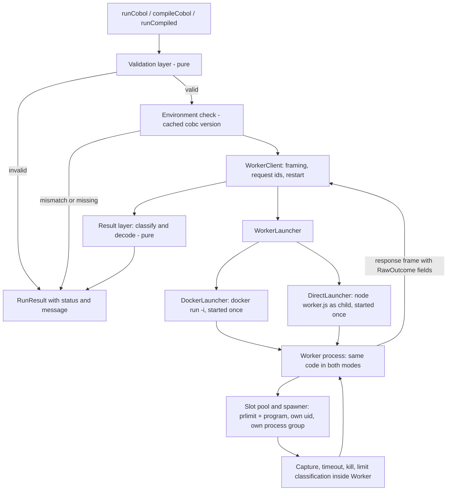
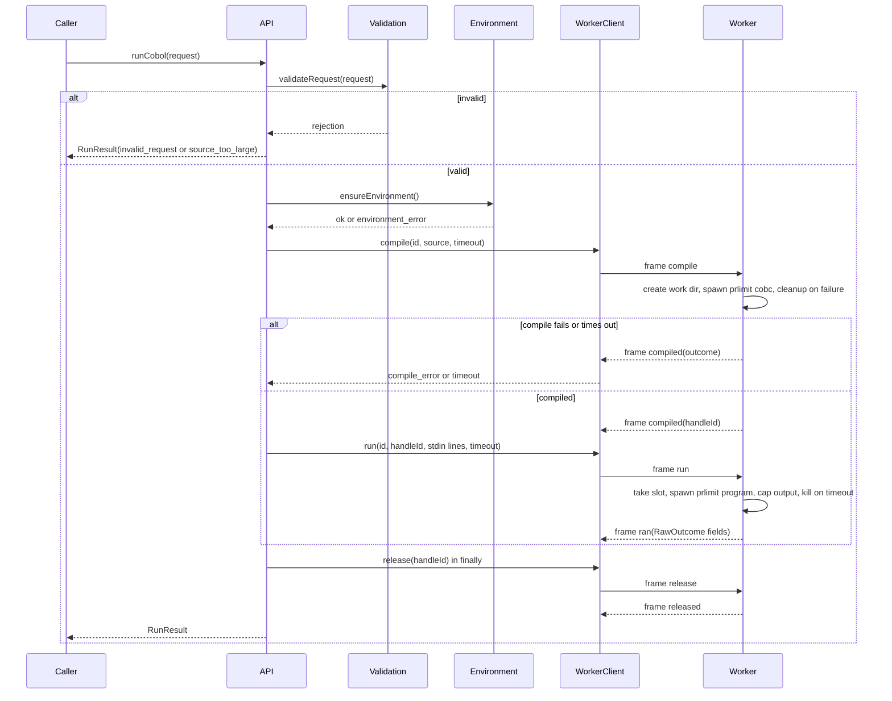

# Design Document

## Overview

The COBOL Oracle Runner (`src/oracle/`) compiles COBOL source with GnuCOBOL 3.1.2 (`cobc -x -free`) and runs the result on caller-supplied input lines. It is the reference implementation for the Necromancer equivalence proof, so it must be reproducible, bounded and safe to call thousands of times with untrusted source.

Two entry points share one pipeline:

- Single-shot: `runCobol(request)` validates, compiles, runs once and cleans up (Requirements 1 to 10).
- Compile once, run many: `compileCobol(source)` returns a `CompiledHandle`. `runCompiled(handle, inputLines, opts)` runs it in a long-lived Worker without `cobc` or any container call per run. `releaseHandle` and `shutdown` clean up (Requirement 11).

Key design decisions:

| Decision | Rationale |
| --- | --- |
| Pure validation and scanning layer, separate from a thin transport interface | Requirement 10.7 needs 100+ generated cases with the process layer replaced by a test double. Validation, env building, output capping, framing, classification and version comparison are pure functions. |
| The Worker is a Node/TypeScript program that runs inside the Oracle_Image and spawns every compiled program itself | Measured `docker exec` latency is about 143 ms per call. Requirement 11.12 allows about 20 ms per run (3000 runs in 60 s). Any per-run container call is therefore impossible. |
| One framed protocol over the stdio of a single long-lived process (`docker run -i` or a direct child) | One code path for Docker mode and direct mode (Requirements 7.1, 7.6, 12.8). Only the launch of the transport differs. |
| Compile also goes through the Worker | One code path for compile and run, and the work directories live next to the compiler and the programs. |
| Worker owns work directories, sandbox, timeouts, output caps, kills and limit classification | The kill and the cleanup must happen where the processes are. The runner only sees finished `RawOutcome` data. |
| Source scans run on a comment- and literal-masked copy of the source | Requirements 13.4 and 13.10: ignore `*>` comments and string literals, still catch case and whitespace variants. |
| Every public function resolves with a `RunResult`, never rejects | Requirement 8.2. Internal exceptions are mapped to `environment_error`. |
| Sandbox is applied to the compiled program (and, with wider limits, to `cobc`) | Requirement 12.9: restrictions must not change the output of a well-behaved program. |
| Integer/byte handling only; no numeric logic | The runner never interprets COBOL numbers, so decimal.js is not needed here. |

Research notes (no external lookups were required; facts below come from the requirements, the existing `Dockerfile` and one measurement): the Oracle_Image is `ubuntu:24.04` with the apt `gnucobol` package, and `cobc -x -free -o <out> <src>` is already used in the Dockerfile. The version check parses `cobc --version` output (first line, `cobc (GnuCOBOL) 3.1.2.0`) and compares the `major.minor.patch` prefix with `3.1.2`. A measured `docker exec` round trip of about 143 ms is the reason the Worker model replaced the earlier "one `docker exec` per run" model (see Design Risks and Validation).

## Architecture



Layers, from the top:

1. API layer (`index.ts`): typed public functions, handle registry, shutdown.
2. Validation layer (`validate.ts`, `scan.ts`): pure checks that run before any Worker request exists.
3. Environment layer (`environment.ts`): one-time cached `cobc --version` check (asked of the Worker), launcher selection.
4. Transport layer (`worker-client.ts`, `framing.ts`, `launcher.ts`, `docker-launcher.ts`, `direct-launcher.ts`): launch the Worker once, multiplex requests by id, detect Worker loss and restart.
5. Worker (`src/oracle/worker/`): protocol server, slot pool, work directories, spawner, capture, timeouts, kills, limit classification.
6. Result layer (`classify.ts`, `result.ts`): map Worker outcomes to `RunResult`, UTF-8 decoding.

### Single-shot sequence



### Worker model

The runner starts exactly one Worker per process, lazily on the first valid request, and keeps it alive until `shutdown()`.

Transport choice: framed messages over the stdio of that one Worker process. Each frame is a 4-byte big-endian length followed by that many bytes of UTF-8 JSON. Reasons:

- Docker mode uses `docker run -i`, so the container's stdin and stdout are the pipe. No port, no published socket, no shared volume for a socket file. This works with `--network none` (Requirement 7.7).
- Direct mode (Requirement 7.6) spawns `node /opt/oracle/worker.js` with the same stdio, so the Worker program, protocol and tests are identical. Only the launch command differs.
- EOF or exit on the pipe is an immediate, reliable signal that the Worker is lost (Requirement 11.7). A socket needs extra health checks.
- Length-prefixed frames avoid delimiter escaping problems; the Worker's own logs go to its stderr, so stdout carries frames only.
- A Unix socket was rejected: it needs a shared mount, file permissions and cleanup, and adds nothing at this message volume (about 3000 small frames per minute).

Concurrency: requests carry an `id`; the Worker answers in completion order, not request order. The runner keeps a `Map<id, pending>` and resolves the matching caller. The Worker runs up to `workerConcurrency` programs at once (default 8), each in its own slot (below); further requests wait in a FIFO queue inside the Worker.

Privilege model (Requirement 12.3: programs are never root):

- The Worker starts as root inside the container, with all capabilities dropped except `SETUID`, `SETGID`, `CHOWN`, `DAC_OVERRIDE`, `FOWNER` and `KILL`, and `no-new-privileges` set. It uses them for three things only: spawning children with a different uid/gid, preparing and wiping directories owned by those uids, and killing processes of those uids.
- Every compiled program (and `cobc`) is spawned with Node's `uid` and `gid` options set to an unprivileged slot uid (default `20000 + slot`, all with gid `20000`, group `oracle-run`). The child therefore never holds root or any capability. The uids need not exist in `/etc/passwd`; the user `oracle` (uid 20000) exists so the image has a named non-root user.
- Why a root Worker and not an unprivileged Worker whose children inherit its uid: with a shared uid the program could `ptrace`, signal or read `/proc/<worker>/mem` of the Worker, and could not be separated from concurrent runs. It would also make `RLIMIT_NPROC` (counted per real uid) apply across all concurrent runs together, so one fork bomb would starve every other run. A distinct uid per slot fixes both.
- Tradeoff: the Worker process is the one trusted component with elevated rights. Mitigations: it is a small program, it never executes data from the program (it only copies bytes), the container has no network, a read-only root filesystem, a pids limit and a memory limit, and the six capabilities above are the only ones left.
- Direct mode when the runner is already unprivileged inside the image: the Worker cannot change uid. It then runs programs as its own non-root uid, logs once that "uid separation unavailable", and applies every other restriction. When it runs as root (the default in the image), the behavior matches Docker mode (Requirement 12.8).

Per-child limits (Requirement 12.4) without a shell launcher: Node has no native `setrlimit`, so the Worker spawns `prlimit` from util-linux (already in the `ubuntu:24.04` base) as the command and passes the program as its argument:

```
prlimit --as=268435456 --cpu=10:11 --nproc=16 --fsize=10485760 --core=0 -- /work/h-<id>/prog
```

`prlimit` sets the limits on itself with `setrlimit` and then `exec`s the program in the same process, so the cost is one extra `exec` of a tiny binary, with no extra process and no shell. The `--cpu=10:11` form uses a soft limit (the kernel sends `SIGXCPU`) and a hard limit one second later (`SIGKILL`). The estimated cost is about 1 ms (measured in the first implementation task, see Design Risks and Validation), well inside the 10 ms per-run Worker overhead target.

Slots: the Worker has `workerConcurrency` slots. A slot is a uid plus a scratch directory `/work/slots/<n>` owned by that uid (mode 0700), used as `HOME` and `cwd` of the program. A run takes a free slot, runs, and after the process group has exited the Worker wipes the scratch directory contents and returns the slot to the pool. Programs can write only inside their scratch directory (the root filesystem is read-only, the handle directory is root-owned and read-only to programs).

Kill handling (Requirements 3.2, 3.6, 5.4, 6.3, 6.5): the child is spawned `detached: true` so it leads a new process group. On timeout or when an output stream reaches the Output_Limit, the Worker calls `process.kill(-pid, "SIGKILL")`, then runs `kill -9 -1` as the slot uid (spawned with that uid) to remove any process that escaped the group with `setsid`. The Worker waits for `close`, wipes the scratch directory, and only then frees the slot and answers. This path is rare, so its extra cost does not affect the budget. No `docker exec` and no `pkill` through Docker are involved.

Work-directory layout (Requirement 6): the Worker creates a handle directory `/work/h-<random>` (unique, created with `mkdtemp`) per compile. During compilation it is owned by the slot uid that runs `cobc`. After a successful compile the Worker changes it to `root:oracle-run` mode 0750 and the executable to mode 0550, so programs can execute the binary but cannot modify it. The directory is not world-accessible; it is readable by root and the `oracle-run` group only. This is the closest match to "owner-only" that still lets an unprivileged uid execute the binary. The Worker removes the directory on compile failure, on `release`, and at shutdown.

Handle lifetime and Worker loss: the handle directory lives in the Worker container's `tmpfs /work`, so it disappears if the container dies. The runner keeps the validated source (at most 64 KiB) of each live handle in its registry. When a run on a restarted Worker returns `unknown_handle`, the runner recompiles that source under the same handle id and retries the run once (see Handle registry). Recompilation after Worker loss is the only case where a handle is compiled more than once.

## Components and Interfaces

All code is TypeScript strict mode, no `any`.

### Public API (`src/oracle/index.ts`)

```ts
export type Status =
  | "ok" | "compile_error" | "timeout" | "source_too_large"
  | "invalid_request" | "resource_limit" | "environment_error";

export interface RunRequest {
  readonly source: string;
  readonly inputLines: readonly string[];
  readonly runTimeoutMs?: number;      // default 5000, max 60000
}

export interface RunResult {
  readonly status: Status;
  readonly stdout: string;
  readonly stderr: string;
  readonly exitCode: number | null;    // null when no process ran or it was killed
  readonly truncated: boolean;
  readonly durationMs: number;
  readonly message?: string;           // present iff status !== "ok"
}

declare const handleBrand: unique symbol;
export interface CompiledHandle { readonly id: string; readonly [handleBrand]: true }

export function runCobol(request: RunRequest, config?: Partial<OracleConfig>): Promise<RunResult>;
export function compileCobol(source: string, config?: Partial<OracleConfig>): Promise<CompiledHandle | RunResult>;
export function runCompiled(handle: CompiledHandle, inputLines: readonly string[], opts?: { runTimeoutMs?: number }): Promise<RunResult>;
export function releaseHandle(handle: CompiledHandle): Promise<void>;
export function shutdown(): Promise<void>;
export function isCompiledHandle(x: CompiledHandle | RunResult): x is CompiledHandle;
```

`RunResult.exitCode` is `number | null`; JSON represents it faithfully, so the round trip (Requirement 8.6) holds. `message` is omitted rather than `undefined` when `ok`, because `JSON.stringify` drops `undefined` fields and the round trip must produce an equal object.

### Configuration (`config.ts`)

```ts
export interface OracleConfig {
  sourceSizeLimitBytes: number;   // 65536
  inputSizeLimitBytes: number;    // 65536
  compileTimeoutMs: number;       // 30000
  defaultRunTimeoutMs: number;    // 5000
  maxRunTimeoutMs: number;        // 60000
  outputLimitBytes: number;       // 1048576
  expectedCobcVersion: string;    // "3.1.2"
  imageName: string;              // e.g. "necromancer-oracle"
  workerConcurrency: number;      // 8 slots
  workerCommand: readonly string[]; // ["node", "/opt/oracle/worker.js"]
  sandbox: SandboxPolicy;
}

export interface ResourceLimits {
  readonly memoryBytes: number;   // RLIMIT_AS
  readonly cpuSeconds: number;    // RLIMIT_CPU soft; hard = soft + 1
  readonly maxProcesses: number;  // RLIMIT_NPROC (per slot uid)
  readonly maxFileBytes: number;  // RLIMIT_FSIZE
}

export interface SandboxPolicy {
  readonly env: Readonly<Record<string, string>>;  // fixed allowlist, see below
  readonly uidBase: number;                        // 20000; slot n runs as uidBase + n, never 0
  readonly gid: number;                            // 20000 (oracle-run)
  readonly run: ResourceLimits;                    // 256 MiB, 10 s, 16 procs, 10 MiB
  readonly compile: ResourceLimits;                // 1 GiB, 30 s, 64 procs, 64 MiB (cobc forks gcc)
  readonly networkDisabled: boolean;
}
```

The `SandboxPolicy` is serialized once and passed to the Worker as a base64 JSON command-line argument (`--policy`), so it is fixed for the Worker's lifetime and cannot be changed by later frames.

Fixed environment allowlist (Requirements 7.8, 12.1): `PATH=/usr/local/bin:/usr/bin:/bin`, `LANG=C.UTF-8`, `LC_ALL=C.UTF-8`, `HOME=<slot scratch dir>`, `TZ=UTC`, `COB_...` variables only if a test shows they are needed. The Worker passes this object as the `env` option of `spawn`, which replaces the environment instead of extending it. No value is read from the Worker's own `process.env` or from the runner.

### Validation (`validate.ts`, pure)

```ts
export type Rejection = { status: "invalid_request" | "source_too_large"; message: string };
export function validateSource(source: string, cfg: OracleConfig): Rejection | null;
export function validateInputLines(lines: readonly string[], cfg: OracleConfig): Rejection | null;
export function validateTimeout(ms: number | undefined, cfg: OracleConfig): Rejection | null;
export function validateRequest(req: RunRequest, cfg: OracleConfig): Rejection | null;
```

Check order is fixed so results are deterministic: size (UTF-8 bytes via `Buffer.byteLength`), empty/whitespace-only, NUL, external calls, file I/O and COPY, then input lines, then timeout. The first failing check wins. The Worker repeats the cheap size, NUL and input checks defensively and answers with an `error` frame if they fail, but the runner is the authority.

### Source scanning (`scan.ts`, pure)

```ts
export function maskCommentsAndLiterals(source: string): string;
export function findExternalCall(source: string): string | null;    // returns offending text
export function findForbiddenConstruct(source: string): "SELECT" | "FD" | "OPEN" | "COPY" | null;
```

`maskCommentsAndLiterals` walks the source line by line. In free format, `*>` outside a literal starts a comment that runs to end of line; a `*` in column 1 is not a comment in free format and is not treated as one. String literals use `"` or `'` with doubled-quote escapes, and are replaced by spaces of equal length. Continuation of a literal across lines is not supported in free format, so a literal ends at end of line if unterminated. Masking preserves line structure so messages can cite line numbers.

On the masked text:

- External call: regex `/\bCALL\s+/i` matches every `CALL` token regardless of case, repeated whitespace, quote style (the quotes are masked, so a literal target appears as blanks) or identifier target. Any `CALL` token is an External_Call and is rejected; the message names `CALL` and, where the original text is available at that offset, the routine name (for example `CALL "SYSTEM"`). This is deliberately stricter than matching `SYSTEM`: every `CALL` leaves the submitted source (Glossary), and the three samples contain none.
- Forbidden constructs: `/\b(SELECT|FD|OPEN|COPY)\b/i` on the masked text. COBOL identifiers contain hyphens, so `OPENING-BALANCE` must not match `OPEN`; the boundary pattern is therefore `(?<![A-Za-z0-9-])(SELECT|FD|OPEN|COPY)(?![A-Za-z0-9-])`.

Residual risk, stated plainly: a regex scan is not a COBOL parser. The scans reduce risk but the Sandbox_Policy is the real security boundary, which is why Requirements 12 and 10.14/10.15 test the sandbox with the scans bypassed.

### Worker protocol (`protocol.ts`, `framing.ts`, pure)

Framing (`framing.ts`):

```ts
export function encodeFrame(message: WorkerMessage): Buffer;            // 4-byte BE length + UTF-8 JSON
export class FrameDecoder {                                             // incremental, handles any chunking
  push(chunk: Buffer): readonly WorkerMessage[];
}
export const MAX_FRAME_BYTES: number;                                   // 8 MiB; larger length prefix is a protocol error
```

`FrameDecoder` buffers partial frames, so it returns zero or more complete messages for any split of the byte stream. A length prefix above `MAX_FRAME_BYTES` or invalid JSON raises a protocol error that the client treats as Worker loss.

Messages (`protocol.ts`). Every request has a unique string `id`; every response echoes it. Binary data is base64 inside JSON.

```ts
export type WorkerRequest =
  | { id: string; type: "ping"; withVersion?: boolean }
  | { id: string; type: "compile"; handleId: string; source: string; timeoutMs: number }
  | { id: string; type: "run"; handleId: string; inputLines: readonly string[];
      timeoutMs: number; outputLimitBytes: number }
  | { id: string; type: "release"; handleId: string }
  | { id: string; type: "shutdown" };

export type EndedBy = "exit" | "timeout" | "output_limit" | "limit" | "spawn_error";
export type BreachedLimit = "memory" | "cpu" | "processes" | "file_size";

export interface RawOutcomeFields {
  stdoutB64: string;
  stderrB64: string;
  exitCode: number | null;
  signal: string | null;
  endedBy: EndedBy;
  limit: BreachedLimit | null;     // set iff endedBy === "limit"
  truncated: boolean;
  durationMs: number;              // measured in the Worker, spawn to close
}

export type WorkerResponse =
  | { id: string; type: "pong"; pid: number; liveHandles: number; busySlots: number;
      cobcVersionOutput?: string }
  | { id: string; type: "compiled"; ok: true; handleId: string; outcome: RawOutcomeFields }
  | { id: string; type: "compiled"; ok: false; outcome: RawOutcomeFields }
  | { id: string; type: "ran"; outcome: RawOutcomeFields }
  | { id: string; type: "released" }
  | { id: string; type: "shutdown_ack" }
  | { id: string; type: "error"; code: "unknown_handle" | "bad_request" | "internal"; message: string };

export type WorkerMessage = WorkerRequest | WorkerResponse;
```

Behavior:

- `ping`: handshake and health check. With `withVersion: true` the Worker runs `cobc --version` once (the only time it is run, Requirement 7.3) and returns the raw output; the runner parses and caches it. `liveHandles` and `busySlots` let tests verify that work directories were removed and slots freed.
- `compile`: creates the handle directory, writes `prog.cob`, spawns `prlimit <compile limits> -- cobc -x -free -o prog prog.cob` with the compile timeout, and answers `compiled`. On failure it deletes the directory and the answer has `ok: false`.
- `run`: takes a slot, writes the encoded input lines to the child's stdin and closes it (swallowing `EPIPE`, Requirement 5.5), caps each stream at `outputLimitBytes`, enforces `timeoutMs`, and answers `ran`. An unknown handle yields `error` with code `unknown_handle`.
- `release`: removes the handle directory; releasing an unknown handle is a no-op that still answers `released`.
- `shutdown`: stops accepting requests, kills running children, removes every handle directory, answers `shutdown_ack` and exits 0.

Limit classification inside the Worker (pure function `classifyChild(termination, stderrText)` in `worker/limits.ts`, so it is testable without a process):

| Observation | `endedBy` | `limit` |
| --- | --- | --- |
| Worker's timer fired and the group was killed | `timeout` | null |
| A stream reached the Output_Limit and the group was killed | `output_limit` | null |
| Terminated by `SIGXCPU`, or by `SIGKILL` at the hard CPU limit with CPU time at or above the soft limit | `limit` | `cpu` |
| Terminated by `SIGXFSZ` | `limit` | `file_size` |
| Terminated by `SIGSEGV`, `SIGABRT` or `SIGBUS`, or exited non-zero with stderr matching the GnuCOBOL/libc allocation failure messages (for example `cob_malloc`, `cannot allocate memory`) | `limit` | `memory` |
| Exited non-zero or was signalled with stderr matching `Resource temporarily unavailable` or `cannot fork` | `limit` | `processes` |
| Process failed to start | `spawn_error` | null |
| Any other exit | `exit` | null |

The memory and process-count rows are heuristics because `RLIMIT_AS` and `RLIMIT_NPROC` surface only as failed `malloc` and `fork` calls, not as a dedicated signal. The CPU and file-size rows are exact because the kernel sends dedicated signals. A well-behaved program never reaches 256 MiB of address space or 16 processes, so the heuristics can only mislabel programs that already crash or misbehave, and in that case the result is still a non-`ok` status. Tests 10.15 pin down the labels used for each limit. This replaces the earlier launcher marker file, which required a shell launcher per run.

### Runner-side transport (`worker-client.ts`, `launcher.ts`)

```ts
export interface WorkerTransport {
  readonly stdin: { write(chunk: Buffer): boolean; end(): void };
  readonly stdout: AsyncIterable<Buffer>;
  readonly exited: Promise<{ code: number | null; signal: string | null }>;
  kill(): void;
}

export interface WorkerLauncher {
  launch(cfg: OracleConfig): Promise<WorkerTransport>;   // rejects with a message naming the missing component
}

export class WorkerClient {
  constructor(launcher: WorkerLauncher, cfg: OracleConfig, logger: Logger);
  request(req: DistributiveOmit<WorkerRequest, "id">): Promise<WorkerResponse>;  // assigns the id
  restart(): Promise<void>;
  stop(): Promise<void>;
}
```

`WorkerClient` launches the Worker lazily, sends a `ping` handshake, then multiplexes requests by id. If the transport ends (EOF on stdout, process exit, or protocol error) every pending request is rejected with `WorkerLostError`. The client does not retry on its own; the API layer decides (see Handle registry). `request` never leaves a pending entry behind: entries are removed on response or on loss.

Launchers (the only place where Docker and direct mode differ):

- `DockerLauncher`: `docker run -i --rm --name necromancer-oracle-<random> --network none --memory 1g --pids-limit 256 --read-only --tmpfs /work:rw,exec,nosuid,size=256m --cap-drop ALL --cap-add SETUID --cap-add SETGID --cap-add CHOWN --cap-add DAC_OVERRIDE --cap-add FOWNER --cap-add KILL --security-opt no-new-privileges <image> node /opt/oracle/worker.js --policy <b64>`. `docker run` happens once per Worker, not per run. If `docker` is missing, the daemon is down, or the image does not exist, the launcher rejects with a message naming the component (Requirement 7.5). The `/work` tmpfs keeps the root filesystem read-only and means no host path is shared with the container.
- `DirectLauncher`: spawns `node /opt/oracle/worker.js --policy <b64> --work-root <dir>` as a child process with piped stdio and the same code path from there on. Selected when `NECROMANCER_IN_ORACLE_IMAGE=1` (Requirement 7.6). If the Worker cannot disable network access (no `unshare` permission) it logs "network isolation unavailable" once and continues with every other restriction (Requirement 12.7). Container-level limits (`--memory`, `--pids-limit`) do not exist in this mode, so the per-child `prlimit` limits are the only memory and process bounds.

### Worker internals (`src/oracle/worker/`)

```ts
// worker/spawner.ts - the only module that touches child_process in the Worker
export interface SpawnSpec {
  readonly command: string;                    // "prlimit" or "cobc" wrapper
  readonly args: readonly string[];
  readonly cwd: string;
  readonly uid: number;
  readonly gid: number;
  readonly env: Readonly<Record<string, string>>;
  readonly stdin: Buffer;
  readonly timeoutMs: number;
  readonly outputLimitBytes: number;
}
export interface ChildTermination {
  readonly stdout: Buffer;
  readonly stderr: Buffer;
  readonly exitCode: number | null;
  readonly signal: string | null;
  readonly endedBy: "exit" | "timeout" | "output_limit" | "spawn_error";
  readonly truncated: boolean;
  readonly durationMs: number;
}
export interface ChildSpawner { run(spec: SpawnSpec): Promise<ChildTermination>; }
```

The real `ChildSpawner` uses `child_process.spawn` with `detached: true`, `stdio: ["pipe", "pipe", "pipe"]`, `uid`, `gid` and `env`. It appends chunks with `appendCapped`, starts the timer, and on timeout or limit breach performs the process-group kill described above. A test double implements `ChildSpawner` with scripted terminations and records every spec it receives, so Worker logic (slots, cleanup, limit classification, argument construction) is testable without `cobc` and without root.

```ts
// worker/slots.ts
export interface SlotPool { acquire(): Promise<Slot>; release(slot: Slot): Promise<void> }  // release wipes scratch first
// worker/server.ts
export function serve(io: { input: AsyncIterable<Buffer>; output: (chunk: Buffer) => void },
                      deps: { spawner: ChildSpawner; fs: WorkFs; policy: SandboxPolicy; logger: Logger }): Promise<void>;
```

`serve` is transport-agnostic (it takes async iterables and a write function), so the same function is used by the real entry point (`process.stdin` and `process.stdout`) and by in-memory tests that connect a `WorkerClient` to a `serve` instance with no process at all.

### Output capture (`capture.ts`, pure)

```ts
export interface Capture { readonly bytes: Buffer; readonly truncated: boolean }
export function appendCapped(current: Capture, chunk: Buffer, limit: number): Capture;
export function decodeUtf8(bytes: Buffer): string;
export function encodeStdin(lines: readonly string[]): Buffer;
```

`encodeStdin` joins each line with a trailing `\n` (empty list yields an empty buffer). `decodeUtf8` uses `TextDecoder("utf-8")` with `ignoreBOM: true` so content is not altered. `appendCapped` and `encodeStdin` run in the Worker; `decodeUtf8` runs in the runner after the base64 payloads are decoded.

### Classification (`classify.ts`, pure, runner side)

Maps a Worker response (`RawOutcomeFields` plus phase) to a `RunResult`:

| Condition | Status | Message |
| --- | --- | --- |
| compile phase, exit code 0 | continue | none |
| compile phase, non-zero exit | `compile_error` | compiler stderr preserved in `stderr`, `exitCode` set |
| compile phase, `endedBy = timeout` | `timeout` | "compile phase timed out after N ms" |
| run phase, `endedBy = timeout` | `timeout` | "run phase timed out after N ms" |
| run phase, `endedBy = output_limit` | `resource_limit` | "output limit exceeded", `truncated = true` |
| run phase, `endedBy = limit`, `limit = memory` | `resource_limit` | "memory limit exceeded" |
| run phase, `endedBy = limit`, `limit = cpu` | `resource_limit` | "CPU time limit exceeded" |
| run phase, `endedBy = limit`, `limit = file_size` | `resource_limit` | "file size limit exceeded" |
| run phase, `endedBy = limit`, `limit = processes` | `resource_limit` | "process count limit exceeded" |
| `endedBy = spawn_error` | `environment_error` | spawn failure text |
| run phase, `endedBy = exit` | `ok` | none (non-zero exit code kept, Requirement 1.6) |

Output-limit decision: Requirement 5.4 says kill, truncate and mark `truncated`, but does not name a status. The design returns `status: "resource_limit"` with message "output limit exceeded" and `truncated: true`, so a truncated stream can never be mistaken for a complete `ok` result by the equivalence engine. This is flagged as a decision for review.

### Environment check (`environment.ts`)

```ts
export type EnvironmentState =
  | { kind: "ready"; client: WorkerClient }
  | { kind: "error"; message: string };
export function ensureEnvironment(cfg: OracleConfig, launcher: WorkerLauncher): Promise<EnvironmentState>;
export function parseCobcVersion(versionOutput: string): string | null;
```

`ensureEnvironment` memoizes a single in-flight promise, so the Worker is launched once and `cobc --version` runs once (via `ping` with `withVersion: true`) even under concurrent first calls (Requirements 7.3, 7.4). It picks `DirectLauncher` when `NECROMANCER_IN_ORACLE_IMAGE=1` and `DockerLauncher` otherwise. If the version differs, the cached state is `error` with a message containing both versions, the Worker is stopped, and every request returns `environment_error` without launching anything again. If Docker or the image is missing, the message names the missing component (Docker daemon vs image) and the failure is not cached permanently: a later call may retry, so a developer who starts Docker does not need to restart the process. A version mismatch is cached permanently as required. A restarted Worker after loss does not re-run the version check, because the image has not changed.

### Handle registry (`handles.ts`)

A `Map<string, { source: string; compiledOnce: boolean }>` keyed by a random UUID. `runCompiled` looks up the id; an unknown or released id returns `invalid_request` without sending anything to the Worker (11.9). `releaseHandle` sends `release` and removes the entry (idempotent). `shutdown` releases all handles, sends `shutdown`, waits up to 2 s for the Worker to exit and then calls `transport.kill()` (which, in Docker mode, also runs `docker kill` on the named container as a fallback). A `process.on("exit")` hook is not relied on, since async cleanup cannot run there; callers and the Vitest `afterAll` call `shutdown()`.

Worker-lost recovery (Requirement 11.7): if a request fails with `WorkerLostError`, the API layer calls `client.restart()` (new launch, new handshake, no new version check) and retries that request once. For a `run`, the restarted Worker answers `unknown_handle`, so the API recompiles the stored source under the same handle id and then runs again. If the retry also fails, the result is `environment_error` with a message that the Worker was lost twice. The handle stays registered after a failed recovery so a later call can try again. A run killed by timeout or limit does not lose the Worker: the Worker kills only the child, so the handle stays usable without any restart.

## Data Models

```ts
// Runner side, never exposed
interface HandleRecord {
  readonly id: string;
  readonly source: string;          // kept to recompile after Worker loss
  readonly createdAtMs: number;
}

// Worker side
interface WorkerHandle { readonly id: string; readonly dir: string }   // dir = /work/h-<random>
interface Slot { readonly index: number; readonly uid: number; readonly scratchDir: string }
```

Work directory layout inside the Worker container (all under the `/work` tmpfs):

```
/work/h-<random>/            root:oracle-run 0750 after compile
    prog.cob                 source, 0440
    prog                     executable, 0550
/work/slots/<n>/             uid 20000+n, 0700; HOME and cwd of the program; wiped after every run
```

The program can write only inside its slot scratch directory; the container root filesystem is read-only. That satisfies Requirement 10.14 (no file creation or modification outside the Work_Directory) in Docker mode. In direct mode the same code applies, but the surrounding filesystem is whatever the host image allows, so test 10.14 runs in Docker mode.

JSON shape of `RunResult` (Requirement 8.6):

```json
{ "status": "ok", "stdout": "...", "stderr": "", "exitCode": 0, "truncated": false, "durationMs": 12 }
```

JSON shape of a `run` request frame body and its response (framed with a 4-byte length prefix):

```json
{ "id": "r-17", "type": "run", "handleId": "9d1c...", "inputLines": ["1000", "5", "3"], "timeoutMs": 5000, "outputLimitBytes": 1048576 }
{ "id": "r-17", "type": "ran", "outcome": { "stdoutB64": "...", "stderrB64": "", "exitCode": 0, "signal": null,
  "endedBy": "exit", "limit": null, "truncated": false, "durationMs": 6 } }
```

### Image and Dockerfile changes

The Worker is Node/TypeScript, so the Oracle_Image must contain Node.js and the compiled Worker. The Dockerfile is rewritten as a multi-stage build; the existing `cobc` install, `cobol-samples` copy and sample compile lines stay.

```dockerfile
# Stage 1: build the Worker bundle with a pinned Node
FROM node:22.11.0-bookworm-slim@sha256:<digest recorded when the image is first built> AS worker-build
WORKDIR /build
COPY package.json package-lock.json ./
RUN npm ci
COPY tsconfig.json ./
COPY src/oracle/worker ./src/oracle/worker
COPY src/oracle/protocol.ts src/oracle/framing.ts src/oracle/capture.ts ./src/oracle/
RUN npm run build:worker        # esbuild: one self-contained dist/worker.js, no node_modules at runtime

# Stage 2: the Oracle_Image
FROM ubuntu:24.04
RUN apt-get update \
 && apt-get install -y --no-install-recommends gnucobol libstdc++6 \
 && rm -rf /var/lib/apt/lists/*
# Node.js binary copied from the pinned official image; no curl, no tarball download, digest-verified by Docker
COPY --from=worker-build /usr/local/bin/node /usr/local/bin/node
COPY --from=worker-build /build/dist/worker.js /opt/oracle/worker.js
RUN groupadd --gid 20000 oracle-run \
 && useradd --uid 20000 --gid 20000 --no-create-home --shell /usr/sbin/nologin oracle \
 && chmod 0555 /opt/oracle/worker.js
ENV NECROMANCER_IN_ORACLE_IMAGE=1
WORKDIR /app
COPY cobol-samples/ ./cobol-samples/
RUN cobc -x -free -o /usr/local/bin/interest cobol-samples/interest.cbl
CMD ["sh", "-c", "printf '1000\\n5\\n3\\n' | interest"]
```

Decisions behind this:

- Node source: a multi-stage `COPY` of the `node` binary from the official `node:22.11.0-bookworm-slim` image (Node 22 LTS), pinned by exact tag and by image digest. The digest gives content-addressed verification without hand-written checksum steps. The alternative, downloading the official tarball with `curl` and checking `SHA256SUMS`, needs `curl`, `xz` and a hard-coded checksum in the Dockerfile, and was rejected for that reason. `libstdc++6` is installed because the Node binary links against it and the Ubuntu base does not include it. The Debian bookworm binary needs glibc 2.36 or newer; Ubuntu 24.04 ships glibc 2.39, so it runs unchanged.
- Worker bundle: the Worker is compiled and bundled at image build time, so the image contains plain JavaScript and no `node_modules`, `npm` or compiler toolchain for TypeScript. The `COPY` of source files is limited to the Worker's modules and the shared pure modules (`protocol.ts`, `framing.ts`, `capture.ts`).
- Changes list, replacing the earlier list: (1) add user and group `oracle` / `oracle-run` (uid and gid 20000); (2) add the pinned Node binary and `libstdc++6`; (3) add the compiled Worker bundle at `/opt/oracle/worker.js`; (4) set `NECROMANCER_IN_ORACLE_IMAGE=1`; (5) keep the `cobc` install and sample copy. The earlier `run-sandboxed.sh` launcher is removed.
- The image keeps `USER root` because the Worker needs to change uid per child. Programs never run as root: the Worker spawns every child with a non-zero uid.

## Performance Budget

Requirement 11.12 allows 60 s for 1000 runs of each of three programs (3000 runs, about 20 ms per run if run one at a time). The design gives each run this budget:

| Step | Target |
| --- | --- |
| Frame encode, pipe write, Worker decode, response frame, runner decode | under 1 ms |
| Slot acquire and release, scratch wipe (tmpfs, empty directory in the normal case) | under 1 ms |
| `spawn` of `prlimit` with `uid`, `gid`, `env`, `detached` (fork, setuid, exec) | 3 to 5 ms |
| `prlimit` `setrlimit` calls and `exec` of the COBOL program | about 1 ms |
| **Worker overhead per run (everything except the COBOL program itself)** | **under 10 ms** |
| COBOL program start and run (GnuCOBOL runtime init, small calculation) | about 3 to 8 ms |

The sum stays near the 20 ms per run available when runs are sequential. With `workerConcurrency` of 8 and the equivalence engine issuing concurrent runs, the effective per-run time drops well below that, which leaves a margin. The performance test (Requirement 10.9) makes the 3000 runs against the Oracle_Image and also records the mean and 95th percentile per-run time so a regression in Worker overhead is visible before the 60 s limit is hit.

## Design Risks and Validation

| Risk | Why it matters | Validation |
| --- | --- | --- |
| `docker exec` costs about 143 ms per call (measured) | 3000 runs would take about 430 s, seven times over the limit in Requirement 11.12. | The design uses no container call per run. The first implementation task is a spike that measures the Worker round trip (frame, spawn with `prlimit`, run `interest`) inside the image and fails the task if the mean overhead is not under 10 ms. The performance test (10.9) keeps this honest. |
| `prlimit` adds one `exec` per run | It is the only per-run cost added by the sandbox. | Measured in the same spike; the budget table above assumes about 1 ms. Fallback if it exceeds the budget: a small C helper compiled in the image that calls `setrlimit` and `execve`. |
| Memory and process-count limits are classified by heuristics | `RLIMIT_AS` and `RLIMIT_NPROC` produce failed `malloc` and `fork` calls, not dedicated signals. | Tests 10.15 run real memory and fork-bomb programs against the image and assert the exact status and message; `classifyChild` is also covered by a property test (Property 20). |
| Root Worker with six capabilities | The Worker is the one elevated component. | Capabilities are limited to what the uid switch, cleanup and kill need; no network, read-only root filesystem, pids and memory limits; a test asserts the program process has uid not equal to 0 and an empty capability set. |
| Handles live in the container's tmpfs | A lost Worker loses the compiled binaries. | The runner keeps the source and recompiles once on `unknown_handle` (Property 19). |
| Docker image pin drift | A floating Node or `cobc` version would break reproducibility. | Node is pinned by tag and digest; `cobc` is checked at startup against 3.1.2 (Property 12). |

## Correctness Properties

_A property is a characteristic or behavior that should hold true across all valid executions of a system-essentially, a formal statement about what the system should do. Properties serve as the bridge between human-readable specifications and machine-verifiable correctness guarantees._

Reflection step: separate criteria for size, empty, and NUL source were merged into one source-validation property. Cleanup (6.2, 6.3, 6.5) merged into one. Determinism (9.1, 9.2, 9.3) merged into one real-compiler property. Error determinism (9.4, 13.6, 13.11) merged with "rejections start no process" because both are checked on the same generated invalid requests. Comment masking (13.4, 13.10) is one property. The environment-allowlist property subsumes the same-environment-every-run criterion (7.8). The Worker-model change adds four properties (framing round trip, request-id multiplexing, Worker-lost recovery, limit classification); they support Requirements 11 and 12 and do not replace any earlier property. Properties 1 to 16 keep their numbers; the two real-compiler properties move from 17 and 18 to 21 and 22.

### Property 1: Source validation classification

For any source string and any configured size limit, `validateSource` returns `source_too_large` when the UTF-8 byte length exceeds the limit, returns `invalid_request` when the source is empty or whitespace only or contains a NUL character (and is within the limit), and returns no rejection when the byte length equals the limit and the source is otherwise valid.

**Validates: Requirements 4.1, 4.2, 4.3, 4.4, 4.5**

### Property 2: Input line validation

For any list of input lines, `validateInputLines` returns `invalid_request` if and only if some line contains `\n` or `\r`, or the total UTF-8 size exceeds 65536 bytes.

**Validates: Requirements 5.1, 5.2**

### Property 3: Timeout validation

For any numeric timeout (including zero, negatives, `NaN`, `Infinity` and values above 60000 ms), `validateTimeout` accepts it if and only if it is finite, greater than 0 and at most 60000 ms; otherwise it returns `invalid_request`.

**Validates: Requirements 3.4, 3.5**

### Property 4: External call detection

For any valid COBOL-like source into which a `CALL` statement is inserted with any letter case, any run of whitespace between `CALL` and the target, single or double quotes around the target, or an identifier as the target, `findExternalCall` detects it and the request is rejected with `invalid_request` and a message naming the call.

**Validates: Requirements 13.1, 13.2, 13.3**

### Property 5: Forbidden construct detection

For any source into which `SELECT`, `FD`, `OPEN` or `COPY` is inserted as a statement keyword with any letter case and any repeated whitespace, `findForbiddenConstruct` reports that construct and the request is rejected with `invalid_request` naming it.

**Validates: Requirements 13.8, 13.9, 13.10**

### Property 6: Comments and literals are ignored by scans

For any source in which `CALL`, `SELECT`, `FD`, `OPEN` or `COPY` appears only inside a `*>` free-format comment or inside a quoted string literal, the scans report nothing and validation accepts the source (when it is otherwise valid).

**Validates: Requirements 13.4, 13.5, 13.10**

### Property 7: Rejected requests are deterministic and start no process

For any invalid request (oversized, empty, NUL, external call, file I/O, `COPY`, bad input lines, bad timeout, or unknown handle), running it twice yields the same status and message, and sends zero frames to the Worker and launches no Worker (verified with a recording `WorkerLauncher` test double).

**Validates: Requirements 3.5, 4.2, 4.4, 4.5, 5.1, 5.2, 9.4, 11.9, 13.2, 13.6, 13.9, 13.11**

### Property 8: Stdin encoding

For any list of input lines without line breaks, `encodeStdin` produces a buffer equal to each line followed by a single `\n`, and an empty buffer for an empty list.

**Validates: Requirements 1.5, 1.7**

### Property 9: UTF-8 decoding preserves content

For any valid string made of arbitrary Unicode text including `\r\n`, tabs and trailing spaces, decoding its UTF-8 encoding returns the identical string.

**Validates: Requirements 1.8**

### Property 10: Output capture is bounded

For any sequence of output chunks and any limit, the captured bytes never exceed the limit, the captured bytes are a prefix of the concatenated chunks, and `truncated` is true if and only if the total bytes exceed the limit.

**Validates: Requirements 5.3, 5.4**

### Property 11: Sandbox environment is fixed

For any parent process environment (including variables named like API keys or tokens) in the runner and in the Worker, the `env` passed by the Worker's spawner to every child (`cobc` and programs) equals the fixed allowlist exactly (with only `HOME` set to the slot's scratch directory), is identical across runs, and the uid is never 0 (verified with the recording `ChildSpawner` test double).

**Validates: Requirements 7.8, 12.1, 12.2, 12.3**

### Property 12: Version check runs once and gates all runs

For any reported `cobc --version` output and any number of subsequent requests, a `ping` with `withVersion` is sent exactly once; if the parsed version differs from `3.1.2` every request returns `environment_error` with both versions in the message and the Worker is not launched again.

**Validates: Requirements 7.3, 7.4**

### Property 13: Result structure and message presence

For any request (valid or invalid) and any scripted Worker response, the runner resolves with a `RunResult` containing `status`, `stdout`, `stderr`, `exitCode`, `truncated` and `durationMs`, and `message` is present if and only if `status` is not `ok`.

**Validates: Requirements 8.2, 8.3, 8.4**

### Property 14: RunResult JSON round trip

For any `RunResult`, parsing `JSON.stringify(result)` produces a value deeply equal to the original.

**Validates: Requirements 8.6**

### Property 15: Cleanup after every outcome

For any scripted child termination (ok, compile_error, timeout, output_limit, each limit, spawn error, delete failure injected), the Worker removes the handle directory (on compile failure and on `release`), wipes the slot scratch directory and frees the slot before it answers, so a following `ping` reports zero busy slots; when a delete failure is injected, the failure is logged and the response is still sent.

**Validates: Requirements 6.2, 6.3, 6.4, 6.5**

### Property 16: Compile once, run many

For any sequence of N runs on one `CompiledHandle` with no Worker loss, the Worker receives exactly one `compile` frame, no `cobc` spawn occurs after it, and the launcher is called exactly once.

**Validates: Requirements 11.2, 11.4, 11.5**

### Property 17: Frame round trip

For any sequence of Worker messages and any way of splitting the concatenated encoded frames into chunks (including one byte at a time and several frames in one chunk), `FrameDecoder` returns exactly the original messages in order, and a length prefix above `MAX_FRAME_BYTES` or a body that is not valid JSON is reported as a protocol error.

**Validates: Requirements 11.3, 11.5, 11.12**

### Property 18: Request-id multiplexing

For any set of concurrent requests and any order in which the (fake) Worker answers them, every caller receives the response whose id matches its own request, no caller receives another caller's response, and no pending entry remains after all responses arrive.

**Validates: Requirements 9.3, 11.5, 11.6**

### Property 19: Worker-lost recovery

For any sequence of runs on a handle and any point at which the Worker is lost (EOF before the response, or exit during a run), the runner restarts the Worker once, retries the request once (recompiling the stored source if the Worker reports `unknown_handle`), and returns the same `RunResult` fields (stdout, stderr, exit code, status) as the same sequence without loss; if the retry is also lost, the result is `environment_error` and the handle remains registered.

**Validates: Requirements 11.7**

### Property 20: Limit classification

For any child termination (signal, exit code, captured stderr text, and whether the Worker's timer or the output cap fired), `classifyChild` is deterministic and returns `timeout` when the timer fired, `output_limit` when the cap fired, the exact limit label for `SIGXCPU` and `SIGXFSZ`, and `exit` (never `limit`) for any normal exit with exit code 0, and the runner's `classify` maps `limit` outcomes to `resource_limit` with a message naming the same limit.

**Validates: Requirements 3.3, 5.4, 12.5**

### Property 21: Determinism and isolation (real compiler)

For any generated input lines applied to a fixed sample program, running the request at least 3 times, and running requests concurrently versus sequentially, yields identical stdout, stderr and exit code (excluding `durationMs`).

**Validates: Requirements 9.1, 9.2, 9.3**

### Property 22: Handle run equals single-shot run (real compiler)

For any input lines applied to a sample program, `runCompiled` returns the same stdout, stderr and exit code as `runCobol` for the same source and input lines.

**Validates: Requirements 11.11**

## Error Handling

| Situation | Status | Behavior |
| --- | --- | --- |
| Oversized, empty, NUL, external call, file I/O, COPY, bad lines, bad timeout | `source_too_large` or `invalid_request` | Returned before any Worker request is sent. |
| Docker daemon missing, image missing (launch of the Worker fails) | `environment_error` | Message names the missing component. Not cached permanently. |
| `cobc` version differs from 3.1.2 | `environment_error` | Cached permanently; message has both versions; Worker stopped. |
| `cobc` exits non-zero | `compile_error` | stderr and exit code returned; stdout empty; nothing executed; Worker deletes the handle directory. |
| Compile timeout | `timeout` | Worker kills the compiler process group; message says "compile phase". |
| Run timeout | `timeout` | Worker kills the whole process group (and any escaped process of the slot uid) inside the container; partial stdout and stderr returned; returns within 2 s of the timeout. |
| Memory, CPU, process or file size limit | `resource_limit` | Worker classifies; message names the limit; partial output returned; Worker and handle stay usable. |
| Output limit reached | `resource_limit`, `truncated: true` | Worker kills the group, cuts the stream at the limit. |
| Broken pipe on stdin | `ok` | `EPIPE` swallowed in the Worker; run completes normally. |
| Work directory delete fails | unchanged | Worker logs the failure on its stderr (forwarded to the runner logger); response still sent. |
| Worker lost mid-request (EOF, exit, protocol error) | unchanged on success | Pending requests fail with `WorkerLostError`; runner restarts the Worker, retries once, recompiles the stored source if the Worker answers `unknown_handle`. If the retry is also lost, `environment_error` and the handle stays registered. |
| Worker answers `error` with code `bad_request` or `internal` | `environment_error` | Message includes the Worker's text. |
| Unknown or released handle (runner registry) | `invalid_request` | No frame sent. |
| Unexpected internal exception | `environment_error` | Caught at the API boundary; the function never rejects. |

Network isolation unavailable (12.7, direct mode only) is logged once and does not change any status.

## Testing Strategy

Dual approach, using Vitest and fast-check (never hand-rolled property testing). Tests live under `tests/oracle/`.

Property-based testing applies to the pure validation, scanning, capture, framing, classification, environment and serialization logic, to the Worker and client logic with test doubles, and to determinism against the real compiler. It does not apply to Docker wiring, sandbox configuration or resource limits, which are covered by example and integration tests.

Test seams (all in-memory, no process needed):

- `WorkerLauncher` test double: records launches and connects a `WorkerClient` to a fake Worker (scripted responses, injectable loss and reordering) or to a real `serve()` instance running with a `ChildSpawner` double.
- `ChildSpawner` test double: scripted `ChildTermination` values; records every `SpawnSpec` (command, args, uid, gid, env, cwd).

### Property tests

- Each property in the section above is one fast-check test with `numRuns` of at least 100 when only test doubles are used (Requirement 10.7), and at least 25 when it uses the real compiler in the Oracle_Image (Requirement 10.6).
- Each test carries a tag comment in this format: `Feature: cobol-oracle-runner, Property N: <title>`.
- Properties 1 to 20 use test doubles. Properties 21 and 22 run against the Oracle_Image with the three samples and generated numeric input lines.
- Generators: `arbSourceWithCall(variant)` builds a minimal valid program and splices a `CALL` with randomized case, whitespace, quote style or identifier target; `arbSourceWithConstruct`; `arbCommentedOrQuoted`; `arbChunks`; `arbRunResult` (includes `null` exit codes and optional message); `arbParentEnv` (includes names like `OPENAI_API_KEY`); `arbWorkerMessage` (all request and response types, binary payloads as base64); `arbChunking` (random split points over a byte stream); `arbResponseOrder` (permutation of pending ids); `arbLossPoint` (index of the request at which the fake Worker closes); `arbTermination` (signal, exit code, stderr text, timer and cap flags).

### Unit and example tests

- One test per Status value: `ok`, `compile_error`, `timeout`, `source_too_large`, `invalid_request`, `resource_limit`, `environment_error` (10.2).
- Integration: run `interest.cbl`, `payroll.cbl`, `tax.cbl` and compare stdout with `cobol-samples/EXPECTED.md` (10.3); verify they pass the External_Call, file I/O and `COPY` scans (10.12, 13.7).
- Infinite loop: status `timeout`, returns within 2 s of the timeout, handle directory removed (`ping` reports `liveHandles` of 0 and `busySlots` of 0) (10.4, 3.6).
- Source of limit plus 1 bytes: `source_too_large` (10.5). Source of exactly the limit is accepted.
- Environment leak: set a fake secret in the runner process, run a COBOL program that `ACCEPT ... FROM ENVIRONMENT`, assert it cannot see it (10.10).
- `CALL "SYSTEM"` spellings: lower, mixed case, repeated whitespace, single quotes, double quotes, identifier (10.11). `SELECT`, `FD`, `OPEN`, `COPY` each with case and whitespace variants (10.13).
- File write outside the Work_Directory with scans bypassed (10.14), via an internal `bypassScans` option available only to tests, in Docker mode.
- One resource-limit test each for memory, CPU time, process count and file size, scans bypassed where needed, asserting `resource_limit`, a message naming the limit, and that a following run succeeds (10.15, 12.5).
- Docker launch args test: the `docker run` command line contains `--network none`, memory and pids limits, `--cap-drop ALL` with exactly the six `--cap-add` entries, `--read-only`, `--security-opt no-new-privileges` (7.7); the spawn spec for programs has uid not equal to 0 and gid 20000 (12.3); direct mode uses no `docker` command (7.6, 12.8).
- Privilege test (real image): a program run reports a non-zero uid and an empty capability set, and cannot read another slot's scratch directory or write to its own binary.
- Handle lifecycle: release, run released handle, `shutdown` releases everything (11.8). Worker lost: kill the Worker process during an idle period and during a run, assert recovery (11.7).
- Slot isolation and queueing: more concurrent runs than slots all complete, and each run's `cwd` and uid differ from any other concurrent run's.
- Early stdin close (5.5) using a program that never reads input.

### Performance test

Compile each sample once and make 1000 runs of each on its handle; assert each batch completes in under 60 s excluding compile (10.9, 11.12). Runs use bounded concurrency (up to `workerConcurrency`) so the test does not rely on the concurrency setting to pass: a second, sequential batch of 200 runs per program asserts a mean per-run time under 20 ms. Both report mean and 95th percentile per-run time. The test runs against the Oracle_Image with the Worker started once, and a precondition check asserts no `docker exec` or `docker run` call occurs during the timed section (the launcher call count stays at 1).

### Verification of non-testable criteria

TypeScript strict mode and no `any` (8.5) are enforced by `tsc --noEmit` with `"strict": true` and an ESLint `@typescript-eslint/no-explicit-any` rule in CI, for both the runner and the Worker. Requirements 10.x are test-suite requirements and are satisfied by the tests listed above. Before declaring any task done, run `scripts/run-samples.sh` (the sample equivalence suite) and `vitest --run`.
