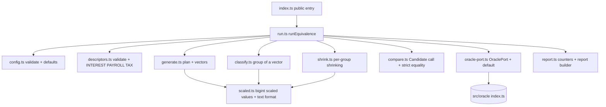
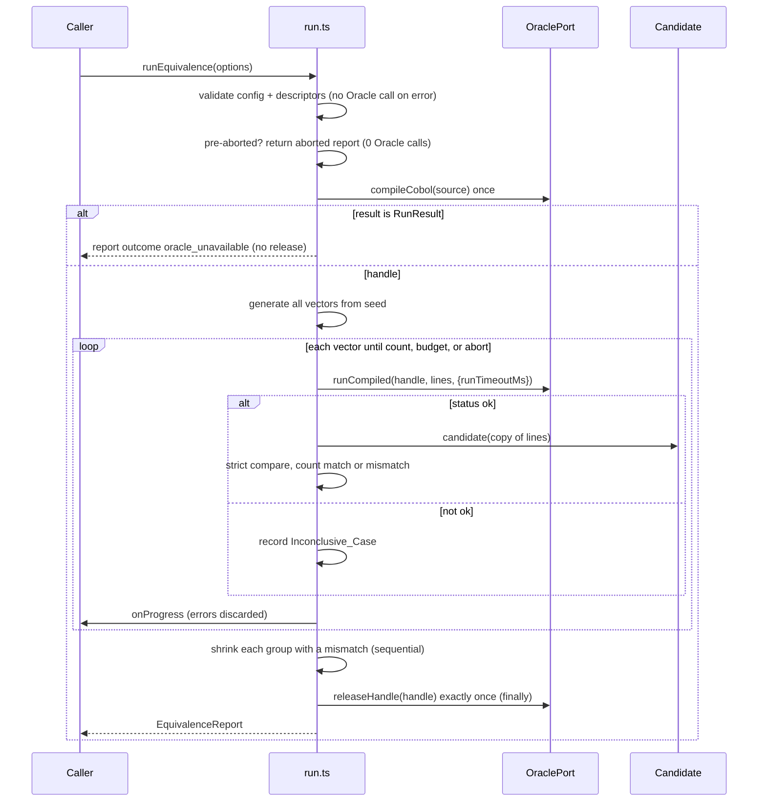

# Design Document: equivalence-engine

## Overview

The Equivalence_Engine (`src/equivalence/`) proves that a candidate TypeScript translation behaves identically to a COBOL program. It compiles the COBOL once through the Oracle, generates inputs with fast-check biased toward COBOL edge cases, runs Oracle and Candidate on each input, and compares DISPLAY output character for character. The result is an `EquivalenceReport` whose `matchScore` is the core product artifact. It exists only when real conclusive cases ran.

Key design decisions:

| Decision | Rationale |
|---|---|
| Oracle is injected through an `OraclePort` that is `Pick<typeof import("../oracle/index.js"), ...>` | Signatures match the real Oracle exactly (`compileCobol`, `runCompiled`, `releaseHandle`, `isCompiledHandle`, `RunResult`, `Status`, `CompiledHandle`). The real functions are the default. Tests use a fake. (Req 12.1 to 12.3) |
| Input generation is a pure, seeded function that returns the whole list of vectors before any Oracle call | Determinism (Req 9.6, 9.7) and testability of generator properties without an Oracle. |
| Plan = deterministic **edge corpus** first, then group-interleaved random vectors | Guarantees the per-field coverage requirements (Req 3.3 to 3.9) in any set of at least 100 vectors, and spreads groups so a Time_Budget stop still covers all four groups. |
| Each Evidence_Group has its own generator that builds vectors **by construction** into that group; `classify()` stays the single authority | Group quotas (Req 4.7) are met without rejection sampling. A property test checks that construction and classification agree. |
| Values are built with `bigint` arithmetic on scaled integers; classification and candidates use `decimal.js` | No JS floating point for field values (Req 3.10). |
| Shrinking uses fast-check over a `bigint`-tuple domain (`fc.bigInt`) that `canShrinkWithoutContext`, seeded with the failing vector as an `example` | Real fast-check shrinking from a vector that came from our own generator, and a hard cap on Oracle calls (Req 8). |
| Run is sequential | The Oracle worker is the bottleneck. Sequential execution keeps results, progress order and shrinking deterministic. |
| Candidate errors are Mismatches only when the Oracle was conclusive | Infrastructure failures never look like wrong translations. (Req 2.6, 2.7, 5.6, 5.7) |

Sources consulted: the existing Oracle public API (`src/oracle/index.ts`, `src/oracle/types.ts`), `cobol-samples/interest.cbl`, the workspace steering rules (`cobol-semantics`, `tech`, `structure`), and the fast-check documentation on `fc.sample`, `fc.check` (`seed`, `examples`, `endOnFailure`) and `fc.bigInt` (shrinks toward zero or the bound nearest zero).

## Architecture

All modules live in `src/equivalence/`. Only `oracle-port.ts` imports from `../oracle/index.js`. Nothing imports from `src/analyzer`, `src/translator` or `src/app`.



Run lifecycle:



## Components and Interfaces

### `oracle-port.ts`

```ts
import * as realOracle from "../oracle/index.js";
export type { CompiledHandle, RunResult, Status } from "../oracle/index.js";

export type OraclePort = Pick<
  typeof realOracle,
  "compileCobol" | "runCompiled" | "releaseHandle" | "isCompiledHandle"
>;

export const defaultOracle: OraclePort = {
  compileCobol: realOracle.compileCobol,
  runCompiled: realOracle.runCompiled,
  releaseHandle: realOracle.releaseHandle,
  isCompiledHandle: realOracle.isCompiledHandle,
};
```

Because the port is derived with `typeof`, the injected functions have exactly the real signatures: `compileCobol(source, config?) => Promise<CompiledHandle | RunResult>`, `runCompiled(handle, inputLines, opts?: { runTimeoutMs?: number }) => Promise<RunResult>`, `releaseHandle(handle) => Promise<void>`. `RunResult.message` is present only when `status !== "ok"`, so the engine reads it as `result.message ?? ""`.

### `descriptors.ts`

```ts
export interface FieldDescriptor {
  readonly name: string;      // 1..64 chars, unique
  readonly digits: number;    // integer 1..18
  readonly scale: number;     // integer 0..18
  readonly signed: boolean;
}
export const INTEREST: readonly FieldDescriptor[];  // principal 7/2, rate 3/2, years 2/0, unsigned
export const PAYROLL: readonly FieldDescriptor[];   // hours 3/1, rate 3/2
export const TAX: readonly FieldDescriptor[];       // income 8/0
export function validateDescriptors(fields: readonly FieldDescriptor[]): void; // throws EquivalenceConfigError
```

### `config.ts`

```ts
export class EquivalenceConfigError extends Error {}  // thrown (promise rejected) before any Oracle call

export interface EquivalenceOptions {
  readonly source: string;                        // COBOL source
  readonly fields: readonly FieldDescriptor[];
  readonly candidate: Candidate;
  readonly caseCount?: number;                    // int 1..100000, default 1000
  readonly seed?: number;                         // int32, default chosen and returned
  readonly timeBudgetMs?: number;                 // int 1..3600000, default none
  readonly oracleTimeoutMs?: number;              // passed to runCompiled as runTimeoutMs; omitted when unset
  readonly mismatchListCap?: number;              // int 1..10000, default 25
  readonly shrinkLimit?: number;                  // int 1..10000, default 200
  readonly signal?: AbortSignal;
  readonly onProgress?: ProgressCallback;
  readonly oracle?: OraclePort;                   // default: defaultOracle
  readonly now?: () => number;                    // default: performance.now-based ms clock
}
export type Candidate = (inputLines: string[]) => string | Promise<string>;
export function resolveConfig(opts: EquivalenceOptions): ResolvedConfig;
```

`resolveConfig` checks, in order: descriptors, caseCount, seed, timeBudgetMs, mismatchListCap, shrinkLimit. Each error message names the setting and the permitted range. A missing seed is chosen from `Math.random()` once, converted to an int32, and returned in the report (this is the only place non-seeded randomness is used, and it is not a field value).

### `scaled.ts` (integer arithmetic on scaled values)

```ts
/** units / 10^decimals as plain decimal text: optional "-", digits, optional ".digits". No exponent. */
export function formatScaled(units: bigint, decimals: number): string;
/** Inverse for plain decimal text. Returns null if the text has more than maxDecimals places or is not plain decimal. */
export function parseScaled(text: string, decimals: number): bigint | null;
export function pow10(n: number): bigint;
export function fieldMaxUnits(f: FieldDescriptor): bigint;  // 10^(digits+scale) - 1, in units of 10^-scale
```

`formatScaled` never emits a lone `-0`, exponent notation, separators or whitespace (Req 3.2).

### `classify.ts`

```ts
export type EvidenceGroup =
  | "standard computation"
  | "zero and maximum boundaries"
  | "half-unit rounding boundary"
  | "field overflow behavior";
export const GROUP_ORDER: readonly EvidenceGroup[]; // classification precedence, see below
export function classifyVector(fields: readonly FieldDescriptor[], lines: readonly string[]): EvidenceGroup;
```

It parses each line with decimal.js (exact, no float) and checks in precedence order (Req 4.6):

1. `field overflow behavior`: for any field, `|value| > Field_Maximum` (this also covers "more integer digits"), or the field is unsigned and the value is negative.
2. `half-unit rounding boundary`: for any field, the digits beyond `scale` are exactly `5` followed only by zeros (for scale 0, the fractional part is `.5`, `.50`, ...).
3. `zero and maximum boundaries`: for any field, value equals 0 or equals Field_Maximum.
4. otherwise `standard computation`.

Field_Maximum is `10^digits - 10^(-scale)`. A negative zero such as `-0` on an unsigned field is not negative.

### `generate.ts`

```ts
export interface GeneratedCase {
  readonly index: number;
  readonly lines: readonly string[];
  readonly group: EvidenceGroup;   // = classifyVector(...) of the lines
}
export function generateCases(fields: readonly FieldDescriptor[], caseCount: number, seed: number): GeneratedCase[];
```

Algorithm (pure and deterministic in `(fields, caseCount, seed)`):

1. **Plan.** Build a list of `caseCount` slots. First the edge corpus (`E` slots, `E <= caseCount`, capped at `caseCount`), then random slots interleaved by group using the repeating cycle `[std, bnd, half, ovf, std, bnd, half, ovf, std, bnd]`, which weights standard 30 percent, boundaries 30 percent, half-unit 20 percent and overflow 20 percent. With `caseCount >= 40` every group gets at least `floor(0.10 * caseCount)` slots, because the cycle gives each group at least 20 percent of random slots and the corpus is at most 10 slots. The slot also records an overflow *kind* (`aboveMax`, `extraIntegerDigits`, `negativeUnsigned`). `negativeUnsigned` is assigned to at most `max(1, floor(0.10 * caseCount))` slots in total, counting the corpus, which bounds Negative_Unsigned_Vectors per unsigned field at 10 percent (Req 3.13).
2. **Edge corpus.** Vector `k` sets every field to edge kind `k`. The kinds, in order, are: `zero`, `max`, `maxMinusUnit`, `maxPlusUnit`, `half` (value with exactly `scale + 1` decimals ending in 5, built as `x.5` for scale 0), `extraDecimals` (1 to 3 extra places, last digit not forced), `negative` (signed fields: a negative value; unsigned fields: negative value, counted against the 10 percent budget), `positive` (an ordinary positive value). A kind that does not apply to a field (for example `half` is still valid at scale 0 as `x.5`, but a signed-only kind on an unsigned field) falls back to a seeded random in-range value. Because all fields in one vector use the same kind, the corpus size is constant (8) regardless of the field count, so 20 fields still fit inside 100 vectors. Signed fields get both a negative value (kind `negative`) and a positive value (other kinds).
3. **Random vectors.** For each group, `fc.sample(groupArb, { seed: derive(seed, group), numRuns: slots })` yields the group's vectors. Every `groupArb` is `fc.tuple(...)` over per-field arbitraries built from `fc.bigInt` on scaled units, so a vector is fully described by `bigint`s:
   - `standard`: units in `[1, maxUnits - 1]` plus an optional tail of 1 to 3 extra places that is added below one unit, never `5` followed by zeros, so the total stays below `maxUnits`. Unsigned fields are never negative.
   - `zero and maximum boundaries`: one chosen field is `0` or `maxUnits`, the other fields use the standard arbitrary.
   - `half-unit rounding boundary`: one chosen field has `scale + 1` decimals ending in 5 within range (`value <= maxUnits - 1` unit), the others use the standard arbitrary.
   - `field overflow behavior`: one chosen field according to the slot kind: above max (`maxUnits + 1 ..`, up to one more integer digit), extra integer digits (up to `digits + 2` integer digits), or negative (unsigned fields only; for signed fields the kind falls back to `aboveMax`). Other fields use the standard arbitrary.
4. Texts are produced with `formatScaled`. The case `group` is set by `classifyVector`, and the plan is only a target. A property test asserts that the generator hits its target group for every random slot.

Signed fields in the `standard`, `boundary` and `half` generators may be negative with a probability of about 30 percent, since negative signed values are not overflow.

### `compare.ts`

```ts
export type CandidateOutcome = { readonly kind: "output"; readonly text: string } | { readonly kind: "error"; readonly text: string };
export function invokeCandidate(candidate: Candidate, lines: readonly string[]): Promise<CandidateOutcome>;
```

It calls the Candidate with `[...lines]` (a fresh copy per case, Req 5.5) and awaits the result. A thrown error or a rejection becomes `{ kind: "error", text: error.message }` (`String(error)` for non-Error values). If the Candidate returns something that is not a string, the outcome is an error whose text is `"Candidate returned non-string output: <typeof>"`. The comparison itself is `oracleStdout === candidateText` with no normalization (Req 5.2). An `error` outcome is always a Mismatch.

### `shrink.ts`

```ts
export interface ShrunkExample {
  readonly group: EvidenceGroup;
  readonly input: readonly string[];
  readonly oracleOutput: string;
  readonly candidateOutput: string;
  readonly limitReached: boolean;
}
export interface ShrinkContext { /* oracle, handle, candidate, fields, seed, limit, runTimeoutMs, signal */ }
export function shrinkGroup(ctx: ShrinkContext, start: MismatchRecord): Promise<{ example: ShrunkExample; oracleCalls: number }>;
```

Shrink domain: each field is a `bigint` in units of `10^-(scale + 3)` (a fixed fine scale, so any generated value, which has at most 3 extra decimals, is exactly representable). The starting lines are parsed with `parseScaled`. The arbitrary is `fc.tuple(...fields.map(f => fc.bigInt({ min, max })))` with bounds that cover the group (`min` is `0` for unsigned fields outside the overflow group and `-(10^(digits+3))`-scaled otherwise, `max` is `10^(digits+2)` integer-scaled for the overflow group and Field_Maximum otherwise). `fc.bigInt` shrinks toward zero or the bound closest to zero and supports shrinking without a context.

The property is `fc.asyncProperty(arb, async (units) => ...)`. The run is `fc.check(prop, { examples: [[startUnits]], seed, numRuns: 1, endOnFailure: false })`. The first run evaluates the example (already failing), then fast-check shrinks it. Because the shrink path relies on fast-check treating `examples` as shrinkable, the first implementation task includes a small spike test. If examples are not shrunk in the installed version, the fallback is to loop over `arb.shrink(value, undefined)` greedily, with the same budget logic.

Inside the property, a closure tracks `oracleCalls`, `best` (the last failing case seen, which is the smallest because fast-check only moves to smaller values after a failure), and `limitReached`:

- If `signal.aborted` or `oracleCalls >= limit`, return `true` (not failing) without calling the Oracle. Every remaining candidate is then rejected quickly and shrinking ends. `limitReached` is set only for the limit (Req 8.7).
- Otherwise `oracleCalls++`, call `runCompiled`. A non-`ok` status returns `true` (Req 8.4). On `ok`, invoke the Candidate and return `oracleStdout === candidateText`. On a mismatch, record `best`.
- A thrown Oracle error inside the property is not swallowed: it ends shrinking and the run's error handling takes over (handle released in `finally`).

The example is the first evaluation and counts toward `oracleCalls`. To avoid re-running a known failure, the starting `best` is pre-seeded from the recorded Mismatch, and the example evaluation is answered from that record with no Oracle call. If no smaller failure is found, `best` stays the start (Req 8.3).

### `run.ts`

```ts
export function runEquivalence(options: EquivalenceOptions): Promise<EquivalenceReport>;
```

Steps:

1. `resolveConfig` (throws `EquivalenceConfigError` before any Oracle call; no report).
2. If `signal?.aborted`, return a report with `aborted: true`, `casesRun: 0`, outcome `inconclusive`, with 0 Oracle calls (Req 9.13).
3. `compileCobol(source)` exactly once. If the result is not a handle (`!oracle.isCompiledHandle(r)`), return outcome `oracle_unavailable` with `oracleStatus`, `oracleMessage`, no `matchScore`, and call `releaseHandle` 0 times.
4. In `try { ... } finally { release }`: generate cases, loop sequentially, then shrink. The `finally` block calls `releaseHandle(handle)` exactly once inside its own `try/catch` that swallows a release failure, so the original error is never masked (Req 2.4, 2.5).
5. Loop: before each case, stop if `signal.aborted` (set `aborted`) or `now() - start >= timeBudgetMs` (set `budgetReached`). Run the Oracle with `{ runTimeoutMs: oracleTimeoutMs }` (the options object is passed as `undefined` when no timeout is configured, so the Oracle default applies). Handle the `ok` and non-`ok` branches as in the sequence diagram. Finally call `onProgress` inside `try/catch`, awaiting a returned promise, and discard any error (Req 10.5).
6. After the loop, shrink each group with at least one Mismatch, in `GROUP_ORDER`, starting from that group's first Mismatch in execution order. Stop shrinking the remaining groups once the signal aborts, and shrink the group in progress to its best-so-far (Req 8.11). The first Mismatch per group is remembered during the loop independent of the capped list.
7. Build the report (`report.ts`).

If a Mismatch exists in a group, the `finally` still releases the handle if shrinking throws.

### `report.ts`

Holds a `RunCounters` accumulator (integer counts only) and `buildReport`. `matchScore` is `matched / conclusive` with exactly one division, and the field is absent when `conclusive === 0`.

### `index.ts` (single public entry point)

Exports `runEquivalence`, `FieldDescriptor`, `EquivalenceReport`, `ProgressCallback`, `INTEREST`, `PAYROLL`, `TAX`, plus the supporting types (`EquivalenceOptions`, `Candidate`, `EvidenceGroup`, `OraclePort`, `EquivalenceConfigError`).

### Test support (under `tests/equivalence/`, not shipped from `src/`)

- `doubles/fake-oracle.ts`: an `OraclePort` with scripted per-call results, counters for `compileCobol` and `releaseHandle` calls, and options to throw or delay. The real oracle is never touched.
- `candidates/interest.ts`: `correctInterestCandidate` and `naiveInterestCandidate` (see below).

### Sample candidates for `cobol-samples/interest.cbl`

The COBOL accepts three lines, stores them with `COMPUTE X = FUNCTION NUMVAL(line)` into `PIC 9(7)V99`, `PIC 9(3)V99` and `PIC 99`, then loops `COMPUTE WS-BALANCE ROUNDED = WS-BALANCE * (1 + WS-RATE / 100)` once per year, and displays `"BALANCE: "` followed by `PIC Z(6)9.99`.

Correct candidate (decimal.js, a cloned `Decimal` with precision 60 so the intermediate `rate / 100` and product are exact):

1. `store(value, digits, scale)`: truncate toward zero to `scale` places (`ROUND_DOWN`), take the absolute value (unsigned field), then reduce modulo `10^digits` (drop high-order digits).
2. `principal = store(NUMVAL(l0), 7, 2)`, `rate = store(NUMVAL(l1), 3, 2)`, `years = store(NUMVAL(l2), 2, 0)` (years is `PIC 99`, so it is truncated to an integer and reduced modulo `10^2`; `100` becomes `0`, `123` becomes `23`).
3. Repeat `years` times: `balance = (balance * (1 + rate / 100)).toDecimalPlaces(2, ROUND_HALF_UP)`, then `balance mod 10^7` (`ROUND_HALF_UP` in decimal.js rounds half away from zero, as COBOL ROUNDED does; the balance is never negative).
4. Output `"BALANCE: " + format(balance)` where `format` pads the integer part to 7 characters with spaces (the last integer digit is always shown, so `0.05` prints as `      0.05`) and always prints 2 decimals.

Confirmed COBOL hazard (fixed in the sample): with GnuCOBOL 3.1.2, the original `interest.cbl` hung when `years = 99`, because the loop index `WS-YEAR-IDX` was `PIC 99` and wrapped from 99 to 00 on the increment, so `WS-YEAR-IDX > WS-YEARS` never became true. The sample is fixed by changing `WS-YEAR-IDX` to `PIC 999`. The `years` field `WS-YEARS` stays `PIC 99`, so the Candidate and the edge corpus still treat years as a 2-digit unsigned integer: `store(value, 2, 0)` truncates and reduces modulo `10^2`. For example, an input of `100` is stored as `00`, zero iterations run, and the balance equals the principal formatted as `Z(6)9.99`.

After the fix, the real-Oracle tests verify three explicit example-based cases (see Testing Strategy): `years = 98` and `years = 99` complete and equal the correct Candidate's output, and `years = 100` stores as `00`, runs zero iterations and outputs the principal.

Timeouts remain handled generically, not as an assumption about this sample: any case where the Oracle returns status `timeout` is an Inconclusive_Case, the Candidate is not invoked for it, and it does not affect the score. A modest `oracleTimeoutMs` may be set in real-Oracle tests to keep the suite fast, but no test relies on a known hang.

Naive candidate: parses lines with `Number`, loops `years` times with `balance *= 1 + rate / 100` and no per-year rounding, no truncation of input, no modulo, and prints `"BALANCE: " + balance.toFixed(2).padStart(10)`. It differs on per-year rounding, overflow wrap, negative input and over-wide input.

## Data Models

```ts
export type OracleStatus = Exclude<Status, "ok">;

export interface MismatchRecord {
  readonly input: readonly string[];
  readonly oracleOutput: string;
  readonly candidateOutput: string;
  readonly group: EvidenceGroup;
}

export interface InconclusiveCase {
  readonly input: readonly string[];
  readonly group: EvidenceGroup;
  readonly status: OracleStatus;
  readonly message: string;       // "" when the Oracle gave none
}

export interface GroupSummary {
  readonly group: EvidenceGroup;
  readonly conclusive: number;
  readonly matched: number;
  readonly inconclusive: number;
}

export type Outcome = "completed" | "inconclusive" | "oracle_unavailable";

export interface EquivalenceReport {
  readonly outcome: Outcome;
  readonly matchScore?: number;               // absent unless conclusive > 0
  readonly seed: number;
  readonly casesRun: number;                  // includes inconclusive, excludes shrinking calls
  readonly conclusiveCount: number;
  readonly matchedCount: number;
  readonly mismatchCount: number;             // exact
  readonly mismatches: readonly MismatchRecord[];   // first N in execution order, N = cap
  readonly mismatchListTruncated: boolean;    // mismatchCount > cap
  readonly shrunkExamples: readonly ShrunkExample[]; // at most one per group
  readonly shrinkOracleCalls: Readonly<Record<EvidenceGroup, number>>;
  readonly groups: readonly GroupSummary[];   // always the four groups, in GROUP_ORDER
  readonly inconclusiveCases: readonly InconclusiveCase[];
  readonly inconclusiveCount: number;
  readonly inconclusiveByStatus: Readonly<Partial<Record<OracleStatus, number>>>;
  readonly containsInconclusive: boolean;
  readonly budgetReached: boolean;
  readonly aborted: boolean;
  readonly elapsedMs: number;                 // non-negative integer
  readonly oracleStatus?: OracleStatus;       // only for oracle_unavailable
  readonly oracleMessage?: string;            // only for oracle_unavailable
}

export interface ProgressEvent {
  readonly completed: number;     // 1..caseCount
  readonly target: number;        // caseCount
  readonly group: EvidenceGroup;
  readonly matched: number;
  readonly mismatches: number;
  readonly inconclusive: number;  // matched + mismatches + inconclusive === completed
}
export type ProgressCallback = (event: ProgressEvent) => void | Promise<void>;
```

Notes:

- No running score appears in `ProgressEvent` (Req 10.4).
- The `inconclusiveCases` list is stored in full. It is bounded by `caseCount` (at most 100,000) and each entry is small.
- `outcome` is `completed` when `conclusiveCount > 0`. The UI decides on a success state only from `matchScore === 1` together with `outcome === "completed"`.
- Reports are plain data (no functions, no `undefined`-valued keys; optional keys are omitted), so two reports can be compared with `toEqual` after removing `elapsedMs`.


## Correctness Properties

*A property is a characteristic or behavior that should hold true across all valid executions of a system-essentially, a formal statement about what the system should do. Properties serve as the bridge between human-readable specifications and machine-verifiable correctness guarantees.*

Reflection: the prework items were merged where one property implies another. Requirements 3.3 to 3.7 become one coverage property. 2.6, 5.7 and 2.7 merge into candidate-failure handling. 7.10 and 7.11 with 4.9 and 6.3 merge into report invariants. 9.8 to 9.10, 9.15, 8.6 and 1.5/1.6 merge into one validation property (with the Oracle never called). 10.1 to 10.4 merge into one progress property. Properties that need the real Oracle (11.3, 11.4) are integration tests, not properties.

### Property 1: Invalid configuration is rejected before the Oracle is touched

*For any* descriptor list or option set that violates a documented limit (empty list, more than 20 fields, duplicate names, digits outside 1 to 18, scale outside 0 to 18, non-integer digits or scale, Case_Count, Time_Budget, Seed, Mismatch_List_Cap or shrink limit out of range or non-integer), the run rejects with an error naming the offending field or setting, calls the injected Oracle 0 times, and produces no report.

**Validates: Requirements 1.5, 1.6, 3.12, 8.6, 9.8, 9.9, 9.10, 9.15**

### Property 2: Valid configuration is accepted

*For any* descriptor list of 1 to 20 uniquely named fields with digits 1 to 18 and scale 0 to 18, and any Case_Count in 1 to 100,000, Seed in the int32 range, Time_Budget in 1 to 3,600,000, Mismatch_List_Cap in 1 to 10,000 and shrink limit in 1 to 10,000, `resolveConfig` returns a configuration that echoes those values, and an omitted Seed is chosen and appears in the report.

**Validates: Requirements 1.1, 9.1, 9.2, 9.3, 9.4, 9.14**

### Property 3: Generated vectors have one plain-decimal line per field

*For any* valid descriptor list, Seed and Case_Count, every generated vector has length equal to the number of descriptors, and every line is plain decimal text (optional minus, digits, optional point and digits, no exponent, separators or whitespace) that `decimal.js` parses exactly. Also, for any scaled integer and decimals count, `parseScaled(formatScaled(x, d), d)` equals `x`.

**Validates: Requirements 3.1, 3.2, 3.11**

### Property 4: Edge coverage in sets of at least 100 vectors

*For any* valid descriptor list, Seed, and Case_Count of at least 100, the generated set contains, for each field, a vector with value zero, one with Field_Maximum, one with Field_Maximum minus one unit, one with Field_Maximum plus one unit, one with 1 to 3 more decimal places than the scale, and, when scale is greater than 0, one with exactly scale plus 1 decimals ending in 5. For each signed field it contains a negative and a positive value. For each unsigned field it contains at least one negative value.

**Validates: Requirements 3.3, 3.4, 3.5, 3.6, 3.7, 3.8, 3.9**

### Property 5: Unsigned fields are non-negative except in a bounded set of vectors

*For any* valid descriptor list, Seed, and Case_Count of at least 100, for each unsigned field the number of vectors in which that field has a leading minus sign is at least 1 and at most 10 percent of the vectors, and all other values for that field carry no minus sign.

**Validates: Requirements 3.9, 3.13**

### Property 6: Generation is deterministic

*For any* valid descriptor list, Seed and Case_Count, calling `generateCases` twice returns element-wise identical vectors in the same order.

**Validates: Requirements 9.7**

### Property 7: Classification matches an independent specification and is total

*For any* descriptor list and any input vector, `classifyVector` returns exactly one of the four groups, equal to the first applicable group in the order overflow, half-unit rounding, zero or maximum, standard, as computed by an independent reference implementation that uses `decimal.js` on the same values. In particular, a vector with all fields strictly between zero and Field_Maximum, with no negative unsigned field and with no extra decimals beyond scale, is `standard computation`.

**Validates: Requirements 4.1, 4.2, 4.3, 4.4, 4.5, 4.6**

### Property 8: Group quotas and construction agree with classification

*For any* valid descriptor list, Seed, and Case_Count of at least 40, each Evidence_Group receives at least `floor(Case_Count * 0.10)` generated cases, and every randomly generated (non-corpus) case is classified into the group it was constructed for.

**Validates: Requirements 4.7**

### Property 9: Strict comparison and exact counting

*For any* Oracle output and Candidate output strings (including strings that differ only in trailing whitespace, case, or line endings), a conclusive case is a Matched_Case if and only if the two strings are identical, and the Candidate receives, for every conclusive case, an array equal to the vector and a fresh copy (a Candidate that mutates its argument does not change later cases or the recorded input).

**Validates: Requirements 5.1, 5.2, 5.3, 5.4, 5.5**

### Property 10: Candidate failures are Mismatches, never run failures

*For any* Candidate that throws, rejects, or returns a non-string on some subset of vectors, and any Oracle script of statuses, each failing vector whose Oracle status is `ok` is counted as exactly one Mismatch whose Candidate output is the error message, vectors with a non-`ok` status are never given to the Candidate and never counted as Mismatches, and the run continues through all remaining vectors.

**Validates: Requirements 2.6, 2.7, 5.6, 5.7**

### Property 11: Oracle lifecycle

*For any* run configuration, Candidate behavior, and Oracle script (including a throwing `runCompiled`, a throwing Candidate, a throwing `releaseHandle`, abort and time budget stops), `compileCobol` is called exactly once before any `runCompiled` call, every `runCompiled` call uses that handle, `releaseHandle` is called exactly once for it after the last `runCompiled` call, and an error thrown during the run is not masked by an error from `releaseHandle`. If `compileCobol` returns a RunResult, `runCompiled` and `releaseHandle` are called 0 times.

**Validates: Requirements 2.1, 2.2, 2.3, 2.4, 2.5**

### Property 12: Inconclusive cases are recorded and excluded from the score

*For any* Oracle script mixing `ok` and non-`ok` statuses, there is exactly one Inconclusive_Case per non-`ok` result with the input, the status and the message (empty string if absent), the per-status counts sum to the total, no vector appears in both the mismatch and inconclusive collections, `matchScore` equals `matchedCount / conclusiveCount` with inconclusive cases in neither term, `containsInconclusive` is true if and only if at least one exists, and when `conclusiveCount` is 0 the outcome is `inconclusive` and `matchScore` is absent.

**Validates: Requirements 6.1, 6.2, 6.3, 6.4, 6.5, 6.6, 7.1, 7.3**

### Property 13: Report count invariants

*For any* completed run, `matchedCount + mismatchCount = conclusiveCount`, `conclusiveCount + inconclusiveCount = casesRun`, the four group summaries are always present with the group conclusive counts summing to `conclusiveCount`, `matchScore` (when present) lies in 0 to 1 and equals `matchedCount / conclusiveCount`, `mismatches.length = min(mismatchCount, Mismatch_List_Cap)`, `mismatchListTruncated` is true if and only if `mismatchCount > Mismatch_List_Cap`, the listed mismatches are the first ones in execution order, `matchScore` is exactly 1 with empty `mismatches` and `shrunkExamples` when there are no Mismatches and at least one conclusive case, and `matchScore` is less than 1 when at least one Mismatch exists.

**Validates: Requirements 4.8, 4.9, 5.4, 7.1, 7.2, 7.4, 7.5, 7.8, 7.9, 7.10, 7.11**

### Property 14: Shrinking is bounded, separate, and only for failing groups

*For any* Candidate that mismatches in some subset of groups and any shrink limit, the report contains exactly one Shrunk_Example per group that has a Mismatch and none for other groups, each Shrunk_Example's input still produces a Mismatch under the Oracle and Candidate (its stored outputs differ), the Oracle calls made for one group's shrinking never exceed the shrink limit, those calls are reported per group and never change `casesRun`, `mismatchCount`, `matchScore`, or the group case counts, and inconclusive Oracle results during shrinking are treated as not failing.

**Validates: Requirements 8.1, 8.2, 8.3, 8.4, 8.5, 8.8, 8.10**

### Property 15: Same inputs, same report

*For any* Seed, running the engine twice with the same COBOL source, descriptors, Candidate, Case_Count, Seed and a deterministic Oracle produces deeply equal reports once `elapsedMs` is removed, and the report carries the Seed used. This holds for at least 20 distinct Seeds in the interest suite.

**Validates: Requirements 7.6, 9.6, 11.5**

### Property 16: Progress events are consistent and isolated from results

*For any* run, the Progress_Callback is invoked exactly once per finished case, with `completed` starting at 1 and increasing by exactly 1, `target` equal to Case_Count, the group of the case that just finished, `matched + mismatches + inconclusive = completed`, and no score field. If the callback throws or rejects, or is absent, the report is deeply equal (without `elapsedMs`) to the report of a run with a well-behaved callback.

**Validates: Requirements 10.1, 10.2, 10.3, 10.4, 10.5, 10.6**

### Property 17: Oracle timeout passthrough

*For any* configured `oracleTimeoutMs`, every `runCompiled` call during the run receives `{ runTimeoutMs: oracleTimeoutMs }`, and when none is configured no timeout is passed.

**Validates: Requirements 9.11**

## Error Handling

| Situation | Behavior |
|---|---|
| Invalid descriptors or options | `EquivalenceConfigError` naming the setting and range. The returned promise rejects. Oracle called 0 times. No report. |
| `compileCobol` returns a RunResult | Report with `outcome: "oracle_unavailable"`, `oracleStatus`, `oracleMessage`, no `matchScore`, `casesRun: 0`. No release call. |
| `runCompiled` returns non-`ok` | Inconclusive_Case. The Candidate is not called. The run continues. |
| `runCompiled` throws (not a RunResult) | The error propagates after `releaseHandle` runs once. It is not turned into a Mismatch or an Inconclusive_Case. |
| Candidate throws, rejects, or returns a non-string | Mismatch with the error text (only when the Oracle was `ok`). The run continues. |
| `releaseHandle` throws | Swallowed (never masks an earlier error). On a clean run the report is still returned. |
| Progress callback throws or rejects | Discarded. |
| Abort before start | Report with `aborted: true`, `casesRun: 0`, outcome `inconclusive`, 0 Oracle calls. |
| Abort or Time_Budget during the case loop | No new cases start. The case in progress finishes. Flags `aborted` or `budgetReached` set. Shrinking still runs for groups with Mismatches unless the signal was aborted. |
| Abort during shrinking | The current group reports its best-so-far. Remaining groups are skipped. The handle is released. |
| Zero conclusive cases | Outcome `inconclusive`, `matchScore` omitted. The UI must not show a success state. |
| Shrinking limit reached | The best-so-far example with `limitReached: true`. |

## Testing Strategy

Property-based testing applies: the engine is mostly pure logic (generation, classification, counting, report assembly) with an injectable Oracle, so properties can run 100 or more iterations with a fake Oracle at no cost. The real-Oracle checks are few and slow, so they are integration tests.

Libraries: **fast-check** with **Vitest** (per the tech steering file). Each correctness property is implemented by a **single** property-based test, configured with `numRuns >= 100` (use `numRuns: 100` or more; use fewer only for properties that call the real Oracle, which have none). Each test carries a comment tag in the form `Feature: equivalence-engine, Property N: <property text>`.

Test files (under `tests/equivalence/`):

- `scaled.test.ts`: Property 3 round trip, formatting examples (`-0` never emitted).
- `generate.test.ts`: Properties 3 to 6 and 8, plus unit examples for the corpus.
- `classify.test.ts`: Property 7 with an independent `decimal.js` reference, plus examples (`0.005` on scale 2, negative unsigned).
- `config.test.ts`: Properties 1 and 2, sample descriptor constants (Req 1.2 to 1.4), default values.
- `run.test.ts` (fake Oracle from `doubles/fake-oracle.ts`): Properties 9 to 13, 16, 17 and the required unit tests: inconclusive exclusion, handle release on Candidate failure, handle release on Oracle error, compile-error result, empty-conclusive outcome, Time_Budget stop (ends within the budget plus 1000 ms and sets the flag), async Candidate resolves, async Candidate rejects, mismatch cap smaller than `mismatchCount`, pre-aborted signal, abort mid-run, `releaseHandle` throwing.
- `shrink.test.ts` (fake Oracle): Property 14, shrink after all cases, limit reached flag, abort during shrinking, and the two-group unit test (`shrinkOracleCalls` does not change `casesRun`). Includes the spike check that fast-check shrinks an `examples` entry.
- `determinism.test.ts`: Property 15 with at least 20 distinct Seeds (fake Oracle, and the real Oracle for interest when available).
- `modules.test.ts`: static scan of `src/equivalence/**/*.ts` that asserts 0 imports of `src/oracle/*` other than `../oracle/index.js`, 0 imports of analyzer, translator or app, and 0 occurrences of `any`. Also checks the exports of `index.ts` (Req 12.1, 12.4 to 12.6), and a test that an injected Oracle is the only one called (Req 12.3).
- `interest.real.test.ts`: against the real Oracle: the correct Candidate gets `matchScore === 1` with an empty `mismatches` list, the naive Candidate gets `mismatchCount >= 1`, `0 <= matchScore < 1`, and exactly one Shrunk_Example for each group that has a Mismatch (Req 11.3, 11.4). It also holds three explicit example-based tests, run through the real Oracle against the fixed sample (`WS-YEAR-IDX` is `PIC 999`): `years = 98` and `years = 99` each complete with status `ok` and the Oracle output equals the correct Candidate's output; `years = 100` is truncated by the `PIC 99` years field to `00`, so zero iterations run and the Oracle output is `"BALANCE: "` followed by the principal formatted as `Z(6)9.99`, equal to the correct Candidate's output. Use a representative principal and rate (for example `1000.00` and `5.00`) for all three. Availability is probed once at module top level with `compileCobol` on the interest source; if no handle is returned the suite uses `describe.skipIf(...)` so the tests are reported as skipped (Req 11.8).

Verification commands: `npx tsc --noEmit` (strict mode, no `any`), `npx vitest --run`, and the sample equivalence suite via `scripts/run-samples.sh` before any task is declared done (workspace rule).

Per the steering rules, money is never handled with JS floating point in the engine. The only floating-point code is the deliberately naive Candidate in `tests/equivalence/candidates/interest.ts`.
