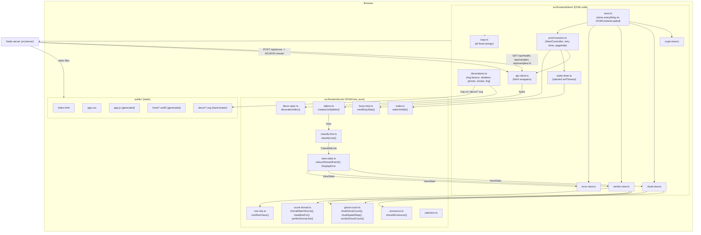

# Design Document

## Overview

The Necromancer frontend is a static single page, served by the existing Node server from `public/`, that drives the three-screen flow already fixed by product and theme steering: **The Crypt** (pick a sample and a translation), **The Ritual** (watch the proof stream live), **The Verdict** (read the result of a finished proof). It is plain TypeScript, built by esbuild into `public/app.js` with no runtime dependency and no framework, matching the pattern already used for `build:server` and `build:worker` in `package.json`.

The page talks to four existing endpoints only: `GET /api/health`, `GET /api/samples`, `GET /api/samples/:id`, `POST /api/prove`. It never invents data: every number, label, or message the user sees either comes verbatim from a `HealthBody`, `SampleSummary`, `SampleDetail`, `ProgressWire`, `ReportWire` or `ErrorWire` (all defined in `src/server/wire.ts`), from the fixed copy table `src/frontend/dom/copy.ts` (Req 11.9), or is one of the two derived values the requirements explicitly allow (the match-score percentage, and a count of displayed rows).

The server already enforces `Content-Security-Policy: default-src 'self'` on every response (`src/server/security-headers.ts`), `X-Content-Type-Options: nosniff`, and serves static files with a fixed extension-to-content-type table including `.woff2` → `font/woff2` and `.svg` → `image/svg+xml; charset=utf-8` (`src/server/static-files.ts`, `CONTENT_TYPES`). The design treats these as fixed platform facts: no inline script, no inline style, no `style` attribute (in markup or written at runtime), fonts and SVGs same-origin only. The `.svg` entry already exists, so decoration files under `public/decor/` need no server change.

### Design principle: pure core, thin DOM shell

Requirement 12.1 is the architectural spine of this design. Every piece of decision-making logic (NDJSON line splitting, line classification, score formatting, headline selection, ghost-count and speed-step arithmetic, row-rise class selection, busy-retry sequencing, live-region throttling, and the overall view-state transition) is written as a pure, DOM-free TypeScript module under `src/frontend/core/`. These modules import nothing from `document`, `window`, or any browser global, so Vitest can test them directly under `environment: "node"` (matching the existing `vitest.config.ts`, whose `include` of `tests/**/*.test.ts` already covers `tests/frontend/`). A thin rendering layer under `src/frontend/dom/` imports the core modules, calls them with real values, and is the only code that touches the DOM. This mirrors how `src/equivalence/` is kept independent of `src/oracle/` and `src/server/` per the repo's structure rule.

### Design decisions

| Decision | Rationale |
|---|---|
| Every SVG Decoration is a same-origin `.svg` file under `public/decor/`, shown through `` created with `createElement` | Satisfies Req 1.6 and 10.9 without `innerHTML`, `data:` URLs or runtime `style`; animations attach to the `` through CSS classes |
| No runtime style writes of any kind (`element.style`, `cssText`, `setAttribute("style", …)`) | `default-src 'self'` blocks inline style attributes (Req 1.4, 1.5); placement, speed and progress width use predefined classes |
| Busy retry sequencing is a pure reducer in `core/busy-retry.ts`; timers, `fetch` and `AbortController` are injected from `dom/proof-session.ts` | Req 7.8, 7.16, 7.17 become property-testable instead of example-only |
| Terminal view states are absorbing in the view-state reducer | The client stops reading at the first terminal event, so a late event can never create a score or overwrite an error |
| `public/app.js` and `public/fonts/*.woff2` are generated, gitignored build artifacts | They are rebuilt from `src/` and `node_modules` in every build, so committing them risks drift |

## Architecture



### Module boundaries

- **`src/frontend/core/`**: pure functions and pure data types only. No `document`, no `fetch`, no timers. This is the code Requirement 12.1 requires to be testable "without a browser." Files: `ndjson.ts`, `classify-line.ts`, `view-state.ts`, `score-format.ts`, `ghost-count.ts`, `row-rise.ts`, `busy-retry.ts`, `announce.ts`, `wake.ts`, `decor-spec.ts`, `selection.ts`.
- **`src/frontend/dom/`**: everything that touches the DOM, `fetch`, `AbortController`, `setTimeout`, `requestAnimationFrame`, or `matchMedia`. Imports from `core/` but never the reverse. Files: `boot.ts`, `crypt-view.ts`, `ritual-view.ts`, `verdict-view.ts`, `error-view.ts`, `decorations.ts`, `api-client.ts`, `proof-session.ts`, `wake-timer.ts`, `copy.ts`. Timers, `fetch` and `matchMedia` are passed in as parameters wherever a test needs a fake (`wake-timer.ts`, `proof-session.ts`, the count-up).
- **`src/frontend/main.ts`**: the esbuild entry point; imports `dom/boot.ts` and nothing else.
- **`public/`**: `index.html` and `app.css` (hand-written), `decor/*.svg` (hand-drawn original artwork), `app.js` and `fonts/*.woff2` (generated, gitignored).

This split is enforced structurally (separate directories, one-way imports) rather than by a lint rule.

## Components and Interfaces

### 1. Build pipeline, fonts, TypeScript config and Docker

#### npm scripts

Added to `package.json` alongside the existing `build:worker` / `build:server`:

```jsonc
"build:frontend": "esbuild src/frontend/main.ts --bundle --platform=browser --target=es2022 --format=esm --outfile=public/app.js --sourcemap=external",
"build:fonts": "node scripts/copy-fonts.mjs",
"typecheck": "tsc --noEmit -p tsconfig.json && tsc --noEmit -p tsconfig.frontend.json",
"build": "npm run build:worker && npm run build:server && npm run build:frontend && npm run build:fonts"
```

#### Fonts (Req 1.7)

- `@fontsource/cinzel` and `@fontsource/jetbrains-mono` are added to **`devDependencies` only**. Today `package.json` `dependencies` contains only `decimal.js`; it stays that way.
- `scripts/copy-fonts.mjs` copies exactly three files, latin subset, into `public/fonts/` under fixed target names, and exits non-zero (with the missing path on stderr) if any source file is missing:

| Source | Target |
|---|---|
| `@fontsource/jetbrains-mono/files/jetbrains-mono-latin-400-normal.woff2` | `public/fonts/jetbrains-mono-400.woff2` |
| `@fontsource/jetbrains-mono/files/jetbrains-mono-latin-700-normal.woff2` | `public/fonts/jetbrains-mono-700.woff2` |
| `@fontsource/cinzel/files/cinzel-latin-400-normal.woff2` | `public/fonts/cinzel-400.woff2` |

- `app.css` declares the three `@font-face` rules with `font-display: swap` and relative same-origin sources, for example `src: url("/fonts/jetbrains-mono-400.woff2") format("woff2");`. Font stacks are `"JetBrains Mono", monospace` and `"Cinzel", serif`. No font is requested from a third-party origin and the page has no `<link>` to a font host. `index.html` may `<link rel="preload" as="font" type="font/woff2" crossorigin href="/fonts/jetbrains-mono-400.woff2">` (same origin).
- `scripts/copy-fonts.mjs` runs under the existing ESLint block for `scripts/**/*.mjs`, which already declares `process`, `console` and `URL`. Imports come from `node:fs` and `node:path`.

#### Generated artifacts and gitignore

`public/app.js`, `public/app.js.map` and `public/fonts/` are **generated build artifacts and are added to `.gitignore`**. `public/index.html`, `public/app.css` and `public/decor/` are hand-written and committed. Consequences:

- The smoke test (Req 12.10) and the static audit need the built files, so a Vitest `globalSetup` file `tests/setup/build-frontend.ts` builds them once before any test starts. It has two exports: a named `runBuild(run: (command: string) => void): void` that calls `run("npm run build:frontend")` and then `run("npm run build:fonts")`, and a default `setup()` function that calls `runBuild` with the real runner. The real runner uses `child_process.execSync(command, { cwd: <repository root>, stdio: "inherit" })` with the plain command string, which works on both Windows and Linux because the shell resolves `npm` (`npm.cmd` on Windows). If either command exits non-zero, `execSync` throws, and the runner rethrows an `Error` whose message includes the failing command, so `setup()` throws and Vitest aborts the run before any test executes. It runs exactly once per `vitest --run` invocation (not per test file), so `npx vitest --run` works on a fresh checkout with no manual build step.
- `vitest.config.ts` gains `globalSetup: ["tests/setup/build-frontend.ts"]` inside `test`:

  ```ts
  export default defineConfig({
    test: {
      include: ["tests/**/*.test.ts"],
      passWithNoTests: true,
      environment: "node",
      globalSetup: ["tests/setup/build-frontend.ts"],
    },
  });
  ```

  `tests/setup/build-frontend.ts` is not matched by the `tests/**/*.test.ts` include, so it is not collected as a test.
- `tests/setup/build-frontend.ts` uses `node:child_process` and `node:path`, so it belongs to the base `tsconfig.json` project (which already includes `tests/**/*.ts` and has `types: ["node"]`) and must stay out of the `tsconfig.frontend.json` type scope.
- As a safety net, the tests that read generated files still call a shared helper that, when `public/app.js` or a font is missing, fails with the message "Run npm run build:frontend && npm run build:fonts first" rather than passing silently. This now only triggers if the globalSetup was bypassed, for example when a single test file is run with a custom config. (A silent skip would let the audit pass on nothing, so the design does not skip.)
- The globalSetup adds the build time (esbuild bundle plus a file copy, normally a few seconds) to every `vitest --run`, and it needs `node_modules` to be installed (`npm ci`), including the `@fontsource/*` dev dependencies.
- `.dockerignore` gains `public/app.js`, `public/app.js.map` and `public/fonts` so a stale local build never enters the build context; the image always builds its own.

#### TypeScript and ESLint configuration

The real `tsconfig.json` has `"lib": ["ES2022"]`, `"types": ["node"]` and `include: ["src/**/*.ts", "tests/**/*.ts", …]`, so it has no DOM types and `document`, `HTMLElement`, `requestAnimationFrame` would fail to compile. Minimal change:

1. `tsconfig.json`: add `"src/frontend/**"` and `"tests/frontend/**"` to `exclude`, so server, oracle and equivalence code stay free of DOM globals.
2. New `tsconfig.frontend.json`: `{ "extends": "./tsconfig.json", "compilerOptions": { "lib": ["ES2022", "DOM"] }, "include": ["src/frontend/**/*.ts", "src/server/wire.ts", "tests/frontend/**/*.ts"], "exclude": ["node_modules", "dist"] }`. `types: ["node"]` is inherited because the audit and smoke tests use `node:fs` and the server.
3. `typecheck` runs both projects (script above).
4. `eslint.config.js` needs no change: `typescript-eslint` recommended turns off `no-undef` for `.ts`, and `**/*.ts` rules (`no-explicit-any`, `no-unused-vars`) already apply to `src/frontend`.

esbuild reads the nearest `tsconfig.json` only for compiler hints, which is unaffected.

#### `Dockerfile.app` (Req 1.9)

The existing build stage copies only `package.json`, `package-lock.json`, `tsconfig.json` and `src/`, and runs only `build:worker` and `build:server`. The runtime stage copies `public/` from the **build context** (`COPY --chmod=a+rX public/ ./public/`), not from the build stage, so a bundle built in stage 1 would never reach the image. Required changes:

Build stage:

```dockerfile
COPY package.json package-lock.json tsconfig.json ./
RUN npm ci                                  # plain npm ci: devDependencies (esbuild, @fontsource/*) are present
COPY scripts/copy-fonts.mjs ./scripts/copy-fonts.mjs
COPY src/ ./src/
COPY public/ ./public/                      # hand-written index.html, app.css, decor/
RUN npm run build:worker && npm run build:server \
 && npm run build:frontend && npm run build:fonts
```

Runtime stage: replace `COPY --chmod=a+rX public/ ./public/` with

```dockerfile
COPY --from=build --chmod=a+rX /build/public/ ./public/
```

The runtime image never runs `npm install`, so the `@fontsource/*` packages are not in it; only the three copied `.woff2` files are. `GET /app.js` therefore answers 200 from the image (served by the existing static table), and `/fonts/*.woff2` and `/decor/*.svg` come from the same directory. The existing `scripts/check-app-image.sh` is extended to request `/app.js`, `/app.css`, `/fonts/jetbrains-mono-400.woff2` and `/decor/skeleton.svg`.

### 2. `src/frontend/core/ndjson.ts`: stream line splitter

```ts
export interface LineSplitter {
  /** Feed one chunk of text; returns complete lines found so far (newline stripped). */
  push(chunk: string): readonly string[];
  /** Call once the stream ends; returns a final trailing line if the stream didn't end in \n, else []. */
  flush(): readonly string[];
}

export function createLineSplitter(): LineSplitter;
```

Internally holds one buffered partial-line string; `push` appends the chunk, splits on `"\n"`, returns all complete segments, and keeps the final (possibly empty) segment buffered for the next call. No DOM, no stream types. The caller (`api-client.ts`) feeds it text decoded with `TextDecoder` using `{ stream: true }`, so multi-byte characters split across chunks decode correctly.

### 3. `src/frontend/core/classify-line.ts`: line classifier

```ts
export type ClassifiedLine =
  | { readonly kind: "progress"; readonly value: ProgressWire }
  | { readonly kind: "report"; readonly value: ReportWire }
  | { readonly kind: "error"; readonly value: ErrorWire }
  | { readonly kind: "unreadable" };

export function classifyLine(rawLine: string): ClassifiedLine;
```

`classifyLine` attempts `JSON.parse`; on throw, or when the parsed value is not an object, or `type` is not one of `"progress" | "report" | "error"`, or the object is missing a field required by that wire type (checked with explicit `typeof`/`Array.isArray` guards, no `any`, no schema library), it returns `{ kind: "unreadable" }`. This implements Requirement 4.7.

`ProgressWire`, `ReportWire`, `ErrorWire` are imported as **types only** from `src/server/wire.ts`; esbuild erases type-only imports, so there is no runtime coupling to the server.

### 4. `src/frontend/core/view-state.ts`: the view-state reducer

```ts
export type ViewName = "crypt" | "ritual" | "busy" | "verdict" | "error" | "interrupted";

export type DisplayError =
  | { readonly source: "server"; readonly code: string; readonly message: string }
  | {
      readonly source: "client";
      readonly kind: "unreadable" | "unreachable" | "http-status";
      readonly message: string;
      readonly status?: number;
    };

export interface ViewState {
  readonly view: ViewName;
  readonly latestProgress: ProgressWire | undefined;
  readonly report: ReportWire | undefined;           // only ever a *complete* report once set
  readonly incompleteReport: ReportWire | undefined; // set when complete === false
  readonly error: DisplayError | undefined;
  readonly busyAttempt: number | undefined;          // defined only while view === "busy"
  readonly interruptCause: "aborted" | "budget" | "stream-ended" | "cancelled" | undefined;
}

export type StreamEvent =
  | Exclude<ClassifiedLine, { readonly kind: "unreadable" }>  // progress | report | error
  | { readonly kind: "unreadable"; readonly message: string } // see note below
  | { readonly kind: "client-failure"; readonly failure: Extract<DisplayError, { source: "client" }> }
  | { readonly kind: "stream-ended" }
  | { readonly kind: "cancelled" }
  | { readonly kind: "busy-wait"; readonly attempt: number }
  | { readonly kind: "busy-exhausted"; readonly error: ErrorWire };

export function initialRitualState(): ViewState;
export function isTerminal(state: ViewState): boolean; // view is verdict | interrupted | error
export function reduceStreamEvent(state: ViewState, event: StreamEvent): ViewState;
```

Note on `unreadable`: the fixed message text lives in `dom/copy.ts`, and `core/` must not import from `dom/`. The DOM layer therefore converts a bare classified `unreadable` into `{ kind: "unreadable", message: COPY.unreadable }` before dispatching, and the reducer copies the message into a `{ source: "client", kind: "unreadable" }` error. The same applies to `client-failure` events built by `api-client.ts` for network failure (`unreachable`, message from `COPY.unreachable`) and for a non-200 response without a valid Error_Line (`http-status`, message from `COPY.httpStatus(status)` containing the numeric status, Req 7.12). The reducer never invents text, so it stays pure and the message is always fixed copy.

Rules, each traced to a requirement:

- **Absorbing terminals.** If `isTerminal(state)`, `reduceStreamEvent` returns `state` unchanged for every event. The client stops reading at the first terminal event, so this also holds in the reducer: a later `report` can never turn an error into a verdict, and a later `error` can never erase a verdict.
- `progress` → `view: "ritual"`, `busyAttempt` cleared, `latestProgress` replaced, `report`/`incompleteReport` untouched (Req 4.2 to 4.4).
- `report` with `complete === true` → `view: "verdict"`, `report` set, `error`/`incompleteReport` cleared (Req 6.1).
- `report` with `complete === false` → `view: "interrupted"`, `incompleteReport` set, `report` stays `undefined`, `interruptCause` is `"aborted"` when `aborted` is true, otherwise `"budget"` (Req 6.12, 6.13).
- `error` → `view: "error"`, `error` set to `{ source: "server", code, message }`, `report`/`incompleteReport`/`latestProgress` cleared (Req 7.7, 7.14).
- `unreadable` and `client-failure` → `view: "error"`, client `DisplayError`, progress cleared (Req 4.7, 7.12, 7.13).
- `stream-ended` while non-terminal → `view: "interrupted"`, `interruptCause: "stream-ended"`, `report` and `incompleteReport` left `undefined` (Req 4.8).
- `cancelled` (user pressed cancel, request aborted) → `view: "interrupted"`, `interruptCause: "cancelled"`, `report` and `incompleteReport` `undefined`, no Match_Score (Req 4.10, 7.16).
- `busy-wait` (attempt) → `view: "busy"`, `busyAttempt` set, other fields unchanged. A later `progress` returns the view to `"ritual"` (Req 7.8).
- `busy-exhausted` (error) → `view: "error"`, `error` set from the server `ErrorWire` (code `busy`), `busyAttempt` cleared (Req 7.17).

Because `report` is only ever assigned from a branch gated on `complete === true`, and terminal states are absorbing, **"a Match_Score is derivable from `state.report` only after a Complete_Report, and only if it was the first terminal event" is a structural invariant of this module**.

### 5. `src/frontend/core/score-format.ts`: score formatting, headline and perfect-score line

```ts
export function formatMatchScore(matchScore: number): string; // e.g. "99.7", "100.0", "0.0"
export type Headline = "it-lives" | "almost-faithful" | "not-faithful";
export function headlineFor(matchScore: number): Headline;
export function perfectScoreLine(conclusiveCount: number): string;
```

**Formatting (Req 6.5, hardened).** `formatMatchScore` clamps the input to `[0, 1]` and never calls `toFixed` on the raw float. Algorithm:

1. `tenths = Math.floor(matchScore * 1000)` (tenths of a percent).
2. While `tenths > 0 && tenths / 1000 > matchScore`, decrement `tenths` (correct downward when float multiplication rounded up).
3. If `matchScore < 1`, clamp `tenths` to at most `999`, so a score below 1 can never print `"100.0"`.
4. Format as `` `${Math.floor(tenths / 10)}.${tenths % 10}` `` using integer division only.

The property test compares the parsed result with `matchScore * 100` using a tolerance of `1e-9` (parsed value `<= matchScore * 100 + 1e-9`, and `>= matchScore * 100 - 0.1 - 1e-9`).

**Score bands (Req 6.6, 6.7).** `headlineFor` keeps its thresholds (`>= 1`, `>= 0.9`, else). The three bands are:

| Score | Headline copy | Color class |
|---|---|---|
| exactly `1` | "It lives" | match (`#38F888`) |
| `0.9 <= score < 1` | "Almost faithful. Not yet safe." | mismatch (`#FF777A`) |
| `score < 0.9` | "Not faithful" | mismatch (`#FF777A`) |

The DOM layer maps the enum to the copy-table rows `headlineItLives`, `headlineAlmostFaithful`, `headlineNotFaithful` and to the color classes. Threshold logic stays pure; wording stays in one place.

**Perfect-score copy (Req 6.6).** `perfectScoreLine(n)` returns exactly `` `No mismatches in ${n} conclusive cases.` `` with `n = ReportWire.conclusiveCount`. The Verdict view shows the headline "It lives" and this line only when `matchScore === 1`. Neither string (nor any other string in the perfect-score copy) contains "proven", "proof", "guaranteed", "guarantee" or "certain", so the page never claims a mathematical proof. A unit test asserts the exact string for several `n` and asserts a case-insensitive regex `/proven|proof|guarantee|certain/` matches neither the line nor the headline copy.

### 6. `src/frontend/core/ghost-count.ts`: decoration counts and speed steps

```ts
export function ritualGhostCount(completed: number, target: number): number;          // integer 2..12
export function ritualSpeedStep(completed: number, target: number): 1 | 2 | 3 | 4;
export function verdictGhostCount(mismatchCount: number, displayedMismatchCount: number, matchScore: number): number;
```

- `ritualGhostCount`: clamps `completed/target` (guarding `target <= 0` as ratio `0`) into fixed steps mapped to integers 2 to 12, non-decreasing as the ratio rises (Req 8.3, 12.6).
- `ritualSpeedStep`: uses the **same ratio** as `ritualGhostCount` and no other value, bucketed into four steps (ratio below 0.25 gives 1, below 0.5 gives 2, below 0.75 gives 3, otherwise 4). It is non-decreasing in `completed` (Req 8.2). The DOM layer maps the step to the CSS class `.ghost-speed-N` (N = 1..4); each class sets a shorter drift `animation-duration` than the previous one.
- `verdictGhostCount`: returns `0` when `matchScore === 1` (Req 9.3), otherwise `Math.min(20, displayedMismatchCount)` (Req 9.1, 9.2, 12.5). `displayedMismatchCount` is the length of the rendered mismatch array; it is passed in so the function stays pure arithmetic. Error views never call it (Req 9.4).

### 7. `src/frontend/core/row-rise.ts`: mismatch row animation class

```ts
export const ROW_RISE_LIMIT = 20;
export function rowRiseClass(index: number): string | undefined;
```

For a non-negative integer `index < 20` it returns `` `row-rise row-rise-${index}` ``. For `index >= 20` it returns `undefined`: no animation class and no delay, so rows after the 20th appear at once (Req 7.3). `app.css` defines `.row-rise` (keyframes on `transform` and `opacity` only) and `.row-rise-0` to `.row-rise-19`, each with a strictly larger `animation-delay` than the previous (for example `index * 40ms`). The delay is class based; there is no inline style and no `element.style`.

### 8. `src/frontend/core/busy-retry.ts`: busy retry reducer

```ts
export const BUSY_RETRY_INTERVAL_MS = 5000;
export const BUSY_RETRY_MAX = 6;

export interface BusyState {
  readonly phase: "requesting" | "waiting" | "ended";
  readonly retriesDone: number;   // retry requests already sent (0..6)
  readonly requestsSent: number;  // 1 initial + retries
}

export type BusyEvent =
  | { readonly kind: "busy-response"; readonly error: ErrorWire } // 429 with code "busy"
  | { readonly kind: "other-response" }                           // 200 stream, or any non-busy error
  | { readonly kind: "timer-fired" }
  | { readonly kind: "cancel" };

export type BusyStep =
  | { readonly kind: "wait"; readonly attempt: number; readonly delayMs: 5000 }
  | { readonly kind: "send"; readonly attempt: number }
  | { readonly kind: "give-up"; readonly error: ErrorWire }
  | { readonly kind: "cancelled" }
  | { readonly kind: "finished" }
  | { readonly kind: "none" };

export function initialBusyState(): BusyState; // { phase: "requesting", retriesDone: 0, requestsSent: 1 }
export function nextBusyStep(state: BusyState, event: BusyEvent): { state: BusyState; step: BusyStep };
```

Semantics:

- The first Proof request is attempt 0 and is not a retry. Retries are numbered 1 to 6.
- `busy-response` while `requesting`: if `retriesDone < 6`, go to `waiting` and return `{ kind: "wait", attempt: retriesDone + 1, delayMs: 5000 }`. The UI shows "The crypt is busy, another soul is being judged…" with that attempt number and a cancel button. If `retriesDone === 6` (the 6th retry also answered busy), go to `ended` and return `{ kind: "give-up", error }`. The view then shows the busy error with the server `message` and a button that returns to the Crypt (Req 7.17).
- `timer-fired` while `waiting`: increment `retriesDone` and `requestsSent`, go to `requesting`, return `{ kind: "send", attempt: retriesDone }` (the new value). A `timer-fired` in any other phase, including after `cancel`, returns `{ kind: "none" }` and sends nothing (guard against a timer that fires despite `clearTimeout`).
- `cancel` in `requesting` or `waiting`: go to `ended`, return `{ kind: "cancelled" }`. The caller clears the timer, aborts the in-flight request, and dispatches the reducer event `cancelled` (view becomes Interrupted, Req 7.16). `cancel` in `ended` returns `none`.
- `other-response` while `requesting`: go to `ended`, return `{ kind: "finished" }`. A non-busy answer (a 200 stream, or any other error) ends the retry loop (Req 7.9 to 7.13 then apply).
- `busy-response` or `other-response` in any phase other than `requesting` returns `none`.

Because sends happen only on `timer-fired` from `waiting`, which requires a preceding `busy-response` with `retriesDone < 6`, the maximum is `1 + 6 = 7` Proof requests.

The server sends `Retry-After: 5` on the 429 (`src/server/prove-runner.ts`), consistent with the fixed 5000 ms. The client uses the constant `BUSY_RETRY_INTERVAL_MS` and does not read the header.

### 9. `src/frontend/core/announce.ts` and `wake.ts`

```ts
export const ANNOUNCE_MIN_INTERVAL_MS = 1000;
export function shouldAnnounce(lastAnnouncedAtMs: number | undefined, nowMs: number): boolean;
// true iff lastAnnouncedAtMs === undefined || nowMs - lastAnnouncedAtMs >= 1000

export const WAKE_DELAY_MS = 3000;
export function wakeVisible(elapsedMs: number, firstByteAtMs: number | undefined): boolean;
// true iff firstByteAtMs === undefined && elapsedMs >= WAKE_DELAY_MS
```

`shouldAnnounce` implements the once-per-second live-region throttle (Req 4.11). `wakeVisible` is the pure statement of Req 5.1 to 5.3: the "Waking the crypt…" notice is visible only while no first byte has arrived and 3000 ms have elapsed.

### 10. `src/frontend/core/decor-spec.ts`: decoration attribute factory

```ts
export type DecorationKind = "skeleton" | "ghost-a" | "ghost-b" | "verdict-ghost" | "smoke" | "fog";
export function decorationAttrs(kind: DecorationKind): Readonly<Record<string, string>>;
```

Returns the attribute map every decoration element must carry. For file-backed kinds: `src` (`/decor/<kind>.svg`), `alt` (`""`), `aria-hidden` (`"true"`), `data-decoration` (kind), `class` (`"decor decor-<kind>"`). For `fog` (a CSS-only layer, no file) the map has no `src`/`alt` but has the other three. No entry is `style`, and none is `tabindex`. `dom/decorations.ts` creates elements only by `createElement` and applies this map with `setAttribute`, so the test for Req 12.8 can assert `aria-hidden="true"` for every kind without a DOM.

### 11. `src/frontend/dom/api-client.ts` and `proof-session.ts`

`api-client.ts` (thin `fetch` wrapper):

- `getHealth()`, `getSamples()`, `getSampleDetail(id)`: simple `fetch` plus `.json()`, typed with `HealthBody` / `SampleSummary[]` / `SampleDetail` (type-only imports from `wire.ts`).
- `startProve(sampleId, variant, signal)`: issues `POST /api/prove` with `Content-Type: application/json` and body `{ sampleId, variant }` only (Req 3.2). For status 200 it returns an async generator of `ClassifiedLine`, reading `response.body.getReader()`, decoding with `TextDecoder`, feeding `createLineSplitter()`, and classifying each line. For a non-200 status it reads the body text and classifies it with the same guards as `classifyLine` (a JSON `ErrorWire` for `busy` and `shutting_down`, or an NDJSON error line for 503 `oracle_unavailable`). A non-200 body that is not a valid Error_Line becomes a `client-failure` with kind `http-status` and the numeric status from the `Response`. A rejected `fetch` (not an abort) becomes a `client-failure` with kind `unreachable`.
- Honors `signal` for cancellation by passing it to `fetch`.

`proof-session.ts` (new) owns the objects with lifetimes: the `AbortController`, the retry `setTimeout` handle and the wake timer. It takes `{ fetch, setTimeout, clearTimeout }` as injected dependencies so tests can use fakes.

- **Start:** creates the `AbortController`, starts the wake timer, sends the request (attempt 0), and feeds `initialBusyState()`.
- **Per response:** a 429 `busy` JSON body is a `busy-response` event; any other answer is `other-response`. It calls `nextBusyStep` and executes the step: `wait` stores the timer handle and dispatches `busy-wait` to the view reducer; `send` issues a new request with a fresh `AbortController`; `give-up` dispatches `busy-exhausted`; `finished` continues into stream reading.
- **Cancel:** calls `clearTimeout(handle)` if a timer is pending, aborts the in-flight request, feeds `cancel` to `nextBusyStep`, and dispatches the reducer event `cancelled`. After this, a stray `timer-fired` yields `none` (reducer guard) and no request is made (Req 7.16).
- **Stream reading:** stops at the first terminal line (`report`, `error`, `unreadable`) and aborts the request on `unreadable` (Req 4.7). When the stream ends without a terminal line it dispatches `stream-ended`.
- **Page leave (Req 4.9):** one `pagehide` listener on `window` aborts the in-flight `AbortController` and clears the retry timer.

### 12. `src/frontend/dom/` view modules and copy table

`crypt-view.ts`, `ritual-view.ts`, `verdict-view.ts`, `error-view.ts`, `decorations.ts` and `boot.ts` contain only DOM manipulation: creating elements with `createElement`, setting `textContent`, toggling CSS classes from `app.css`, managing focus and the live region. `boot.ts` owns the single `ViewState` instance and the `Selection`, calls `reduceStreamEvent`, and re-renders the view module matching `state.view` after each update (a `switch` over `ViewName` with no default, so a missed case is a compile error).

**No unsafe DOM writes.** DOM code never uses `innerHTML`, `outerHTML`, `insertAdjacentHTML` or `document.write` (Req 2.13, 7.15), and **never uses `element.style`, `setAttribute("style", …)` or `cssText`** (Req 1.4, 1.5). Every visual variation is a predefined class in `app.css`:

- Ghost placement: `.ghost-slot-1` to `.ghost-slot-12` (horizontal start position, vertical delay).
- Ghost speed: `.ghost-speed-1` to `.ghost-speed-4` (drift `animation-duration`).
- Progress bar width in 5 percent steps: `.progress-step-0` to `.progress-step-20`. The step is chosen from `completed / target` and is a visual class only; it is never displayed as a number.
- Row rise: `.row-rise-0` to `.row-rise-19` (section 7).

**`dom/copy.ts`** is the single copy table (Req 11.9). It holds every fixed string the page shows that the server does not supply:

| Key | Text |
|---|---|
| `headlineItLives` | "It lives" |
| `headlineAlmostFaithful` | "Almost faithful. Not yet safe." |
| `headlineNotFaithful` | "Not faithful" |
| `perfectScoreLine(n)` | delegates to `core/score-format.ts` |
| `interruptedTitle` | "Interrupted, not a verdict" |
| `busyWaiting(attempt)` | "The crypt is busy, another soul is being judged…" with the attempt number |
| `wakingCrypt` | "Waking the crypt…" |
| `unreadable` | fixed "server sent an unreadable response" message (4.7) |
| `unreachable` | fixed "server could not be reached" message (7.13) |
| `httpStatus(status)` | fixed message containing the numeric HTTP status (7.12) |
| `catalogFailed` | fixed "catalog could not be loaded" message (1.10) |
| `detailFailed` | fixed message shown in place of the source panels (2.12) |
| `oracleUnavailableNotice` | oracle-unavailable notice in the Crypt (5.7) |
| `noProofRun` | "No proof was run." (7.9) |

Headings are "The Crypt", "The Ritual", "The Verdict" (Req 11.3). The perfect-score copy has no wording that claims a mathematical proof (section 5).

### 13. Crypt view (Req 2, 3, 5.5 to 5.7, 11)

- On load: `GET /api/health` is sent once, fire-and-forget (Req 5.5), and `GET /api/samples` renders one tombstone card per sample showing `name` and `trapLabel`. The first sample is auto-selected and `GET /api/samples/:id` is requested (Req 2.2). Selecting another card requests that detail and replaces both panels (Req 2.3).
- If the catalog request fails or returns non-200: the server `message` when an Error_Line is returned, otherwise `COPY.catalogFailed`, plus a retry button that repeats the request (Req 1.10).
- Detail panels: `cobolSource` left, the selected variant's `source` right, both in JetBrains Mono, with line numbers (rendered as separate text nodes per line, `textContent` only). Side by side at viewport width >= 900 px and stacked below, through a CSS media query (Req 11.5, 11.6). Code panels and the Mismatch table scroll horizontally inside their own containers (`overflow-x: auto`), so the page itself has no horizontal scroll at 360 px (Req 11.7).
- Highlights: class `line-curse` on each COBOL line listed in `curses[].lines`, class `line-marker` on each TypeScript line from `markers[].line` of the selected variant (Req 2.6).
- Curse chips (label from `curses[]`) and the `fidelityPact` list (Req 2.5).
- Variant selector: exactly `correct`, `subtle`, `naive`; `correct` is selected by default. Changing it re-renders from the already loaded detail with no request (Req 2.7, 2.8). Next to it: the label from `provenance.label` ("Pre-generated with Kiro" when the server returns that text, Req 11.4), and next to the TypeScript panel `provenance.label`, `provenance.generatedWith` and `provenance.date` (Req 2.9).
- No upload, no textarea, no drop zone (Req 2.10). The variant's expected outcome is never shown before a Proof ends (Req 2.11).
- Summon button: disabled until the sample detail has loaded, while a detail request has failed (Req 2.12, 3.5), and while a Proof runs (Req 3.3, 3.4); the sample cards and variant selector are also disabled while a Proof runs. If `GET /api/health` returned `oracle: "unavailable"`, a notice (`COPY.oracleUnavailableNotice`) is shown in the Crypt and Summon **stays enabled**, so the server's answer to the Proof decides the outcome (Req 5.7).
- Interactive controls have a minimum 44 by 44 CSS px touch target and a visible `:focus-visible` outline (Req 3.7, 11.8). All controls are native `<button>` or `<input type="radio">` elements, so keyboard operation is built in.
- Colors: background between `#080808` and `#101010`, match `#38F888`, mismatch `#FF777A`; Cinzel Regular only for the logo and screen titles, JetBrains Mono for everything else (Req 11.1, 11.2).

### 14. Waking the crypt (Req 5.1 to 5.4, 5.6)

`dom/wake-timer.ts` takes an injected `setTimeout`/`clearTimeout` pair and the constant `WAKE_DELAY_MS = 3000`:

- It starts when a request is sent: the Proof request, and the initial `GET /api/samples` request.
- It is cleared as soon as the response headers or the first stream line arrive.
- If it fires first, the view shows `COPY.wakingCrypt` and the Skeleton decoration (``). When headers or the first line arrive afterwards, both are removed.
- If the response arrives within 3000 ms, the timer is cleared before it fires and neither is ever shown (Req 5.3).
- For the sample catalog (5.6), the same timer is used and the notice stays in the Crypt until the catalog request ends. The Skeleton and notice are removed on success and on failure.
- Skeleton swing: CSS keyframes on `transform` only (rotate around the rope anchor, Req 5.4); under Reduced_Motion the swing is removed and the Skeleton is shown static or fades in within 300 ms.

### 15. Ritual view (Req 4, 8)

- Progress text "`completed` of `target`", a progress bar with class `.progress-step-N`, running `matched`, `mismatches`, `inconclusive` counts and the latest `group` (Req 4.2, 4.6). No score and no percentage is computed or shown (Req 4.3, 4.4).
- A smoke animation built from `smoke.svg` and CSS (Req 4.5), and a cancel button (Req 4.10).
- Live region: a visually hidden `aria-live="polite"` element. Progress text updates go through `shouldAnnounce(lastAnnouncedAtMs, now)`, so at most one update per second (Req 4.11).
- Ritual_Ghosts (not under Reduced_Motion): on each progress line the DOM layer sets the number of ghost `` elements to `ritualGhostCount(completed, target)` (2 to 12), uses `ghost-a.svg` and `ghost-b.svg` alternately (two distinct original shapes, Req 8.5), gives each a `.ghost-slot-K` class, and sets one class `.ghost-speed-N` from `ritualSpeedStep(completed, target)` (Req 8.2). Ghosts are removed from the DOM after a fade-out (`opacity` transition) when the Ritual ends (Req 8.4).
- Summon smoke plume (Req 3.6): a `smoke.svg` decoration above the button, shown for at most 1200 ms and skipped when Reduced_Motion is set.
- While in `busy` view: the text `COPY.busyWaiting(busyAttempt)` and a cancel button, which calls `proof-session` cancel.

### 16. Verdict view (Req 6, 7.1 to 7.6, 9)

What is shown, and from which field:

| Item | Source field |
|---|---|
| Match_Score percentage | `formatMatchScore(report.matchScore)` |
| Conclusive / matched / mismatched counts | `conclusiveCount`, `matchedCount`, `mismatchCount` |
| Cases run, seed, elapsed time | `casesRun`, `seed`, `elapsedMs` |
| One row per group | `groups[]`: `group`, `matched`, `conclusive` unchanged (Req 6.8) |
| Inconclusive section (only when `inconclusiveCount > 0`) | `inconclusiveCount` and each `inconclusiveByStatus` entry, with the statement that these are not part of the score (Req 6.9) |
| Sample name and Variant | the `Selection` held by `boot.ts` (Req 6.10) |
| Return button | restores the Crypt with the previous Sample and Variant selected (Req 6.11) |

Every number is taken from a server line; the only derived values are the score percentage and counts of displayed rows (Req 6.14). The Match_Score is shown only in the Verdict, only for a Complete_Report (Req 6.2).

**Count-up (Req 6.3, 6.4).** A `requestAnimationFrame` loop of 900 ms (inside 600 to 1200 ms) displays `formatMatchScore(finalScore * t)` for `t` in `[0, 1]`, so the shown value never exceeds the final value, and the last frame sets exactly `formatMatchScore(finalScore)`. When `matchMedia("(prefers-reduced-motion: reduce)")` matches, the loop is skipped and the final value is shown at once. The headline and its color class are applied when the count-up ends (immediately under Reduced_Motion).

**Headline.** From `headlineFor` (section 5). For exactly 1, the Verdict shows "It lives" in the match color and `perfectScoreLine(conclusiveCount)`. Below 1, "Almost faithful. Not yet safe." or "Not faithful" in the mismatch color. Match and mismatch are also conveyed as text labels, not color alone (Req 10.7).

**Mismatch table (Req 7.1 to 7.6).**
- Shown only when `mismatches.length > 0`. Each row has class `row-mismatch` (mismatch color) plus the class from `rowRiseClass(index)` for rows 0 to 19; rows from index 20 on get no animation class and no delay (Req 7.3).
- Columns: `input` (all entries, in order), `oracleOutput`, `candidateOutput`, `group`. All cells are filled with `textContent`; `oracleOutput` and `candidateOutput` cells have a CSS class with `white-space: pre` and the JetBrains Mono font so leading and trailing spaces are visible (Req 7.2).
- `shrunkExamples`, when not empty: each with `group`, `input`, `oracleOutput`, `candidateOutput`, labelled as the smallest failing case (Req 7.4).
- When `mismatchListTruncated` is true: a notice that the list is truncated, with `mismatchCount` from the report beside the number of displayed rows (Req 7.5).
- When `mismatchCount` is 0 in a Complete_Report: no table and no Verdict_Ghost (Req 7.6).
- The row rise animates only `transform` and `opacity`, and is removed under Reduced_Motion.

**Verdict ghosts (Req 9).** `verdictGhostCount(mismatchCount, displayedRows, matchScore)` red ghosts (`verdict-ghost.svg`, `#FF777A`) are created once and rise once; none at score 1; none for any error view. At most 20 are on screen.

**Interrupted view (Req 6.12, 6.13, 4.8, 4.10).** Title `COPY.interruptedTitle`. Cause: from `interruptCause`: for an Incomplete_Report, whether `aborted` or `budgetReached` caused it; for client-side interrupts "stream ended" or "cancelled". It shows `casesRun` when an Incomplete_Report exists and the partial mismatch list labelled "partial" when present. It never shows a Match_Score, a success headline or a percentage.

### 17. Error view mapping (Req 7.7 to 7.13, 7.17)

`error-view.ts` renders `state.error` (a `DisplayError`). It never shows a score, a success headline, or ghosts.

| Situation | Displayed output |
|---|---|
| `busy` after the retries are exhausted (HTTP 429, JSON body) | server `message`, `code` label, and a button that returns to the Crypt |
| `oracle_unavailable` (503 NDJSON body, or inside a 200 stream) | server `message`, plus `COPY.noProofRun` stating that no proof was run |
| `shutting_down` (503 JSON body) | server `message` and a button that returns to the Crypt |
| `inconclusive`, `timeout`, `engine_config`, `internal_error` | server `message` and the `code` label |
| any other server code (400-class validation) | server `message` and the `code` label |
| non-200 without a valid Error_Line body | fixed message containing the HTTP status number (`COPY.httpStatus(status)`) |
| network failure before any response | fixed `COPY.unreachable` ("server could not be reached") |
| unreadable stream line | fixed `COPY.unreadable` |

All strings are inserted as text content (Req 7.15). A "return to the Crypt" button is present in every error view, which keeps the page recoverable.

### 18. Decorations and their delivery (Req 1.6, 10)

Every SVG Decoration is a same-origin `.svg` file under `public/decor/`, **original artwork**: `skeleton.svg`, `ghost-a.svg`, `ghost-b.svg`, `verdict-ghost.svg` (red `#FF777A`) and `smoke.svg`. The `.svg` files contain no `<style>` element, no `style` attribute, no `<script>`, no `onload` or other event attribute, no `data:` URL and no external `href` or `xlink:href`; colors are set with presentation attributes (`fill`, `stroke`). The server serves them as `image/svg+xml; charset=utf-8` (existing `.svg` entry in `static-files.ts`).

`dom/decorations.ts` creates `` elements with `createElement("img")` and the attribute map from `decorationAttrs(kind)`: `src="/decor/<file>.svg"`, `alt=""`, `aria-hidden="true"`, `data-decoration`, and classes `decor decor-<kind>`. There is no `innerHTML`, no `data:` URL, no `style` attribute and no third-party artwork. The CSS for `.decor` sets `pointer-events: none`, a `z-index` below content, and low-opacity rules (at most 0.15 over text, Req 10.3); the elements are not focusable (no `tabindex`, `` is not interactive). Animations are applied to the `` through CSS classes and use only `transform` and `opacity` (Req 10.4). Fog layers are empty `<div>` elements with the same attribute map minus `src`/`alt`.

**Reduced_Motion CSS (Req 10.5, 3.6, 5.4, 8.1, 6.3).** One `@media (prefers-reduced-motion: reduce)` block removes: the Skeleton swing, the Ritual_Ghost drift, the smoke plume (Ritual smoke and Summon plume), fog and ember drift, the row rise (`.row-rise` animation set to `none`), and the Verdict_Ghost rise. Decorations are then shown static or fade in over at most 300 ms. The count-up is removed in JavaScript through `matchMedia` (the final value is shown at once).

### 19. State changes, focus and live region (Req 10.8)

On every `view` change, `boot.ts` (a) sets the polite live region text to the new state's heading, (b) moves keyboard focus to that heading, which has `tabindex="-1"`, and (c) leaves ordinary content order untouched. This announcement is independent of the progress throttle in section 15 (a state change is always announced).

### 20. `public/index.html`, `public/app.css`

Hand-written. `index.html` contains the minimal shell (a root `<div id="app">`, `<link rel="stylesheet" href="/app.css">`, `<script type="module" src="/app.js">`, the live region element, the three screen containers as empty class-toggled `<section>` elements) and no inline styles, scripts, event-handler attributes or third-party URLs (Req 1.3, 1.4). `app.css` defines the Crypt theme palette and typography from the spooky-theme steering file, the tombstone card shapes, the 900 px breakpoint, the class families `.ghost-slot-*`, `.ghost-speed-*`, `.progress-step-*`, `.row-rise-*`, the decoration keyframes restricted to `transform`/`opacity`, the `@font-face` rules, and the Reduced_Motion block.

## Data Models

The frontend introduces no new wire formats. It consumes `HealthBody`, `SampleSummary`, `SampleDetail`, `ProgressWire`, `ReportWire`, `ErrorWire` as already defined in `src/server/wire.ts` (type-only imports). The new types are the pure-module interfaces above (`LineSplitter`, `ClassifiedLine`, `ViewState`, `DisplayError`, `StreamEvent`, `Headline`, `BusyState`, `BusyEvent`, `BusyStep`, `DecorationKind`) plus one UI-local type:

```ts
// src/frontend/core/selection.ts
export interface Selection {
  readonly sampleId: SampleId;
  readonly variant: Variant;
}
```

`Selection` is the only piece of client-held state that survives a round trip back to the Crypt from the Verdict (Req 6.11), carried by `boot.ts` outside of `ViewState`.

## Correctness Properties

*A property is a characteristic or behavior that should hold true across all valid executions of a system—essentially, a formal statement about what the system should do. Properties serve as the bridge between human-readable specifications and machine-verifiable correctness guarantees.*

### Property 1: NDJSON splitting round-trips across arbitrary chunk boundaries

For all strings composed of zero or more lines terminated by `\n`, and for all ways of splitting that string's bytes into chunks at arbitrary boundaries, feeding the chunks through `createLineSplitter()` in order (and calling `flush()` at the end) SHALL yield exactly the sequence of lines contained in the original string, in order, with no line split, merged, dropped, or duplicated.

**Validates: Requirements 4.1, 12.2**

### Property 2: Unparseable or unknown-type lines always classify as unreadable

For all strings that are either not valid JSON, or valid JSON that is not an object, or an object whose `type` field is not `"progress"`, `"report"`, or `"error"`, or an object missing a field required by its declared `type`, `classifyLine` SHALL return `{ kind: "unreadable" }`.

**Validates: Requirements 4.7**

### Property 3: The reducer exposes a report only if the first terminal event is a Complete_Report

For all finite sequences of stream events (`progress`, `report`, `error`, `unreadable`, `client-failure`, `stream-ended`, `cancelled`, `busy-wait`, `busy-exhausted`) fed through `reduceStreamEvent` in order starting from `initialRitualState()`, the resulting `ViewState.report` field SHALL be defined if and only if the first terminal event of the sequence (`report`, `error`, `unreadable`, `client-failure`, `stream-ended`, `cancelled` or `busy-exhausted`) is a `report` with `complete === true`; every event after the first terminal event SHALL leave the state unchanged; and `ViewState.view` SHALL equal `"ritual"` or `"busy"` only while `ViewState.report` is undefined.

**Validates: Requirements 4.3, 4.4, 4.8, 4.10, 6.1, 6.2, 6.12, 7.14, 7.16**

### Property 4: Match-score formatting never rounds up and is exact only at 1

For all `matchScore` values in the closed range 0 to 1, `formatMatchScore(matchScore)` SHALL return a string that parses to a number less than or equal to `matchScore * 100` (compared with a tolerance of 1e-9), within 0.1 of `matchScore * 100`, and SHALL return `"100.0"` if and only if `matchScore` equals exactly 1.

**Validates: Requirements 6.5, 12.3**

### Property 5: Headline classification matches the fixed score bands

For all `matchScore` values in the closed range 0 to 1, `headlineFor(matchScore)` SHALL return `"it-lives"` if and only if `matchScore` equals exactly 1, `"not-faithful"` if and only if `matchScore` is less than 0.9, and `"almost-faithful"` for every other value in range.

**Validates: Requirements 6.6, 6.7**

### Property 6: Verdict-ghost count is the capped mismatch count, and zero for a perfect score

For all non-negative integers `mismatchCount` and `displayedMismatchCount`, and for all `matchScore` in the closed range 0 to 1, `verdictGhostCount(mismatchCount, displayedMismatchCount, matchScore)` SHALL equal `0` when `matchScore` equals exactly 1, and SHALL otherwise equal `min(20, displayedMismatchCount)`.

**Validates: Requirements 9.1, 9.2, 9.3, 12.5**

### Property 7: Ritual-ghost count stays within range and never decreases with progress

For all `completed` and `target` with `0 <= completed <= target` and `target > 0`, `ritualGhostCount(completed, target)` SHALL return an integer in the closed range 2 to 12, and for any two calls with the same `target` where the second call's `completed` is greater than or equal to the first's, the second call's result SHALL be greater than or equal to the first's result.

**Validates: Requirements 8.3, 12.6**

### Property 8: Row-rise class is present only for the first 20 rows, with strictly increasing delay step

For all non-negative integers `index`, `rowRiseClass(index)` SHALL return a class string if and only if `index < 20`, and for all `i < j < 20` the delay step encoded in `rowRiseClass(i)` SHALL be strictly less than the delay step encoded in `rowRiseClass(j)`; for `index >= 20` it SHALL return `undefined`.

**Validates: Requirements 7.3**

### Property 9: Busy retry stays within bounds, never sends after cancel, and gives up exactly at the sixth busy retry

For all sequences of `busy-response`, `other-response`, `timer-fired` and `cancel` events fed through `nextBusyStep` from `initialBusyState()`, the number of Proof requests sent (the initial one plus each `send` step) SHALL be at most 7; every `wait` step SHALL have `attempt` in 1..6 and `delayMs` equal to 5000; no `send` step SHALL occur after a `cancel` has produced `cancelled`; and a `give-up` step SHALL be produced if and only if a `busy-response` arrives while the 6th retry is the request in flight.

**Validates: Requirements 7.8, 7.16, 7.17**

### Property 10: Ritual speed step is bounded and never decreases with progress

For all `completed` and `target` with `0 <= completed <= target` and `target > 0`, `ritualSpeedStep(completed, target)` SHALL return an integer in 1..4, SHALL be non-decreasing as `completed` increases for a fixed `target`, and SHALL return the same value for any two pairs with the same ratio `completed / target`.

**Validates: Requirements 8.2**

### Property 11: Live-region throttle allows at most one announcement per second

For all `lastAnnouncedAtMs` (or undefined) and `nowMs >= lastAnnouncedAtMs`, `shouldAnnounce(lastAnnouncedAtMs, nowMs)` SHALL return `true` if and only if `lastAnnouncedAtMs` is undefined or `nowMs - lastAnnouncedAtMs >= 1000`.

**Validates: Requirements 4.11**

## Error Handling

Error handling is almost entirely a passthrough of server-provided data, by design (Requirement 6.14).

- **Transport-level failures** (network error before any response): `api-client.ts` catches the rejection and returns a `client-failure` of kind `unreachable` with the fixed `COPY.unreachable` text (Req 7.13). This text is a constant, never computed.
- **Non-200 responses with a valid `ErrorWire` body** (`busy` 429, `oracle_unavailable` 503, `shutting_down` 503, and any 400-class validation error): parsed with the same object-shape guard as `classifyLine`, then rendered per the table in section 17 (Req 7.9 to 7.11, 7.17).
- **Non-200 responses whose body is not a valid `ErrorWire`**: a `client-failure` of kind `http-status` with a fixed message embedding only the numeric HTTP status read from the `Response` (Req 7.12).
- **`busy` retry loop**: a pure reducer in `core/busy-retry.ts` (section 8) driven by `dom/proof-session.ts`, which owns the timer and `AbortController`. It retries every 5000 ms at most 6 times, shows the attempt number and a cancel button, gives up at the 6th retry answered busy, and never sends a request after cancel (Req 7.8, 7.16, 7.17). It is property-tested (Property 9) and example-tested for copy text and button presence.
- **Mid-stream `error` lines** (after progress lines already arrived): the reducer discards `latestProgress` as part of transitioning to `view: "error"` (Req 7.14).
- **Unreadable lines**: abort the in-flight request (`AbortController.abort()` from `proof-session.ts` on the first `unreadable` classification) and route to the error view with the fixed "unreadable response" message (Req 4.7).
- **Stream ends without a terminal line**: `stream-ended` produces the Interrupted view and no score (Req 4.8).
- **User cancel and page leave**: `cancelled` produces the Interrupted view (Req 4.10); `pagehide` aborts the request (Req 4.9).
- **Events after a terminal state**: ignored by the reducer (absorbing terminals).
- **Thrown exceptions inside DOM rendering code**: not expected, since `boot.ts` dispatches with an exhaustive `switch` over `ViewName` (a compile-time guarantee).

## Testing Strategy

Property-based testing applies to the pure core (parsers, reducers, formatters, counters). It does not apply to DOM rendering, CSS, asset delivery or timers; those use example tests, static audits and a smoke test, as below.

**Unit tests** (Vitest, no browser, under `tests/frontend/`):
- `ndjson.test.ts`: empty input, no trailing newline, multiple chunks mid-line, empty lines.
- `classify-line.test.ts`: one example per `ErrorCode` seen by the page, one per wire shape, plus the fixed set of malformed shapes (missing field, wrong `type`, non-object JSON, non-JSON text).
- `view-state.test.ts`: example sequences: progress-then-report, progress-then-error (discards progress, Req 7.14), events after a terminal event are ignored, stream-ended with nothing, report with `complete: false`, `cancelled` yields interrupted with no score, `busy-wait` then `progress` returns to ritual, `busy-exhausted` yields an error with the server message, unreadable and `client-failure` produce client `DisplayError` variants.
- `score-format.test.ts`: boundary examples: `0`, `1`, `0.999999`, `0.9`, `0.8999999`, `0.9999999`, `0.8`, and a case where `matchScore * 1000` rounds up in floating point. `headlineFor` boundary examples at 0.9, 0.8999999, 0.9999999, 1. `perfectScoreLine`: asserts the exact string `No mismatches in 1234 conclusive cases.` for sample `n`, and asserts no match for `/proven|proof|guarantee|certain/i` in the line or the "It lives" copy.
- `ghost-count.test.ts`: boundary examples: `completed === target`, `target === 0` guard, `mismatchCount` of `0`, `21`, exactly `20`; speed-step boundaries at ratios 0.25, 0.5, 0.75.
- `row-rise.test.ts`: indices 0, 19 (class), 20, 1000 (`undefined`), and that app.css defines `.row-rise-0` to `.row-rise-19` with strictly increasing `animation-delay`.
- `busy-retry.test.ts`: exact scripted run: initial busy then wait attempt 1, six retries answered busy then give-up, cancel while waiting (timer-fired afterwards yields none), non-busy answer ends the loop.
- `announce.test.ts`: `shouldAnnounce` boundaries at 999 and 1000 ms and `undefined`.
- `wake-timer.test.ts` (fake timers): the notice and Skeleton appear at 3000 ms with no response, are removed when the first byte arrives, and never appear when the response arrives at 2999 ms; the same for the sample catalog request.
- `proof-session.test.ts` (injected fake `fetch`, timers and `AbortController`): request body is exactly `{ sampleId, variant }` with `Content-Type: application/json` (Req 3.2); a 429 busy answer schedules a 5000 ms timer; cancel clears the timer, aborts, and sends no further request; `pagehide` aborts (Req 4.9); the retry copy and cancel/return buttons are present (example test of `COPY` values).
- `decor-spec.test.ts`: for every `DecorationKind`, `decorationAttrs(kind)` has `aria-hidden="true"`, `data-decoration`, class `decor`, no `style` and no `tabindex`; file-backed kinds have `src` under `/decor/` and `alt=""`.
- `static-audit.test.ts` (reads files from disk after the globalSetup build; still fails with a clear "run the build first" message if `app.js` is missing):
  - `public/index.html`, `public/app.css`, `public/app.js`: no inline `style=` attribute, no `<style>` element, no inline `<script>` body, no event-handler attribute, no third-party-origin URL (Req 12.7).
  - `public/app.js` is scanned for `.style.`, `cssText`, `setAttribute("style"`, `innerHTML`, `outerHTML`, `insertAdjacentHTML` and `document.write` (Req 1.4, 1.5, 2.13).
  - `public/decor/*.svg` are scanned for `data:`, `http://`, `https://`, `<style`, `style=`, `<script` and `onload=`; every required file exists (Req 1.6, 10.9).
  - Every element carrying `data-decoration` in `index.html` also carries `aria-hidden="true"`, and the attribute factory test above covers elements created at runtime (Req 12.8).
  - Every `@keyframes` block used by a Decoration selector in `app.css` sets only `transform` and `opacity` (Req 12.9); `.ghost-slot-1..12`, `.ghost-speed-1..4`, `.progress-step-0..20` and `.row-rise-0..19` are all defined, and the Reduced_Motion block lists every animation removed per Req 10.5.
  - `package.json` lists `@fontsource/cinzel` and `@fontsource/jetbrains-mono` only under `devDependencies` and not under `dependencies` (Req 1.7); `app.css` `@font-face` `src` URLs are same-origin relative, use `font-display: swap`, and the three target files exist in `public/fonts/`.
- `static.smoke.test.ts`: start the real server (reusing the `createApp`/`makeDeps`/fake-`OracleBackend` pattern already used in `tests/server/routes.test.ts` and `headers.test.ts`) pointed at the built `public/` directory, and assert `GET /`, `GET /app.js`, `GET /app.css`, `GET /decor/skeleton.svg` (`image/svg+xml; charset=utf-8`) and one `GET /fonts/*.woff2` all return 200 with the content types from `src/server/static-files.ts`'s fixed table (Req 12.10).
- `copy-fonts.test.ts`: `scripts/copy-fonts.mjs` exits non-zero when a source file is missing (run against a temporary root).
- `build-frontend.setup.test.ts`: the globalSetup module's `setup()` runs `npm run build:frontend` before `npm run build:fonts`, and throws with the failing command in the message when either command fails (tested with an injected command runner, so no real build runs). To make this testable, `tests/setup/build-frontend.ts` exports a named `runBuild(run: (command: string) => void): void` that the default `setup()` calls with the real runner.

`npm test` and `npx vitest --run` build the frontend themselves through the Vitest `globalSetup` file `tests/setup/build-frontend.ts` (Components section 1), so no separate build step is needed on a fresh checkout or in CI. The existing sample equivalence suite (`scripts/run-samples.sh`) is unaffected by the frontend build and is re-run as part of task completion per the workspace tech rule, satisfying Requirement 12.11.

**Property tests** (Vitest + fast-check, `fc.assert`/`fc.property`, minimum 100 runs, each tagged with its design property), under `tests/frontend/`:

| Test file | Property |
|---|---|
| `ndjson.property.test.ts` | **Feature: necromancer-frontend, Property 1: NDJSON splitting round-trips across arbitrary chunk boundaries** |
| `classify-line.property.test.ts` | **Feature: necromancer-frontend, Property 2: Unparseable or unknown-type lines always classify as unreadable** |
| `view-state.property.test.ts` | **Feature: necromancer-frontend, Property 3: The reducer exposes a report only if the first terminal event is a Complete_Report** |
| `score-format.property.test.ts` | **Feature: necromancer-frontend, Property 4: Match-score formatting never rounds up and is exact only at 1** |
| `score-format.property.test.ts` | **Feature: necromancer-frontend, Property 5: Headline classification matches the fixed score bands** |
| `ghost-count.property.test.ts` | **Feature: necromancer-frontend, Property 6: Verdict-ghost count is the capped mismatch count, and zero for a perfect score** |
| `ghost-count.property.test.ts` | **Feature: necromancer-frontend, Property 7: Ritual-ghost count stays within range and never decreases with progress** |
| `row-rise.property.test.ts` | **Feature: necromancer-frontend, Property 8: Row-rise class is present only for the first 20 rows, with strictly increasing delay step** |
| `busy-retry.property.test.ts` | **Feature: necromancer-frontend, Property 9: Busy retry stays within bounds, never sends after cancel, and gives up exactly at the sixth busy retry** |
| `ghost-count.property.test.ts` | **Feature: necromancer-frontend, Property 10: Ritual speed step is bounded and never decreases with progress** |
| `announce.property.test.ts` | **Feature: necromancer-frontend, Property 11: Live-region throttle allows at most one announcement per second** |

For Property 1, fast-check generates arrays of valid line strings (excluding embedded `\n`) joined with `\n`, plus an independent arbitrary array of split points used to cut the joined string into chunks of varying size (including zero-length and single-character chunks), then asserts the splitter's output matches the original lines exactly.

For Property 3, fast-check generates arbitrary sequences of `StreamEvent` values (`fc.array` over an `fc.oneof` of generators for each event kind, with `report` events generated with both `complete: true` and `complete: false`, and terminal events interspersed at arbitrary positions) and compares the folded state with a simple model that records the first terminal event.

For Property 4, besides `fc.double({ min: 0, max: 1 })` the generator adds the boundary values `0`, `1`, `1 - Number.EPSILON`, `0.9995`, `0.9999999` and values of the form `k / 1000` and `k / 1000 - 1e-12`.

For Property 9, fast-check generates arrays of `busy-response`, `other-response`, `timer-fired` and `cancel` events (including long runs of `busy-response` and `timer-fired` pairs, so the 6th retry is reached) and folds them through `nextBusyStep`, counting `send` steps and checking the stated invariants against a model of the state.

Running `npm test` executes both unit and property suites through the existing single `vitest --run` script; no new test command is introduced.