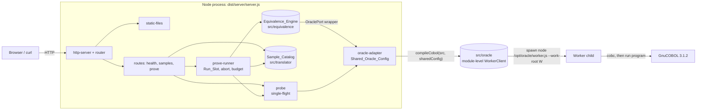
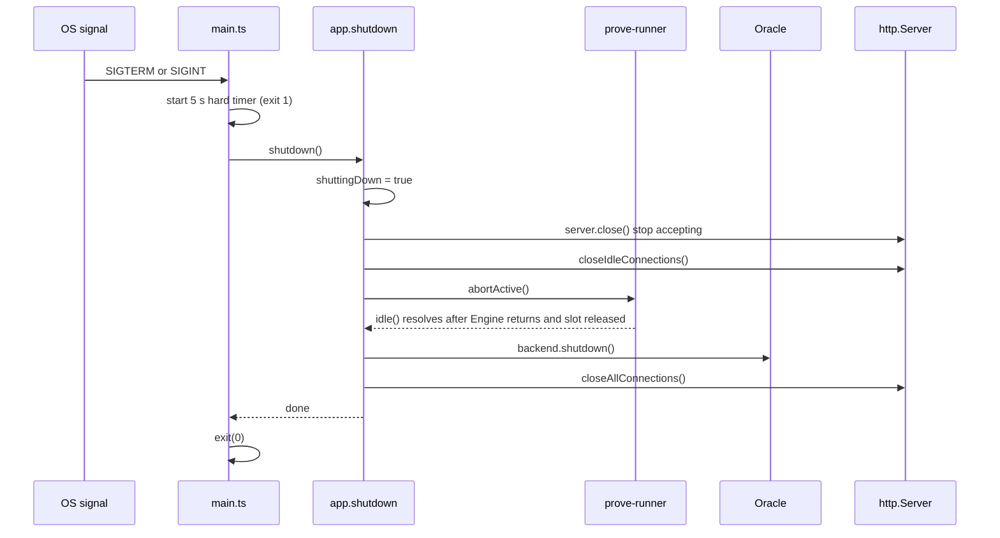
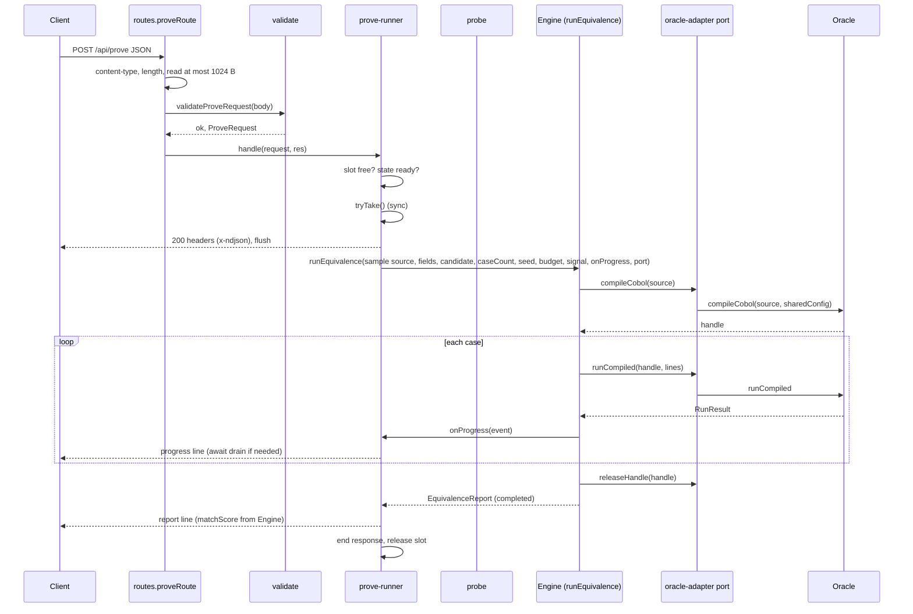
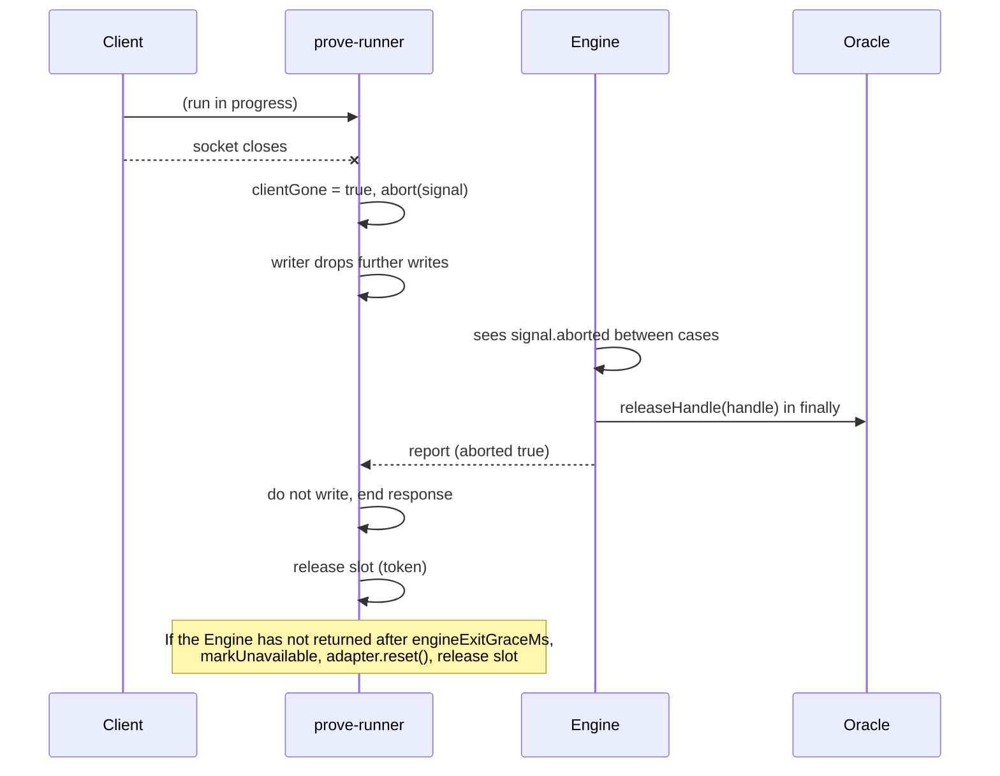
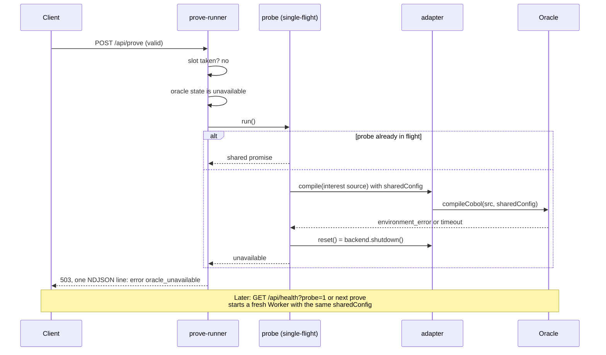
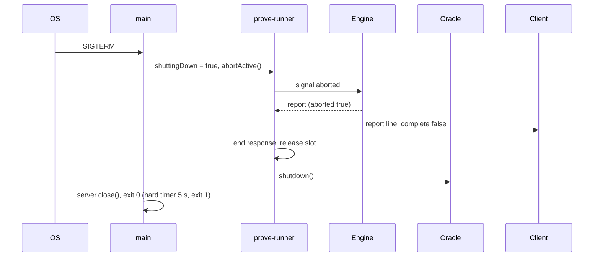

# Design Document: necromancer-server

## Overview

The Necromancer_Server is one plain Node 22 process built on `node:http`. It serves static files from `public/` and exposes four JSON endpoints over three existing modules that this spec does not modify: the Sample_Catalog (`src/translator/`), the Equivalence_Engine (`src/equivalence/`) and the Oracle (`src/oracle/`). It ships as one Docker image (`Dockerfile.app`) for Render's free tier.

Design goals, in priority order:

1. **The proof is real.** A `matchScore` leaves the server only inside a `report` event built from an Engine report with outcome `completed` after a real run. Progress events and error events cannot carry a score, by construction of their types and mappers.
2. **Nothing a user sends reaches the Oracle.** The request selects a catalog id and a variant. The COBOL text and the Candidate come from the catalog.
3. **Survive 512 MB.** One run at a time, one Worker child, backpressure on the stream, capped mismatch list, one probe at a time.
4. **No change outside `src/server/`.** The three existing modules stay untouched. All adaptation (shared Oracle config, bundling, paths) happens in new code.

### Verified facts about src/oracle in-image mode

These were read from the code, not assumed. Each one drives a design decision.

| Fact | Source | Consequence |
|---|---|---|
| `selectLauncher()` returns `DirectLauncher` iff `process.env.NECROMANCER_IN_ORACLE_IMAGE === "1"`, else `DockerLauncher`. It is called inside `getClient` when the client is first created. | `launcher.ts`, `handles.ts` | The image sets the env var. Tests without it use Docker mode. |
| `handles.ts` holds one module-level `client: WorkerClient \| null`, created by `client ??= new WorkerClient(selectLauncher(), cfg, noopLogger)` with the cfg of the **first** `compile`. Later configs never reach the Worker. `shutdownImpl` stops it and sets `client = null`. | `handles.ts` | Every `compileCobol` call must pass the same Shared_Oracle_Config (Req 16). `shutdown()` is also the way to reset a stuck Worker. |
| `compileCobol(source, config?)` is the only public call that takes a config. `runCompiled(handle, lines, opts?)`, `releaseHandle(handle)` and `shutdown()` take none. The registry stores the merged cfg per handle. | `index.ts`, `handles.ts` | Only `compileCobol` needs the wrapper. Req 16.3 is satisfied by one wrapper around that call. |
| `mergeConfig(partial)` returns a **new** object on every call (spreads defaults), so the object the Worker sees is not the object we pass. Only our reference is stable. | `config.ts` | "Same reference" tests observe the backend boundary (the fake's recorded argument), not the merged object. |
| `DirectLauncher.launch` runs `spawn(command, [...args, "--policy", base64], { stdio: ["pipe","pipe","inherit"], shell: false })` with `[command, ...args] = cfg.workerCommand` and no `env`, so the Worker inherits the server's environment and runs as the server's uid. Worker stderr goes to the server's stderr. | `direct-launcher.ts` | Worker logs appear in the container log. A non-root server gives a non-root Worker. `--work-root` must come from `workerCommand`. |
| `DEFAULT_CONFIG.workerCommand` is `["node", "/opt/oracle/worker.js"]`. The Worker uses `--work-root` or `"/work"` and calls `mkdir(workRoot, { recursive: true })`. | `config.ts`, `worker/main.ts` | A non-root user cannot create `/work`, so the server must pass `--work-root`. |
| The Worker compiles with `cobc -x -free -o <program> <source>` in a per-handle directory and runs `<dir>/<program>` from there. The child env is `{ ...policy.env, HOME: dir, TMPDIR: dir }`; `policy.env.PATH` is `/usr/local/bin:/usr/bin:/bin`. | `worker/server.ts`, `config.ts` | Work_Root must allow `exec`. cobc and its C compiler write temp files to the handle dir, so no separate TMPDIR directory is needed and `/tmp` may be read-only or `noexec`. |
| `RealChildSpawner` passes `uid`/`gid` to `spawn` only when the spec has them. Phase A's `server.ts` does not set them. | `worker/spawner.ts`, `worker/server.ts` | Phase A works as a non-root user. Phase B (per-slot uids from 20000) needs root or `CAP_SETUID` (see Risks). |
| `DockerLauncher` appends `cfg.workerCommand` after the image name, with `/work` as an `exec` tmpfs. | `docker-launcher.ts` | In Docker mode (developer machine, tests) the Work_Root passed to the adapter must be `/work`, a path inside the container. |
| The Engine calls `oracle.compileCobol(config.source)` with **one** argument, `oracle.runCompiled(compiled, lines, runOptions)`, and `oracle.releaseHandle(compiled)` in a `finally`. `onProgress` is awaited after every case. | `equivalence/run.ts` | The `OraclePort` handed to the Engine must be a wrapper that injects the shared config. Awaiting `onProgress` gives us backpressure for free. |
| `shrink.ts` imports `fast-check` at runtime. | `equivalence/shrink.ts` | The server bundle contains fast-check (a devDependency). This is allowed because esbuild bundles it and no `node_modules` ships (Req 11.5). It adds bundle size, not a runtime dependency. |
| `files.ts` resolves with `fileURLToPath(new URL("../../" + relative, import.meta.url))` and reads with `readFileSync`, caching per path. | `translator/files.ts` | The bundle must keep `import.meta.url` (ESM output) and live at `<App_Root>/dist/server/server.js`. |

## Architecture

### Process and module layout



### Files under `src/server/`

| File | Responsibility | Pure? |
|---|---|---|
| `config.ts` | `loadServerConfig(env)` validates `PORT`, `NECROMANCER_DEFAULT_CASE_COUNT`, `NECROMANCER_MAX_CASE_COUNT`, `NECROMANCER_TIME_BUDGET_MS`, `NECROMANCER_WORK_ROOT`. Returns a frozen `ServerConfig` or throws `ServerConfigError` naming the variable. | yes |
| `wire.ts` | TypeScript types of every JSON shape that leaves the server (`HealthBody`, `SampleSummary`, `SampleDetail`, `ProveRequest`, `ProgressWire`, `ReportWire`, `ErrorWire`). The only place that defines response keys. | types |
| `errors.ts` | `ErrorCode` union, `errorBody(code, message)`, the code-to-status table. | yes |
| `security-headers.ts` | `applySecurityHeaders(res)`; one list of constant headers. | yes |
| `body-reader.ts` | `checkJsonContentType`, `readBodyLimited(req, limit)`, `parseJsonObject(buffer)`. | I/O |
| `validate.ts` | `validateProveRequest(body: unknown, limits): Validation`. Pure and total. | yes |
| `static-files.ts` | `resolveStaticPath(urlPath, realRoot): string \| null` (pure) and `serveStatic(req, res, root)`. | mixed |
| `mappers.ts` | `toProgressWire`, `toReportWire`, `toEngineErrorWire`. Allowlist mappers; the only code that touches `EquivalenceReport`. | yes |
| `catalog-wire.ts` | `toSampleSummary`, `toSampleDetail` (explicit allowlist over `Sample` and `Translation`). | yes |
| `oracle-adapter.ts` | `createOracleAdapter({ backend, workRoot })`. Owns the Shared_Oracle_Config and the wrapper `OraclePort`. | yes |
| `probe.ts` | `createProbe(deps)`: single-flight, 15 s timeout, state machine for `Oracle_State`. | no (timers) |
| `cobc-version.ts` | `parseCobcVersion(stdout)` (pure) and `readCobcVersion(exec)`; one fixed `execFile`. | mixed |
| `workdir.ts` | `prepareWorkRoot(workRoot, fsPort)`: `mkdir -p`, write check, exec check. Called by `main.ts` only. | I/O |
| `prove-runner.ts` | `createProveRunner(deps)`: Run_Slot, AbortController, budget and backstop timers, stream writer, slot release. | no |
| `routes.ts` | `createHandler(app)`: route table, method checks, 404/405, top-level try/catch. | no |
| `app.ts` | `createApp(deps)` wires everything and returns `{ server, shutdown, state }`. No `process.*` access. This is the test entry. | no |
| `main.ts` | Reads `process.env`, runs `loadServerConfig`, `prepareWorkRoot`, `createApp`, `listen`, installs signal handlers. The only file that calls `process.exit`. | no |

### Dependency injection seams

`createApp` takes everything with a side effect as a parameter. `main.ts` passes the real implementations. Tests pass fakes.

```ts
import type { OraclePort } from "../equivalence/index.js";
import type { runEquivalence } from "../equivalence/index.js";
import type { PartialOracleConfig } from "../oracle/config.js";
import type { CompiledHandle, RunResult } from "../oracle/index.js";
import type { getSample, getTranslation } from "../translator/index.js";

/** What the adapter needs from the Oracle. The real value is `import * as oracle from "../oracle/index.js"`. */
export interface OracleBackend {
  compileCobol(source: string, config?: PartialOracleConfig): Promise<CompiledHandle | RunResult>;
  runCompiled(handle: CompiledHandle, inputLines: readonly string[], opts?: { runTimeoutMs?: number }): Promise<RunResult>;
  releaseHandle(handle: CompiledHandle): Promise<void>;
  isCompiledHandle(value: unknown): value is CompiledHandle;
  shutdown(): Promise<void>;
}

export interface ServerConfig {
  readonly port: number;
  readonly defaultCaseCount: number;   // default 1000
  readonly maxCaseCount: number;       // default 2000
  readonly timeBudgetMs: number;       // default 60000
  readonly workRoot: string;           // default $HOME/work
}

/** Timings that are not environment variables. Tests shrink them to milliseconds. */
export interface Timings {
  readonly abortBackstopGraceMs: number;   // 5000: abort at budget + grace
  readonly engineExitGraceMs: number;      // 5000: wait after abort before the timeout error
  readonly probeTimeoutMs: number;         // 15000
  readonly probeMinIntervalMs: number;     // 2000 in production, 0 in tests
  readonly shutdownDeadlineMs: number;     // 5000
}

export interface AppDeps {
  readonly config: ServerConfig;
  readonly timings: Timings;
  readonly backend: OracleBackend;                       // real oracle or a fake
  readonly engine: typeof runEquivalence;                // real Engine or a throwing fake
  readonly catalog: { getSample: typeof getSample; getTranslation: typeof getTranslation };
  readonly staticRoot: string;                           // realpath-able directory
  readonly cobcVersion: () => Promise<string | null>;    // real: single execFile; test: constant
  readonly logger: ServerLogger;                         // line sink; tests capture it
  readonly now: () => number;                            // uptime clock
}
```

Choices that matter for tests:

- **Fake Oracle port, real Engine and real Candidate (Req 13.2).** The test passes a fake `OracleBackend`. The adapter wraps it into the `OraclePort` for the real `runEquivalence`.
- **Small budget (Req 13.3).** Tests build `ServerConfig` directly with `timeBudgetMs: 50`. The 1000 ms floor lives in `loadServerConfig`, not in `ServerConfig`, so the floor stays tested separately. `Timings.abortBackstopGraceMs` and `engineExitGraceMs` are also small in tests.
- **Engine throw (Req 8.9).** The test passes `engine: () => Promise.reject(new Error("boom"))`.
- **Catalog throw (Req 6.5).** The test passes a `catalog` whose `getSample` throws.

## Components and Interfaces

### HTTP server and router (`app.ts`, `routes.ts`)

```ts
const server = http.createServer({ maxHeaderSize: 8192 }, handler);
server.headersTimeout = 15_000;
server.requestTimeout = 30_000;
server.keepAliveTimeout = 65_000;   // above common proxy idle timeouts; verify on Render
server.maxConnections = 64;         // bounds memory from idle sockets
```

`requestTimeout` covers receiving the request, not sending the response, so a 60 s NDJSON stream is not cut.

Per request, in this order:

1. `applySecurityHeaders(res)` runs first, before routing, so every class of response (static, JSON, stream, 4xx, 5xx, the catch-all) has the headers. `Content-Security-Policy: default-src 'self'`, `X-Content-Type-Options: nosniff`, `Referrer-Policy: no-referrer`, `X-Frame-Options: DENY`. No `Access-Control-*`. Node sends no `X-Powered-By` or `Server` header; the handler also calls `res.removeHeader` for both as a guard.
2. Split `req.url` at the first `?` into `rawPath` and `query`. A URL that does not start with `/` gets 404.
3. If `rawPath` is `/api` or starts with `/api/`: set `Cache-Control: no-store`, dispatch on the route table below. No match gives 404 JSON.
4. Otherwise: `serveStatic`.
5. The whole dispatch is inside `try/catch`. An exception logs `request failed` with the error name and message server-side and answers 500 `internal_error` if headers are not yet sent. If headers were sent, it destroys the socket.

Route table (exact match on the decoded pathname; no trailing-slash tolerance):

| Pattern | Methods | Handler |
|---|---|---|
| `/api/health` | GET | `healthRoute` |
| `/api/samples` | GET | `samplesListRoute` |
| `/api/samples/:id` | GET | `sampleDetailRoute` |
| `/api/prove` | POST | `proveRoute` |

A known route with another method gets 405 with `Allow` listing the allowed method. `OPTIONS` therefore gets 405 everywhere. `:id` is the single segment after `/api/samples/`, decoded once with `decodeURIComponent` inside `try` (a malformed escape gives 404), then compared with `SAMPLE_IDS.includes(id)`. There is no property lookup, so `__proto__` and `constructor` are plain unknown ids.

Request log: one line on `res.on("finish")` and on `res.on("close")` without finish: `GET /api/health 200 3ms`. Format arguments are values, not a format string. The query string and bodies are never logged.

### Static files (`static-files.ts`)

`resolveStaticPath(rawPath, realRoot)` is pure with respect to the filesystem apart from the final `realpath`. Steps:

1. `rawPath === "/"` maps to `index.html`.
2. Decode once with `decodeURIComponent` (error means 404). Never decode a second time.
3. Reject (404) if the decoded string contains `\0` or `\`, or if any segment is `..`, or if any segment starts with `.` (this also rejects `.`, `.git`, `.env`), or if the path ends with `/` (no directory index except `/`).
4. `candidate = path.join(realRoot, ...segments)`.
5. `real = await fs.realpath(candidate)`; reject unless `real.startsWith(realRoot + path.sep)`. This blocks symlinks that leave the root. A symlink that stays inside the root is served.
6. `stat(real).isFile()` must be true; directories get 404 (no listing).
7. Content-Type from a fixed table on `path.extname(real).toLowerCase()`:

| ext | type |
|---|---|
| html | `text/html; charset=utf-8` |
| css | `text/css; charset=utf-8` |
| js | `text/javascript; charset=utf-8` |
| json | `application/json; charset=utf-8` |
| svg | `image/svg+xml` |
| png | `image/png` |
| ico | `image/x-icon` |
| woff2 | `font/woff2` |
| txt | `text/plain; charset=utf-8` |
| other | `application/octet-stream` |

(Req 2.5 asks for `charset=utf-8` on text types. SVG is XML text; adding `; charset=utf-8` to `image/svg+xml` is harmless, and the implementation should do so for consistency with that requirement.)

`Cache-Control: no-cache` for `index.html`, `public, max-age=3600` for everything else. `GET` streams the file with `pipeline(createReadStream, res)`; `HEAD` sends the headers and `Content-Length` only. Other methods give 405 with `Allow: GET, HEAD`.

`realRoot` is computed once at startup (`await fs.realpath(staticRoot)`), so a symlinked `public/` itself is fine.

The placeholder `public/index.html` contains the app name and no `<script>`. The CSP `default-src 'self'` allows its inline `<style>` only if `style-src` permits it, so the placeholder uses no inline style either (see Risks for the later UI spec).

### Body reader and validation (`body-reader.ts`, `validate.ts`)

Order of checks in `proveRoute`, each before the Run_Slot is touched:

1. Method is POST (405 otherwise).
2. `Content-Type` matches `/^application\/json(?:\s*;\s*charset=utf-8)?$/i`, else 415.
3. `Content-Length` header, when present and greater than 1024, gives 413 with `Connection: close` and the body is never read.
4. Read at most 1024 bytes. Count bytes per chunk; when the total passes 1024, stop reading, answer 413 with `Connection: close`, and call `req.destroy()` on `res` `finish`. This covers chunked bodies and a lying `Content-Length`.
5. Decode with `new TextDecoder("utf-8", { fatal: true })` (invalid bytes give 400 `invalid_json`), `JSON.parse`, and require a plain object (`typeof === "object"`, not `null`, not an array). Else 400.
6. `validateProveRequest(body, { defaultCaseCount, maxCaseCount })`.

`validateProveRequest` is a total function over `unknown`:

```ts
export interface ProveRequest {
  readonly sampleId: SampleId;
  readonly variant: Variant;
  readonly caseCount: number;      // default applied
  readonly seed: number | undefined;
}

export interface ValidationFailure {
  readonly ok: false;
  readonly status: 400;
  readonly code: ErrorCode;        // "invalid_body" | "unknown_key" | "invalid_sample_id" | "invalid_variant" | "invalid_case_count" | "invalid_seed"
  readonly message: string;
}

export type Validation = { readonly ok: true; readonly value: ProveRequest } | ValidationFailure;

export interface CaseCountLimits {
  readonly min: 100;
  readonly default: number;
  readonly max: number;
}
```

Rules:

- `Object.keys(body)` (own enumerable keys, so a JSON `"__proto__"` key is just a key) must be a subset of `["sampleId","variant","caseCount","seed"]`. The first offender yields `unknown_key` with the key quoted via `JSON.stringify` and cut to 40 characters.
- `sampleId`: `typeof === "string"` and `SAMPLE_IDS.includes`. Message: `sampleId must be one of: interest, payroll, tax`.
- `variant`: same with `VARIANTS`.
- `caseCount`: absent gives the default. Present requires `typeof === "number"`, `Number.isSafeInteger`, and `min <= n <= max`. Message: `caseCount must be an integer from 100 to <max>`, with the max in force.
- `seed`: absent gives `undefined`. Present requires `Number.isInteger` in `[-2147483648, 2147483647]`. `-0` is normalized with `seed + 0`.
- Own-property read uses `Object.hasOwn(body, key)`, never `body[key] ?? default`, so `Object.prototype` members cannot supply a value.

The failure body is always `{"type":"error","code":...,"message":...}` with a 4xx status. It never has a score.

### Catalog wire mappers (`catalog-wire.ts`)

Explicit allowlist: each function builds a new object literal with named keys. It never spreads a catalog object. `Candidate` functions are not copied. `FieldDescriptor` fields are copied key by key (`name`, `digits`, `scale`, `signed`).

### Oracle adapter and the Shared_Oracle_Config (`oracle-adapter.ts`)

```ts
export interface OracleAdapter {
  /** The one config object. Frozen. Same reference on every compileCobol call. */
  readonly sharedConfig: Readonly<PartialOracleConfig>;
  /** Handed to runEquivalence as `oracle`. */
  readonly port: OraclePort;
  /** For the probe. Uses the same wrapper, so the same config. */
  readonly compile: (source: string) => Promise<CompiledHandle | RunResult>;
  readonly backend: OracleBackend;
  /** shutdown() on the backend. Resets the module-level Worker client. */
  readonly reset: () => Promise<void>;
}

export function createOracleAdapter(opts: { backend: OracleBackend; workRoot: string }): OracleAdapter {
  const sharedConfig: Readonly<PartialOracleConfig> = Object.freeze({
    workerCommand: Object.freeze(["node", "/opt/oracle/worker.js", "--work-root", opts.workRoot]),
  });
  const compile = (source: string): Promise<CompiledHandle | RunResult> =>
    opts.backend.compileCobol(source, sharedConfig);   // the ONLY compileCobol call site in src/server
  const port: OraclePort = {
    compileCobol: (source) => compile(source),         // a caller-supplied config is ignored
    runCompiled: (h, lines, o) => opts.backend.runCompiled(h, lines, o),
    releaseHandle: (h) => opts.backend.releaseHandle(h),
    isCompiledHandle: opts.backend.isCompiledHandle,
  };
  return { sharedConfig, port, compile, backend: opts.backend, reset: () => opts.backend.shutdown() };
}
```

Why this shape:

- **Created once, before the first probe.** `main.ts` calls `createOracleAdapter` once; `createApp` receives the adapter's backend and builds the adapter itself, so there is one adapter per app.
- **One call site.** A unit test greps `src/server/**/*.ts` for `compileCobol(` and expects exactly one match, in `oracle-adapter.ts`. The type `PartialOracleConfig` has `workerCommand?: readonly string[]`, so the frozen tuple type-checks without a cast.
- **Why it matters (Req 16.4).** `handles.ts` creates its Worker client from the first config it sees. A call without the shared config could start the Worker with `/work`, which a non-root user cannot create. A comment in `oracle-adapter.ts` records this.
- **Docker mode.** `workRoot` is a parameter. `main.ts` passes `config.workRoot` (`$HOME/work`). Integration tests on a developer machine run in Docker mode and pass `"/work"`, which is the tmpfs the `DockerLauncher` provides inside the container. Other `PartialOracleConfig` fields stay at the defaults.
- **`shutdown()` and `reset()`.** `shutdown()` takes no config, so it cannot violate Req 16.3. It stops the Worker, clears the handle registry and sets `client = null`, so the next `compileCobol` starts a fresh Worker with the same shared config. The server uses it (a) at process shutdown, (b) after a probe failure or timeout, and (c) after the Engine-exit timeout of Req 9.4.

### Probe (`probe.ts`)

```ts
export type OracleState = "ready" | "unavailable";

export interface ProbeController {
  readonly state: () => OracleState;
  /** Single-flight. Returns the last state when a Prove_Run is active. */
  readonly run: (opts?: { force?: boolean }) => Promise<OracleState>;
  readonly markUnavailable: () => void;
}
```

A probe is real end to end (Req 4.7):

1. `adapter.compile(getSample("interest").cobolSource)` through the same wrapper.
2. If the result is not a handle (`backend.isCompiledHandle` false), the probe fails.
3. `backend.runCompiled(handle, example.input)` with the first `examples[0]` pair of the sample.
4. Success only if `result.status === "ok"` and `result.stdout === example.output` (strict `===`, trailing newline included).
5. `releaseHandle(handle)` in `finally`.

Wrapper behavior:

- **Single flight.** `let inFlight: Promise<OracleState> | null`. Concurrent callers get the same promise. The promise is cleared in `finally`.
- **Timeout.** `Promise.race` with a 15 s timer (`Timings.probeTimeoutMs`). A timeout counts as `unavailable` and calls `adapter.reset()` so a hung Worker is replaced on the next probe.
- **Not during a Prove_Run.** If `slot.isTaken()`, return the last state without running anything.
- **Failure handling.** All exceptions are caught; the state becomes `unavailable`; only a short fixed reason string goes to the log (no stack, no path in any HTTP body). On a failed probe, `adapter.reset()` runs so a dead Worker client does not stay cached.
- **Exec check.** If `workdir.ts` reported that the Work_Root cannot execute files, the probe returns `unavailable` without calling the backend and logs the path and cause once.
- **Initial state** is `unavailable` until the first probe succeeds (Req 4.2).
- **Minimum interval.** A probe that finished less than `probeMinIntervalMs` (2000 ms) ago is not repeated for `?probe=1`; its result is returned. This bounds the compile rate an anonymous caller can force on a 512 MB instance. It still reflects a real probe from this process (Req 4.7). Tests set it to 0. This is the only place the design adds a rule beyond the requirements; see Decisions.

### cobc version (`cobc-version.ts`)

```ts
execFile("cobc", ["--version"], { timeout: 5000, maxBuffer: 16 * 1024, shell: false, windowsHide: true }, cb)
```

Fixed command, fixed args, called once at startup from `main.ts`, in the background. The first line is parsed with `/^cobc \(GnuCOBOL\) (\d+\.\d+\.\d+(?:\.\d+)?)/` to `"3.1.2.0"` style strings; anything else gives `null`. The health handler returns the cached value if settled and otherwise waits at most 1000 ms for the in-flight call, then reports `null`. The result is never recomputed.

### Work directory setup (`workdir.ts`)

`prepareWorkRoot(workRoot, fsPort)` runs in `main.ts` before the first probe:

1. `mkdir(workRoot, { recursive: true, mode: 0o700 })`. Failure exits non-zero with the path and error code in the message.
2. Write `<workRoot>/.necro-check-<pid>` with `#!/bin/sh\nexit 0\n`, mode `0o700`. Failure exits non-zero ("cannot write to").
3. `access(file, X_OK)`. On Linux, `access(2)` reports `EACCES` for a regular file on a `noexec` mount, so this detects the Docker `--tmpfs` default (`noexec`). The server does not execute the file, because Req 3.6 and 10.8 allow only the `cobc --version` call and the Worker. On failure: log `work root <path> does not allow executing files (noexec mount?)` and set `execAllowed = false` (the probe then fails, health shows `degraded`; the server stays up).
4. Remove the check file (best effort).

Directories the Server needs: only the Work_Root. The Worker sets `TMPDIR` to each handle directory under the Work_Root (verified above), so no separate TMPDIR is created. The server does not assume `/tmp` exists or is writable.

### Prove runner (`prove-runner.ts`)

```ts
export interface RunSlot {
  /** Synchronous: returns true and takes the slot, or returns false. */
  readonly tryTake: () => boolean;
  readonly release: () => void;   // idempotent per take
  readonly isTaken: () => boolean;
}

export interface ProveRunner {
  /** Handles a validated request on `res`. Never throws. */
  readonly handle: (req: ProveRequest, res: ServerResponse, sock: ClientLink) => Promise<void>;
  readonly abortActive: () => void;
  /** Resolves when no run is active. */
  readonly idle: () => Promise<void>;
}
```

`tryTake` is a plain `if (taken) return false; taken = true; return true;`. JavaScript runs it to completion, so two requests cannot both win (Req 9.1). `release` is guarded by a per-run token: `const token = Symbol()`, `release(token)` clears the slot only if the token matches, so double release is a no-op and a late release from a timed-out run cannot free a newer run's slot (Req 9.2).

`handle` algorithm (all paths funnel into one `finally`):

1. If `shuttingDown`: respond 503 `shutting_down` JSON (before any slot).
2. If `slot.isTaken()`: respond 429 with `Retry-After: 5` and code `busy`. This early check keeps a probe from starting while a run is active.
3. If `probe.state() === "unavailable"`: `await probe.run()` (single-flight). If it is still unavailable, respond 503 with one NDJSON `error` line, code `oracle_unavailable`, and stop. The slot is not held during this await.
4. `if (!slot.tryTake())`: respond 429 (another request won during the await). Check and take are one synchronous step, so two simultaneous requests cannot both win.
5. Build `sample = catalog.getSample(sampleId)`, `translation = catalog.getTranslation(sampleId, variant)`. These are the only COBOL text and Candidate used (Req 7.10).
6. `res.writeHead(200, { "Content-Type": "application/x-ndjson; charset=utf-8", "Cache-Control": "no-store", "X-Accel-Buffering": "no" }); res.flushHeaders();`
7. `const ac = new AbortController()`. Register `res.on("close")` and `req.on("close")`: if the final event is not written yet, set `clientGone = true` and `ac.abort()`.
8. Timers: `backstop = setTimeout(() => ac.abort(), timeBudgetMs + abortBackstopGraceMs)`.
9. Call the Engine:

```ts
const options: EquivalenceOptions = {
  source: sample.cobolSource,
  fields: sample.fields,
  candidate: translation.candidate,
  caseCount: req.caseCount,
  ...(req.seed !== undefined ? { seed: req.seed } : {}),
  timeBudgetMs: config.timeBudgetMs,
  signal: ac.signal,
  onProgress: (e) => writer.progress(toProgressWire(e)),
  oracle: adapter.port,
};
```

10. Race the Engine promise against an "exit watchdog": when `ac.signal` aborts, start `setTimeout(engineExitGraceMs)`; if the Engine has not returned, write the `error` event `timeout`, `markUnavailable()`, `adapter.reset()` (stops the stuck Worker so a stale Engine call fails fast), and go to `finally`.
11. On Engine result: map by `outcome`:
    - `completed` with `matchScore` defined: `report` event (`toReportWire`).
    - `inconclusive`: `error` event, code `inconclusive`.
    - `oracle_unavailable`: `error` event, code `oracle_unavailable`; also `probe.markUnavailable()`.
    - `completed` without `matchScore` (impossible per `buildReport`): `error` event `internal_error`.
12. On Engine throw: log the cause, write `error` event (`engine_config` for `EquivalenceConfigError`, else `internal_error`), generic message.
13. `finally`: clear both timers, `writer.end()` (no write after the final event; `res.end()` once), `slot.release(token)`.

**Stream writer.** One object per run:

```ts
interface NdjsonWriter {
  progress(e: ProgressWire): void | Promise<void>;   // returns a promise only when backpressure applies
  final(e: ReportWire | ErrorWire): void;            // writes once, then closes the writer
  end(): void;
}
```

- `write(line)`: if `closed || clientGone`, drop silently (Req 9.3).
- `const ok = res.write(JSON.stringify(event) + "\n")`. When `ok === false`, `progress` returns a promise resolved by `res.once("drain")` or `res.once("close")` (so a vanished client cannot hang the Engine).
- `final` sets `closed = true` before writing so nothing can follow it.
- `JSON.stringify` output never contains a raw newline, so one event is exactly one line.

**Client disconnect** sets `clientGone`, aborts the signal, and the Engine returns an aborted report. The runner does not write it. The slot releases after the Engine returns (Req 9.3). If the Engine does not return within `engineExitGraceMs` of the abort, the watchdog path of step 10 applies (the log line is written, the socket is already gone).

**Shutdown** sets `shuttingDown`, then `abortActive()`; the in-flight run (if the client is still connected) ends with a partial `report` (`aborted: true`, `complete: false`), and `idle()` resolves.

### Mappers (`mappers.ts`)

Wire types are defined in `wire.ts`. The mappers read named properties and build new literals.

```ts
export interface ProgressWire {
  readonly type: "progress";
  readonly completed: number;
  readonly target: number;
  readonly group: string;
  readonly matched: number;
  readonly mismatches: number;
  readonly inconclusive: number;
}
export function toProgressWire(e: ProgressEvent): ProgressWire {
  return { type: "progress", completed: e.completed, target: e.target, group: e.group,
           matched: e.matched, mismatches: e.mismatches, inconclusive: e.inconclusive };
}
```

`ProgressWire` has no key whose name contains `score`. `ErrorWire` has exactly `type`, `code`, `message`. `toReportWire(report, echo)` requires `report.outcome === "completed"` and `report.matchScore !== undefined` (otherwise it throws, and the runner turns the throw into `internal_error`). It does not read `inconclusiveCases`, `oracleMessage`, `oracleStatus`, `shrinkOracleCalls` or `containsInconclusive`. It sets `complete = !report.aborted && !report.budgetReached`.

### Shutdown (`app.ts`, `main.ts`)



A second signal during shutdown is ignored. The hard timer is `unref`'d only after it is cleared on success.

## Data Models

### Server_Config

| Variable | Default | Rule |
|---|---|---|
| `PORT` | 10000 | integer string, 1..65535 |
| `NECROMANCER_DEFAULT_CASE_COUNT` | 1000 | `100 <= v <= NECROMANCER_MAX_CASE_COUNT` |
| `NECROMANCER_MAX_CASE_COUNT` | 2000 | `v <= 100000` (and `>= DEFAULT`, via the default's rule) |
| `NECROMANCER_TIME_BUDGET_MS` | 60000 | `1000 <= v <= 3600000` |
| `NECROMANCER_WORK_ROOT` | `$HOME/work` | non-empty absolute path |

All numeric values must match `/^[0-9]+$/` and be safe integers; an unset or empty variable uses the default. The cross-field rule produces an error that names the variable the rule is written on: setting only `NECROMANCER_MAX_CASE_COUNT=500` fails with a message naming `NECROMANCER_DEFAULT_CASE_COUNT` (default 1000 exceeds the max), and the message says to set both. `PORT` is read by the same function (Req 1.3), so one place formats these errors: `ServerConfigError("NECROMANCER_TIME_BUDGET_MS must be an integer from 1000 to 3600000, got \"abc\"")`. Values echoed in messages are cut to 40 characters. Only these variable names and values are ever logged (Req 15.6). The abort backstop is `timeBudgetMs + timings.abortBackstopGraceMs`.

### Endpoint JSON shapes

All JSON is UTF-8. Errors everywhere use `{"type":"error","code":string,"message":string}`.

**`GET /api/health`** (200 always):

```json
{ "status": "ok", "oracle": "ready", "cobcVersion": "3.1.2.0", "uptimeMs": 12345 }
```

`status` is `"degraded"` and `oracle` is `"unavailable"` when the last probe failed or none finished. `cobcVersion` is `string | null`.

**`GET /api/samples`** (200): array of three, order `interest`, `payroll`, `tax`:

```json
[{ "id": "interest", "name": "INTEREST", "trapLabel": "…", "defaultInput": ["1000", "5", "3"] }]
```

**`GET /api/samples/:id`** (200):

```json
{
  "id": "interest", "name": "INTEREST", "trapLabel": "…",
  "cobolSource": "…file text…",
  "fields": [{ "name": "principal", "digits": 7, "scale": 2, "signed": false }],
  "curses": [{ "id": "…", "label": "…", "lines": [12, 13] }],
  "fidelityPact": ["…"],
  "examples": [{ "input": ["1000","5","3"], "output": "…\n" }],
  "defaultInput": ["1000", "5", "3"],
  "translations": [
    { "variant": "correct",
      "source": "…file text…",
      "provenance": { "label": "Pre-generated with Kiro", "generatedWith": "Kiro", "date": "YYYY-MM-DD" },
      "markers": [{ "curseId": "…", "line": 20 }] },
    { "variant": "subtle", "…": "…" },
    { "variant": "naive", "…": "…" }
  ]
}
```

`translations` always has exactly three entries in the order `correct`, `subtle`, `naive`. There is no `candidate` key anywhere.

**`POST /api/prove`** request body (at most 1024 bytes, `Content-Type: application/json`):

```json
{ "sampleId": "interest", "variant": "naive", "caseCount": 1000, "seed": 42 }
```

`caseCount` and `seed` are optional. Responses:

- Validation or limit failure: 4xx, JSON error body (not a stream).
- 429 busy: JSON error body, `Retry-After: 5`.
- 503 oracle unavailable (probe failed): `Content-Type: application/x-ndjson`, one line `{"type":"error","code":"oracle_unavailable","message":"…"}`.
- 200 stream (`application/x-ndjson; charset=utf-8`): zero or more progress lines, then exactly one final line.

Progress line:

```json
{"type":"progress","completed":120,"target":1000,"group":"standard computation","matched":118,"mismatches":2,"inconclusive":0}
```

Report line (final):

```json
{
  "type": "report",
  "sampleId": "interest", "variant": "naive", "caseCount": 1000,
  "matchScore": 0.973,
  "complete": true,
  "casesRun": 1000, "conclusiveCount": 1000, "matchedCount": 973, "mismatchCount": 27,
  "groups": [{ "group": "field overflow behavior", "conclusive": 250, "matched": 240, "inconclusive": 0 }],
  "mismatches": [{ "input": ["9999999.99","99.99","99"], "oracleOutput": "…", "candidateOutput": "…", "group": "field overflow behavior" }],
  "mismatchListTruncated": true,
  "shrunkExamples": [{ "group": "…", "input": ["…"], "oracleOutput": "…", "candidateOutput": "…", "limitReached": false }],
  "inconclusiveCount": 0,
  "inconclusiveByStatus": {},
  "seed": 42, "elapsedMs": 8123, "aborted": false, "budgetReached": false
}
```

`caseCount` in the report is the echoed requested value; `casesRun` is the Engine's count. `shrunkExamples` is copied field by field (`group`, `input`, `oracleOutput`, `candidateOutput`, `limitReached`). `inconclusiveCases` is never included.

Error line (final):

```json
{"type":"error","code":"inconclusive","message":"No conclusive case ran."}
```

## Error Handling

| Situation | HTTP | `code` | `message` (fixed text, no user input except the named field) |
|---|---|---|---|
| Any exception in a handler before headers | 500 | `internal_error` | `Internal server error.` |
| Catalog read failure on `/api/samples*` | 500 | `internal_error` | `Internal server error.` (cause logged) |
| Unknown path under `/api/` | 404 | `not_found` | `No such endpoint.` |
| Unknown sample id | 404 | `not_found` | `No such sample.` |
| Unsafe or unknown static path | 404 | `not_found` | `Not found.` |
| Method not allowed on a known path | 405 | `method_not_allowed` | `Method not allowed.` plus `Allow` header |
| `POST /api/prove` wrong content type | 415 | `unsupported_media_type` | `Content-Type must be application/json.` |
| Body over 1024 bytes (header or streamed) | 413 | `payload_too_large` | `Request body must be at most 1024 bytes.` (`Connection: close`) |
| Invalid UTF-8 or JSON, or not an object | 400 | `invalid_json` / `invalid_body` | `Body must be a JSON object.` |
| Unknown body key | 400 | `unknown_key` | `Unknown key "<key>". Allowed: sampleId, variant, caseCount, seed.` |
| Bad `sampleId` | 400 | `invalid_sample_id` | `sampleId must be one of: interest, payroll, tax.` |
| Bad `variant` | 400 | `invalid_variant` | `variant must be one of: correct, subtle, naive.` |
| Bad `caseCount` | 400 | `invalid_case_count` | `caseCount must be an integer from 100 to <max>.` |
| Bad `seed` | 400 | `invalid_seed` | `seed must be an integer from -2147483648 to 2147483647.` |
| Run_Slot taken | 429 | `busy` | `A proof is already running. Try again soon.` (`Retry-After: 5`) |
| Oracle unavailable after re-probe | 503 | `oracle_unavailable` | `The oracle is not available.` (NDJSON, one line) |
| Shutdown in progress | 503 | `shutting_down` | `The server is shutting down.` |
| Engine outcome `inconclusive` (in stream) | 200 | `inconclusive` | `No conclusive case ran.` |
| Engine outcome `oracle_unavailable` (in stream) | 200 | `oracle_unavailable` | `The oracle failed during the run.` |
| `EquivalenceConfigError` (in stream) | 200 | `engine_config` | `The run was rejected.` |
| Other Engine throw (in stream) | 200 | `internal_error` | `Internal server error.` |
| Engine did not return after abort + grace (in stream) | 200 | `timeout` | `The run did not stop in time.` |
| Probe failure | 200 (health) | n/a | `oracle: "unavailable"`, no detail |

Stream errors keep status 200 because headers are already sent. Messages never include stderr, paths, stack traces or Oracle text.

## Build and Deployment Design

### `build:server` (esbuild)

Add to `package.json` scripts:

```json
"build:server": "esbuild src/server/main.ts --bundle --platform=node --target=node22 --format=esm --outfile=dist/server/server.js --sourcemap=external"
```

Choices:

- **ESM, not CJS.** `import.meta.url` must survive so `files.ts` resolves `../../<relative>` from `dist/server/server.js` to `<App_Root>`. In CJS esbuild replaces `import.meta` with an empty object and the paths break, so no `--define` workaround is used (Req 1.8).
- **Entry is `main.ts`**, which imports `createApp` and the real modules. Because `createApp` has no top-level side effects, tests import `app.ts` directly without the bundle.
- **Worker stays a separate CJS bundle.** `dist/worker.js` is built by the existing `build:worker` script (`--format=cjs`) and installed at `/opt/oracle/worker.js`. The server never imports the Worker; the Oracle starts it as a child with `node /opt/oracle/worker.js`. Two outputs, two scripts, no cross-dependency. The image build runs both.
- **Dependencies are bundled.** `decimal.js` (a dependency) and `fast-check` (used by `generate.ts` and `shrink.ts`) are inlined. If esbuild reports a CJS `require` of a Node built-in in the ESM output ("Dynamic require of … is not supported"), the fix is the standard banner `--banner:js="import { createRequire } from 'node:module'; const require = createRequire(import.meta.url);"`. The bundle test (13.11) is what finds this, since it runs the bundle outside the source tree.
- **Source maps** are written next to the bundle (`server.js.map`) but not copied to the final image (the final stage copies only `server.js`, to keep the image small and avoid leaking source paths).

### Static imports and translation source text

`src/translator/translations/registry.ts` imports the nine translation modules statically, so esbuild includes the nine `candidate` functions in the bundle. That keeps working: no dynamic `import()` is involved. At runtime `catalog.ts` also reads each translation's **file text** with `readFileSync` from `<App_Root>/src/translator/translations/<id>.<variant>.ts`, plus `cobol-samples/<id>.cbl`, for the UI to display. These files are not part of the bundle and must exist in the image (Req 11.4). The bundled functions and the on-disk text come from the same build context, so they cannot drift inside one image. Bundling changes nothing in `src/translator/`.

### Layout rule

```
<App_Root>/
  dist/server/server.js          <- new URL("../../" + rel, import.meta.url) resolves to <App_Root>/rel
  public/
  cobol-samples/*.cbl
  src/translator/translations/*.ts
```

In the image `<App_Root>` is `/app`. The worker is at `/opt/oracle/worker.js`.

### `Dockerfile.app` (multi-stage)

```dockerfile
# Stage 1: build the two bundles on the same pinned Node image the Oracle image uses.
FROM node:22.11.0-bookworm-slim@sha256:f035ba7ffee18f67200e2eb8018e0f13c954ec16338f264940f701997e3c12da AS build
WORKDIR /build
COPY package.json package-lock.json tsconfig.json ./
RUN npm ci
COPY src/ ./src/
RUN npm run build:worker && npm run build:server

# Stage 2: runtime. GnuCOBOL 3.1.2 from the Ubuntu 24.04 archive, Node copied from stage 1.
FROM ubuntu:24.04
RUN apt-get update \
 && apt-get install -y --no-install-recommends gnucobol libstdc++6 \
 && rm -rf /var/lib/apt/lists/*

COPY --from=build /usr/local/bin/node /usr/local/bin/node
COPY --from=build --chmod=0555 /build/dist/worker.js /opt/oracle/worker.js

# Fixed non-root identity. HOME and the default Work_Root exist at build time.
RUN groupadd --gid 10001 necro \
 && useradd --uid 10001 --gid 10001 --home-dir /home/necro --create-home \
            --shell /usr/sbin/nologin necro \
 && mkdir -p /home/necro/work \
 && chown -R 10001:10001 /home/necro \
 && chmod 0700 /home/necro/work

WORKDIR /app
COPY --from=build /build/dist/server/server.js ./dist/server/server.js
COPY public/ ./public/
COPY cobol-samples/ ./cobol-samples/
COPY src/translator/translations/ ./src/translator/translations/

ENV NODE_ENV=production \
    PORT=10000 \
    HOME=/home/necro \
    NECROMANCER_IN_ORACLE_IMAGE=1
EXPOSE 10000

HEALTHCHECK --interval=30s --timeout=5s --start-period=10s --retries=3 \
  CMD ["node", "-e", "fetch('http://127.0.0.1:'+(process.env.PORT||'10000')+'/api/health').then(r=>process.exit(r.status===200?0:1),()=>process.exit(1))"]

USER 10001:10001
CMD ["node", "dist/server/server.js"]
```

Notes:

- The pinned image reference is the same tag and digest as the Oracle `Dockerfile`, as Req 11.2 asks. The `useradd` line uses a fixed uid 10001 with a `nologin` shell (Req 10.6). Ubuntu 24.04 ships a `ubuntu` user at uid 1000, so 10001 does not collide.
- `$HOME/work` exists at build time (owner 10001, mode 0700) **and** `main.ts` runs `mkdir -p` at every start (Req 10.3), so a fresh `--tmpfs` or volume mount over it also works.
- The healthcheck has no `curl` (not in the image) and succeeds on HTTP 200 regardless of `oracle` (Req 11.8). Node 22 has global `fetch`.
- No `node_modules`, `tests/`, `.kiro/`, `docs/` or other `src/` files are in the final stage. `COPY src/translator/translations/ …` copies only the nine `.ts` files and `registry.ts`, which are read as text or ignored.
- The Oracle `Dockerfile` is untouched.
- `COPY` from the build context keeps file modes from the checkout, and the files must be readable by uid 10001. The implementation should use `COPY --chmod=a+rX` (or `chmod -R a+rX /app`) on the data directories so a restrictive checkout mode cannot make the catalog unreadable.

Run commands (documented in `docs/kiro-log.md`):

```bash
docker build -f Dockerfile.app -t necromancer-app .
docker run --rm -p 10000:10000 necromancer-app
# /tmp as a default Docker tmpfs (noexec): Work_Root is not on it, so the oracle stays ready.
docker run --rm -p 10000:10000 --tmpfs /tmp necromancer-app
# Read-only root, Work_Root on an exec tmpfs owned by the app user.
docker run --rm -p 10000:10000 --read-only --tmpfs /tmp \
  --tmpfs /home/necro/work:rw,exec,nosuid,uid=10001,gid=10001,mode=0700,size=128m necromancer-app
```

Each of these must reach `oracle: "ready"` within the probe time. A script `scripts/check-app-image.sh` runs the last two and polls `/api/health?probe=1`.

### `.dockerignore`

Current content excludes `node_modules`, `dist`, `.git`, `.kiro`, `docs`, `tests`, `coverage`, `cobol-samples/bin`, `*.log`, `.env`, `.env.local`. For a multi-stage build that compiles inside the image:

- `src/`, `public/`, `tsconfig.json`, `package.json`, `package-lock.json`, `cobol-samples/*.cbl` are **not** excluded. No pattern matches them today.
- `dist` stays excluded: the build stage creates `/build/dist` itself, so a stale local `dist/` cannot leak in.
- `tests` and `docs` stay excluded: the build uses esbuild, which does not read `tests/`. (`tsc` is not run in the image, so `tsconfig.json`'s `include` of `tests/**` is harmless; esbuild reads only `compilerOptions`.)
- No lines are removed. Optional additions that reduce context size and do not conflict: `deploy-test`, `scripts`, `Dockerfile`, `Dockerfile.app`. The Oracle image build needs `src/oracle/...` and `cobol-samples/`, which remain.

`deployment.test.ts` parses this file with the conservative parser (a pattern matches at any depth and everything below). Any new ignore pattern must therefore avoid the names `public`, `translations`, `cobol-samples/*.cbl` and the nine translation files.

### Test plan for `tests/translator/deployment.test.ts` (Req 11.10)

Resolve the TODO by deleting it and adding a `describe("deployment: Dockerfile.app")` block that reads `Dockerfile.app` and asserts with regexes on the text of the **final stage** (split the file on the last `^FROM ` line):

- final stage has `COPY cobol-samples/ ./cobol-samples/` and `COPY src/translator/translations/ ./src/translator/translations/` (with `WORKDIR /app`); and `COPY public/ ./public/`;
- `COPY --from=build … /build/dist/server/server.js ./dist/server/server.js` (resolves to `/app/dist/server/server.js`);
- `/opt/oracle/worker.js` appears as the destination of the worker copy with `--chmod=0555`;
- `CMD ["node", "dist/server/server.js"]` (exec form);
- `NECROMANCER_IN_ORACLE_IMAGE=1` in an `ENV`;
- a `USER` line whose value is not `root` and not `0`;
- the final stage contains no `COPY . .` and no `COPY . ` of the whole repository, and no `node_modules`;
- `HEALTHCHECK` present, `EXPOSE 10000`, `ENV … PORT=10000`, `WORKDIR /app`;
- base images: first `FROM` contains `node:22.11.0-bookworm-slim@sha256:`, final `FROM ubuntu:24.04`;
- the Oracle `Dockerfile` assertion stays as it is;
- `.dockerignore` parsed with the existing `parseIgnoreRules`/`isIgnored`: `public`, `public/index.html`, the three `.cbl` files and every file listed with `readdirSync("src/translator/translations")` are not ignored.

### Steering edits (Req 12)

`tech.md`: replace the "Front end" and "Back end" lines:

- `Front end: static files in public/ served by the Node server. Styling: Tailwind CSS (build output or CDN-free static CSS). Design source: Figma. The UI technology is decided in the UI spec.`
- `Back end: one plain Node server (node:http, built with esbuild into dist/server/server.js). No web framework.`
- `Deployment: Render free Docker web service (Dockerfile.app), one container that holds the server, the Worker and GnuCOBOL.`

`structure.md`: add `/src/server/` (HTTP server, routes, prove runner, oracle adapter), `/public/` (static UI files served by the server), `Dockerfile.app` (app image) and a note that `Dockerfile` is the Oracle test image; replace the `/src/app/ UI (Next.js)` line with `/public/`. No other lines or files change.

## Security Analysis

| Threat | Control |
|---|---|
| Path traversal in static files | Single decode, reject NUL, `\`, `..`, dot segments, trailing `/`; `realpath` prefix check against the real root; directories 404; symlink escape fails the prefix check. |
| Directory listing, dotfile leak | No listing code; dot segments rejected. |
| Prototype keys (`__proto__`, `constructor`) | Sample ids compared with `Array.includes`; body keys read with `Object.keys` and `Object.hasOwn`; `JSON.parse` makes `__proto__` an own data property. |
| Oversized or slow bodies | 1024-byte cap by header and by counting; `requestTimeout` 30 s, `headersTimeout` 15 s, `maxHeaderSize` 8 KB, `maxConnections` 64. |
| Header injection | No response header is built from request data. `Allow` and `Retry-After` are constants. |
| Slowloris | `headersTimeout` and `requestTimeout` drop incomplete requests. |
| Code or command injection | No `eval`, `new Function`, `vm`, shell. Fixed `execFile("cobc", ["--version"])`. Request fields only select catalog entries; they never enter a COBOL string, path, command or log format string. A static-scan unit test greps `src/server` for those tokens. |
| Cross-origin use | No CORS headers, `OPTIONS` gets 405, CSP `default-src 'self'`, `X-Frame-Options: DENY`. |
| Information leak | Generic 500 body; stack and paths only in server logs; reports exclude Oracle stderr, messages and `inconclusiveCases`. Only five env values are ever logged. |
| Abuse of probe/compile | Single-flight probe, 2 s minimum interval, no probe during a run, one run at a time with 429. |
| Oracle Phase A caveat (Req 10.9) | The Oracle currently has no per-program uid, no `prlimit`, no network isolation. This is acceptable only because the sole COBOL ever compiled is `getSample(id).cobolSource` for three fixed repository files. This reliance is recorded here and in `docs/kiro-log.md`. Any future "upload COBOL" feature must first finish Oracle Phase B and is out of scope. |

## Resource Analysis (512 MB, free tier)

- **Processes.** The server (Node, bundle with decimal.js and fast-check) plus one Worker child plus, during a compile, `cobc` and its C compiler, and during a case, one tiny COBOL program. Compile happens once per run (and once per probe), never concurrently with another run because of the Run_Slot and the "no probe during a run" rule. Actual peak figures are measured and recorded in `docs/kiro-log.md` (Req 11.9); this design does not assume them.
- **Stream memory.** `res.write` buffering is bounded by backpressure: the Engine awaits `onProgress`, which waits for `drain` once the socket buffer is full. At the maximum `caseCount` of 2000 the stream is about 2000 short lines.
- **Report size.** The mismatch list is capped by the Engine (`DEFAULT_MISMATCH_LIST_CAP = 25`); `shrunkExamples` is at most four entries. `inconclusiveCases` is dropped.
- **Connections.** `maxConnections = 64`; one long stream at a time.
- **Cold start.** Render's free tier sleeps the service when idle. On wake the process must listen quickly: `main.ts` creates the Work_Root, starts listening, then starts `cobc --version` and the first probe in the background. Health reports `degraded` until the probe finishes (compile takes on the order of seconds). The UI polls `/api/health` and treats a prove request that arrives during this window by waiting on the single-flight probe (Req 8.11), so the first click after wake works without an extra step. A cold-start `prove` can take the probe time plus the run time; the 60 s budget starts when the run starts, not when the request arrives.
- **Time budget.** Default 60 s is below Render's request limits for a streamed response because bytes flow throughout; `X-Accel-Buffering: no` asks proxies not to buffer.

## Sequence Diagrams

### Prove run (normal)



### Client abort



### Probe, 503 path and recovery



### Shutdown during a run



## Correctness Properties

*A property is a characteristic or behavior that should hold true across all valid executions of a system-essentially, a formal statement about what the system should do. Properties serve as the bridge between human-readable specifications and machine-verifiable correctness guarantees.*

Prework reflection: several criteria collapse into shared properties. Validation, no-slot and no-Oracle-call for bad requests are one property (Property 2). Report allowlist, score pass-through and `complete` flag are one mapper property (Property 8), while the progress and error mappers each get their own property because they guard the central "no score without a real run" rule. The path rules for static files and `/api/` 404s stay separate because they test different code. Items that are one-shot configuration or image facts (Dockerfile text, non-root user, startup time, memory) are example, smoke or integration tests and are listed in the Testing Strategy, not here.

### Property 1: Environment configuration is validated totally

*For any* map of environment variables, `loadServerConfig` either returns a config in which `100 <= defaultCaseCount <= maxCaseCount <= 100000`, `1000 <= timeBudgetMs <= 3600000` and `1 <= port <= 65535` (with defaults 10000, 1000, 2000, 60000 for unset or empty variables), or throws an error whose message names the offending variable; and any value that is not an unsigned base-10 integer string (signs, spaces, decimal points, exponents) is rejected.

**Validates: Requirements 1.3, 15.1, 15.2, 15.3, 15.4**

### Property 2: Prove request validation is total and side-effect free on rejection

*For any* HTTP body bytes and any `Content-Type` and `Content-Length`, `POST /api/prove` handling either yields a `ProveRequest` whose `sampleId` and `variant` are catalog values, whose `caseCount` is an integer in `[100, maxCaseCount]` and whose `seed` is absent or an int32, or yields a 4xx JSON `{type:"error",code,message}` (not a stream, no score) after which the Run_Slot was never taken and the Oracle backend recorded zero calls. Any unknown key is rejected with its name in the message.

**Validates: Requirements 7.1, 7.2, 7.3, 7.4, 7.5, 7.6, 7.7, 7.8**

### Property 3: Static path resolution never leaves the Static_Root

*For any* request path string (including encoded `..`, NUL, backslash, dot segments, absolute paths and symlinks planted in a temp root), the static server either answers 404 or serves a regular file whose real path lies inside the real Static_Root and has no dot-prefixed segment; it never lists a directory.

**Validates: Requirements 2.3, 2.4**

### Property 4: Security headers appear on every response

*For any* request (any method, any path, any headers, any body) that receives a response, the response has `Content-Security-Policy: default-src 'self'`, `X-Content-Type-Options: nosniff`, `Referrer-Policy: no-referrer` and `X-Frame-Options: DENY`, has no header whose name starts with `Access-Control-`, has no `X-Powered-By` header and no `Server` header, and every `/api/` response has `Cache-Control: no-store`.

**Validates: Requirements 3.1, 3.2, 3.3, 3.4**

### Property 5: Unknown API paths and unknown sample ids are 404 JSON

*For any* string `s`, `GET /api/samples/<s>` where `s` is not one of `interest`, `payroll`, `tax` (including `__proto__`, `constructor`, `toString`, encoded and malformed escapes) answers 404 with a JSON error body, and *for any* path under `/api/` that is not a defined endpoint the answer is 404 JSON and never `index.html`.

**Validates: Requirements 2.8, 6.4**

### Property 6: Sample responses are allowlisted data

*For any* catalog sample id, and *for any* catalog object carrying extra enumerable properties (functions, `candidate`, unknown keys), the JSON for `GET /api/samples` and `GET /api/samples/:id` contains exactly the documented keys, contains no function and no `candidate` key after `JSON.parse`, lists exactly three translations in the order `correct`, `subtle`, `naive`, and each `source` equals the text of the matching file on disk.

**Validates: Requirements 5.1, 5.2, 5.3, 6.1, 6.2, 6.3**

### Property 7: Progress events never carry a score

*For any* object shaped like a `ProgressEvent`, including objects with extra properties such as `matchScore` or `score`, `toProgressWire` returns an object with exactly the keys `type`, `completed`, `target`, `group`, `matched`, `mismatches`, `inconclusive`, and every progress line written during any run has no key containing `score` (case-insensitive).

**Validates: Requirements 8.3**

### Property 8: Report mapping is an allowlist that passes the Engine's score through

*For any* `EquivalenceReport` with outcome `completed` (including extra properties such as `inconclusiveCases`, `oracleMessage`, `oracleStatus` and arbitrary strings that look like paths or stack traces), `toReportWire` returns an object with exactly the documented key set, `matchScore` strictly equal to the input's `matchScore`, `complete` equal to `!aborted && !budgetReached`, no `inconclusiveCases` key, and no value containing the input's `oracleMessage`.

**Validates: Requirements 8.5, 8.6, 8.7, 8.12**

### Property 9: Only a completed Engine outcome can produce a score, and error events never contain one

*For any* `EquivalenceReport` outcome in `completed | inconclusive | oracle_unavailable` and *for any* thrown error value, the final line of the stream is a `report` only when the outcome is `completed` with a defined `matchScore`; in every other case it is exactly `{type:"error",code,message}` with no `matchScore`, `score` or count keys, and the code is one of the documented codes.

**Validates: Requirements 8.8, 8.9, 8.10, 4.7**

### Property 10: NDJSON framing

*For any* completed run with any `caseCount`, `seed`, variant and any sequence of fake Oracle results, the response body is a sequence of lines each ending in `\n` and each valid JSON, with only `progress` lines before one final `report` or `error` line, nothing after the final line, and `progress` events appear in the order the Engine produced them (non-decreasing `completed`).

**Validates: Requirements 8.1, 8.2, 8.4**

### Property 11: Run_Slot is taken and released exactly once on every exit path

*For any* sequence of prove requests and exit paths (report, inconclusive, Engine throw, client disconnect, budget, abort, backstop timeout, shutdown) with any interleaving, the slot is held by at most one run at a time, a request that arrives while it is held gets 429 with `Retry-After`, the number of releases equals the number of successful takes, and the slot is free once all runs have ended.

**Validates: Requirements 9.1, 9.2, 9.3, 9.4, 9.6**

### Property 12: Every compiled handle is released

*For any* run that obtains a handle from the fake Oracle and ends through any exit path (normal, abort, budget, Engine throw, client disconnect), `releaseHandle` is called exactly once for that handle, and the fake Oracle has no live handles after the run ends.

**Validates: Requirements 9.5**

### Property 13: Only catalog COBOL and the catalog Candidate reach the Oracle

*For any* valid `ProveRequest` (and any extra keys that were rejected earlier), every `source` the fake backend receives in `compileCobol` is equal to `getSample(sampleId).cobolSource` for the requested id, and the Candidate the Engine invokes is `getTranslation(sampleId, variant).candidate`.

**Validates: Requirements 7.10**

### Property 14: Every Oracle compile call uses the one frozen Shared_Oracle_Config

*For any* interleaving of probes (start-up, `?probe=1`, re-probe after failure) and prove runs, every `compileCobol` call the fake backend records has a second argument that is `toBe` (same reference) the adapter's `sharedConfig`; `sharedConfig` and its `workerCommand` are frozen; `workerCommand` equals `["node", "/opt/oracle/worker.js", "--work-root", workRoot]`; and no recorded call has an undefined config.

**Validates: Requirements 10.2, 16.1, 16.2, 16.3, 16.5**

### Property 15: Oracle_State is `ready` only after a real, matching probe

*For any* fake backend behavior (compile failure of any status, a non-handle value, a run with any status, stdout that differs from the documented output by any edit, a thrown error, a hang past the probe timeout), the probe returns `ready` if and only if compilation produced a handle and the run returned status `ok` with stdout strictly equal to the first example's output; `GET /api/health` then reports `oracle: "ready"` and `status: "ok"` exactly when the state is `ready`, and `oracle: "unavailable"` and `status: "degraded"` otherwise, with HTTP status 200 in both cases, and concurrent probes make exactly one backend compile call.

**Validates: Requirements 4.1, 4.2, 4.3, 4.6, 4.7, 4.8**

### Property 16: Logs never contain request bodies or the query string

*For any* request body bytes and query string, every line the logger receives for that request contains neither the body text (when longer than the method, path and status tokens) nor the query string.

**Validates: Requirements 1.6, 15.6**

## Testing Strategy

PBT applies to the validators, mappers, config parser, path resolution, the Run_Slot and handle-release accounting, and the adapter, because these are pure or fake-backed logic with large input spaces. It does not apply to the Dockerfile, the steering files, the non-root user or image memory; those use example, text-assertion and integration tests.

### Tooling and tagging

- Vitest and fast-check (already in `devDependencies`). Each property is one `fc.assert(fc.property(...), { numRuns: 100 })` or more; HTTP-level properties use `fc.asyncProperty` with `numRuns` between 100 and 200 against an in-process server on port 0.
- Each property test carries a tag comment: `// Feature: necromancer-server, Property N: <title>`.
- New tests live in `tests/server/`. Only `tests/translator/deployment.test.ts` is modified outside it.
- No `it.skip`, `describe.skipIf`, `it.runIf`, `test.todo` and no early `return` on a missing dependency in new tests (Req 13.8).

### Test layout

| File | Content | Requirements |
|---|---|---|
| `config.test.ts` | Property 1; every default; each invalid value names its variable; cross-field cases (MAX alone below default 1000; DEFAULT above MAX; MAX 100001; budget 999 and 3600001; `PORT` `0`, `65536`, `"80a"`, `" 80"`, `"+80"`, `"1e3"`) | 1.3, 13.12, 15 |
| `validate.test.ts` | Property 2 (validator part): arbitrary `fc.jsonValue()`, plus arbitrary objects with random keys including `__proto__`; example per rule | 7.3 to 7.8, 13.5 |
| `prove-validation.http.test.ts` | Property 2 (HTTP part) with `fc.uint8Array()` bodies, random content types and lengths; 415, 413 by header, 413 by streamed body (chunked, lying length), 400 per field and unknown key; asserts slot free and fake backend call count 0 | 7.1, 7.2, 13.1, 13.5 |
| `static.test.ts` | Property 3 on a temp `public/` with a planted symlink out of the root and a dotfile; type table example per extension; HEAD, 405 with `Allow`; cache headers; placeholder has no `<script>` | 2.x, 13.1 |
| `headers.test.ts` | Property 4 (arbitrary method, path, header values, body), covering static, JSON, stream, 404, 405, 413 and 500 classes; `/api/` `Cache-Control` | 3.x, 13.1 |
| `routes.test.ts` | Properties 5, 6; samples list shape; sample detail has no function or `candidate` key; `source` equals file text; throwing catalog gives generic 500 and logs the cause; 405 with `Allow` | 5, 6, 1.7, 13.4 |
| `mappers.test.ts` | Properties 7, 8, 9 (mapper part) over generated `ProgressEvent` and `EquivalenceReport` values with extra properties | 8.3, 8.5 to 8.10, 8.12 |
| `prove-run.test.ts` | Properties 9 (stream part), 10, 13; fake Oracle backend, real Engine and real Candidate; stream is valid NDJSON; `progress` first; exactly one final; report has every field of Req 8.5; 503 on unavailable with single error line and no `matchScore` in the body; Engine throw; backpressure with a slow reader | 8.x, 13.2, 13.3 |
| `concurrency.test.ts` | Properties 11, 12; second request while one runs gets 429 and first still completes; slot reusable afterwards; client disconnect aborts and the fake sees no further `runCompiled` calls; budget run gives `complete: false`; backstop timeout path with `Timings` of a few ms; shutdown aborts and ends the stream; no run after shutdown begins (503) | 9.x, 13.3 |
| `shared-config.test.ts` | Property 14 with a recording fake backend, `toBe` identity, `Object.isFrozen` on config and `workerCommand`, `workerCommand` value, no call with undefined config; static grep that `compileCobol(` appears once in `src/server` | 16.x, 10.2, 13.13 |
| `probe.test.ts` | Property 15 with scripted fake behaviors, single-flight (two concurrent probes, one compile call), no probe during a run, 15 s timeout with fake timers, no stack or path in health body, `cobcVersion` parsing (`parseCobcVersion`) and caching (exec fake called once) | 4.x |
| `logging.test.ts` | Property 16; request log format; only allowed env names logged | 1.6, 15.6 |
| `workdir.test.ts` | `prepareWorkRoot` with a temp dir and an injected fs port: creates nested dirs, fails with a clear message on write error, flags a non-executable root | 10.3 to 10.5 |
| `static-scan.test.ts` | Greps `src/server/**/*.ts` for `eval(`, `new Function`, `node:vm`, `exec(`, `shell: true`, `Access-Control`, and for child-process usage other than the one fixed `execFile("cobc", ["--version"]` | 3.6, 10.8 |
| `bundle.test.ts` | Runs `npm run build:server` (fails, not skips, on a build error), copies `dist/server/server.js` into a temp App_Root laid out like the image (`dist/server/`, `cobol-samples/`, `src/translator/translations/`, `public/`), starts it as a child process on a free port with `NECROMANCER_WORK_ROOT` in the temp dir, requests `/api/samples/interest`, asserts `cobolSource` and the three translation `source` values equal the on-disk files and are non-empty, and that no data copy exists next to the bundle. The oracle will be `unavailable` here, which the test accepts since it checks `/api/samples` and `/api/health` shape only | 1.8, 13.11 |
| `integration.test.ts` | Real Oracle through HTTP (below) | 13.6, 13.7, 13.8 |

### Real-Oracle integration tests (Req 13.6 to 13.8)

One file, so one module-level Oracle client and one Worker per vitest worker process (the Oracle's state is process-global):

- `beforeAll`: run a **preflight** that throws an `Error` naming the missing piece. In Docker mode (`NECROMANCER_IN_ORACLE_IMAGE` not `1`): `docker version` succeeds, else `"Docker daemon is not running or not reachable"`; `docker image inspect necromancer-oracle` succeeds, else `"Oracle_Image 'necromancer-oracle' is missing: run docker build -t necromancer-oracle ."`. In in-image mode: `cobc --version` succeeds and `/opt/oracle/worker.js` exists, else `"cobc not found"` or `"worker bundle /opt/oracle/worker.js missing"`. A thrown `beforeAll` fails every test in the file (no skip).
- The server is created with `createApp` using the real backend (`import * as oracle`), a real catalog and real Engine, with `workRoot: "/work"` in Docker mode. `afterAll`: `await app.shutdown()` (calls `oracle.shutdown()`).
- Tests: `interest/correct` with a fixed `seed` and `caseCount` 300 gives `matchScore === 1` and `complete: true`; `interest/naive` gives `matchScore < 1` and a non-empty `mismatches` list in which every item has `input`, `oracleOutput`, `candidateOutput`, `group`; `interest/subtle` gives `0 < ... < 1`, strictly above the naive score for the same seed (the assertion is `naive < subtle < 1`); `GET /api/health?probe=1` reports `oracle: "ready"` and `cobcVersion` starting with `3.1.2`.
- Timeouts are set per test (`caseCount` sized to finish within the vitest timeout, as the Oracle suite already does).

### Image-level checks (not part of `npm test`)

`scripts/check-app-image.sh` builds `Dockerfile.app` and runs the three `docker run` configurations from the Dockerfile section, polling `/api/health?probe=1` until `oracle:"ready"` or failing after 60 s, then prints the image size and `docker stats` memory at idle and during a 2000-case run. Results go into `docs/kiro-log.md` (Req 11.9, 14).

### Completion gate (Req 13.10)

`npm run typecheck`, `npm run lint`, `npm test` and `scripts/run-samples.sh` must pass before the work is declared done.

## Decisions

1. **ESM bundle.** Needed to keep `import.meta.url`. Rejected: CJS with `--define:import.meta.url`, forbidden by Req 1.8.
2. **One `compileCobol` call site.** Encapsulating the config in `oracle-adapter.ts` makes Req 16.3 checkable by grep and removes the risk of a second config. Rejected: passing the config through each caller.
3. **`adapter.reset()` uses `shutdown()`.** It is the only Oracle API that clears the stuck client without touching `src/oracle/`. The cost: handles of a still-running stale Engine call are dropped, which is the intent.
4. **Probe minimum interval of 2 s (addition).** Not in the requirements. It protects a 512 MB instance from a loop on `?probe=1`. It can be removed by setting `probeMinIntervalMs` to 0, and the requirements do not conflict because the returned value is still a real recent probe.
5. **Stream errors keep HTTP 200.** Headers are already sent when the Engine reports `inconclusive` or `oracle_unavailable`. Only the pre-stream 503 (Req 8.11) uses a non-200 status with the NDJSON content type.
6. **`cobcVersion` waits at most 1 s.** Avoids a slow `cobc --version` delaying the health check that Render uses.
7. **Exec check uses `access(X_OK)`.** It avoids a third child process. The probe, which really runs the compiled program, remains the final authority.

## Risks / things to watch

- **Docker `--tmpfs` is `noexec` by default.** `--tmpfs /tmp` is fine because the Work_Root is elsewhere. Anyone who points `NECROMANCER_WORK_ROOT` at a default tmpfs gets `degraded` with a log line naming the path. The image test configurations include an `exec` tmpfs mount for the Work_Root.
- **Oracle Phase B conflicts with non-root.** Phase B spawns programs with `uid = 20000 + slot` (see `SandboxPolicy.uidBase` and `SpawnSpec.uid`). `child_process.spawn` with `uid` requires root or `CAP_SETUID`; a non-root server cannot do that. When Phase B lands, either the app image runs the Worker as root with the server as non-root (two processes with different identities, not possible with the direct launcher as written), or Phase B must provide a different isolation mechanism. This spec's non-root design is valid only for Phase A and must be revisited then.
- **The Oracle keeps one Worker, created from the first config.** Mitigated by the single adapter and the single call site. Also, there is no Worker restart inside the Oracle; the server's `reset()` after a failed probe or timeout is the only recovery.
- **Process-global Oracle state in tests.** Real-Oracle tests must live in one file, create one app, and call `shutdown()` in `afterAll`. Two test files in parallel each start their own Worker (and in Docker mode, their own container); on small machines this is slow but correct. Fake-backend tests do not touch the real module.
- **CSP vs Google Fonts (later UI spec).** `default-src 'self'` blocks fonts and styles from `fonts.googleapis.com` and `fonts.gstatic.com`, and blocks inline styles and scripts. The steering requires Cinzel and JetBrains Mono. The UI spec must either self-host the font files in `public/` (compatible with the current CSP) or relax `style-src` and `font-src` deliberately. This spec does not change the CSP.
- **Keep-alive and the Render proxy.** `keepAliveTimeout` is set above typical proxy idle timeouts to avoid reused-closed-socket errors; confirm on Render.
- **fast-check in the production bundle.** It is a devDependency used by Engine runtime code. Bundling is what keeps Req 1.1 and 11.5 true. If the bundle is much larger than expected, measure idle RSS; do not move it to `dependencies` without a decision.
- **Stale Engine after the exit-grace timeout.** The slot is released while a stuck Oracle call may still be running. `reset()` kills the Worker, which makes that call fail; the next request re-probes first. A rare overlap is possible in the window before the reset completes.
- **Leftover handle directories.** The Worker removes its directories at shutdown. After a hard kill, leftovers stay in the Work_Root until the container filesystem is recreated. On Render each deploy and wake starts from a fresh filesystem, so no sweep is built; revisit if the Work_Root moves to a persistent volume.