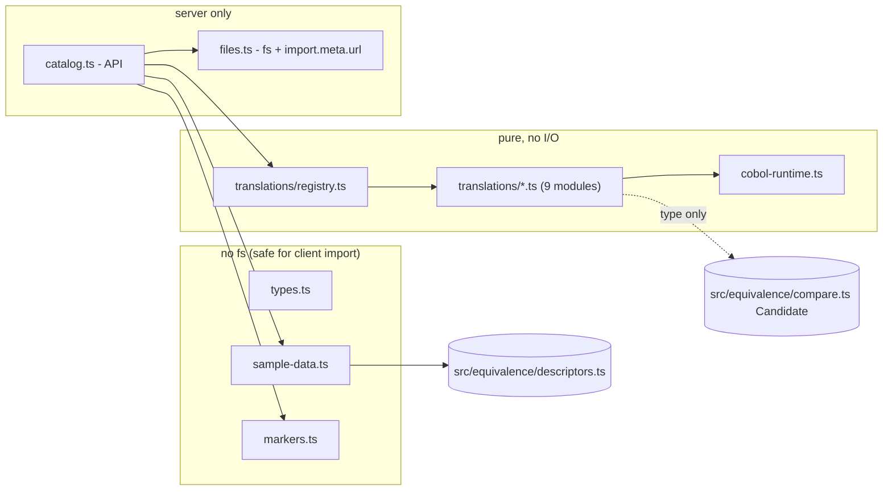

# Design Document

## Overview

The Sample_Catalog is a server-side module set in `src/translator/`. It serves three kinds of data:

1. **Static sample data** (names, trap labels, curses, fidelity pacts, example pairs). No I/O.
2. **Nine pre-generated translations** (`interest|payroll|tax` x `correct|subtle|naive`), each a plain TypeScript module exporting a `Candidate` and a `Provenance`.
3. **Text read from disk** (the three `.cbl` files and the nine translation files) so the UI shows exactly what runs.

A small read-only API (`listSamples`, `getSample`, `getTranslation`) joins these. Nothing in `src/translator/` runs the Oracle or the engine. The Oracle only appears in `tests/translator/`, which calls the existing `runEquivalence`.

Decisions that shape the design:

- **The module cannot contain its own source text.** Keeping a string copy next to the code would duplicate it and let the two drift. So a translation module exports only `candidate` and `provenance`. The catalog reads the module's own file from disk and fills `Translation.source`. Requirement 4.2 is met by the catalog record `Translation`, not by the module alone. A test compares `source` with the file bytes (Req 4.3).
- **A small COBOL runtime library is shared.** `cobol-runtime.ts` holds the primitives every faithful translation needs (NUMVAL, truncate, round half away from zero, store into an unsigned field, Z-edit). `correct` and `subtle` import it. This keeps each translation file short and readable, and makes `subtle` differ from `correct` by one visible line. `naive` does not use it, because it is the "first attempt".
- **Static data and file access are in separate modules.** A client component can import types and curse data without pulling in `fs` (Req 1.3c).

## Architecture



Dependency rules, checked by a test (Req 4.7):

- `src/translator/**` never imports from `tests/` or `src/oracle/`.
- It imports from `src/equivalence/` only `Candidate` (type) and `INTEREST`, `PAYROLL`, `TAX`, `FieldDescriptor` from `descriptors.ts`. Import `descriptors.js` directly, not the `index.js` barrel (the barrel pulls in the whole engine).
- `types.ts`, `sample-data.ts`, `markers.ts`, `cobol-runtime.ts` and `translations/**` never import `node:*`.

### Plain TypeScript rule for translation modules

Translation modules (`translations/*.ts`) and the runtime (`cobol-runtime.ts`) must stay plain TypeScript. The app server may be a plain Node server, so these files must not depend on a framework or a bundler:

- No `next/*` imports, no `server-only` or `client-only` packages, no `"use server"` / `"use client"` directives.
- No bundler-specific import forms: no `?raw` / `?url` suffixes, no `import.meta.glob`, no `require.context`, no path aliases (`@/...`), no `webpack*` / `vite*` / `esbuild` imports or magic comments.
- Only relative imports with the `.js` extension (NodeNext style), `decimal.js`, and type-only imports from `../equivalence/compare.js` and `../equivalence/descriptors.js`.
- No `process`, `Buffer`, or other Node globals; the translations are pure functions of their input lines.

Only `files.ts` may use Node APIs (`node:fs`, `node:url`, `import.meta.url`), and it uses nothing else. A static scan in `catalog.test.ts` enforces the list above on `translations/**` and `cobol-runtime.ts` (Req 4.5, 4.7). Where a framework needs special handling (for example file tracing for an image), it is configured outside `src/translator/`.

### File layout

```
src/translator/
  types.ts                  SampleId, Variant, Curse, ExamplePair, Provenance, Sample, Translation, CurseMarker
  sample-data.ts            per-sample static data (SampleData, without cobolSource)
  markers.ts                extractCurseMarkers(source) -> CurseMarker[]
  cobol-runtime.ts          Decimal primitives (decimal.js, no floats)
  files.ts                  server-only: repoPath(), readRepoText(), cached
  catalog.ts                listSamples, getSample, getTranslation
  index.ts                  re-exports the API and the types
  translations/
    registry.ts             static imports of the 9 modules -> Record<SampleId, Record<Variant, Entry>>
    interest.correct.ts   interest.subtle.ts   interest.naive.ts
    payroll.correct.ts    payroll.subtle.ts    payroll.naive.ts
    tax.correct.ts        tax.subtle.ts        tax.naive.ts
tests/translator/
  catalog.test.ts           no Oracle: shape, curses, markers, provenance, API, immutability, source identity, static scans
  deployment.test.ts        no Oracle: .dockerignore does not exclude the .cbl files
  interest-copies.test.ts   no Oracle: 200 seeded vectors, copies vs originals
  translations.property.test.ts   no Oracle: fast-check properties
  oracle.test.ts            real Oracle: example pairs, Standard_Run x 9, ordering, groups
```

`.kiro/steering/structure.md` gets two lines (Req 11.3):

```
/src/translator/   pre-generated sample translations (3 samples x correct/subtle/naive), sample catalog and read-only API
/tests/translator/ catalog unit tests, property tests, and real-Oracle verification
```

The first line replaces the existing `/src/translator/   COBOL -> TypeScript generation` line only in wording, keeping "COBOL -> TypeScript" so the original intent stays: `/src/translator/   COBOL -> TypeScript translations: pre-generated samples, catalog and read-only API`.

## Types (`types.ts`)

```ts
import type { Candidate } from "../equivalence/compare.js";
import type { FieldDescriptor } from "../equivalence/descriptors.js";

export type SampleId = "interest" | "payroll" | "tax";
export type Variant = "correct" | "subtle" | "naive";
export const SAMPLE_IDS: readonly SampleId[] = ["interest", "payroll", "tax"];
export const VARIANTS: readonly Variant[] = ["correct", "subtle", "naive"];

export interface Curse {
  readonly id: string;
  readonly label: string;               // <= 32 chars
  readonly lines: readonly number[];    // 1-based COBOL line numbers
}

export interface ExamplePair {
  readonly input: readonly string[];    // one ACCEPT line per field
  readonly output: string;              // exact DISPLAY text, trailing newline included
}

export interface Provenance {
  readonly label: "Pre-generated with Kiro";
  readonly generatedWith: "Kiro";
  readonly date: string;                // YYYY-MM-DD
}

export interface SampleData {           // static, no fs
  readonly id: SampleId;
  readonly name: "INTEREST" | "PAYROLL" | "TAX";
  readonly trapLabel: string;
  readonly fields: readonly FieldDescriptor[];
  readonly defaultInput: readonly string[];
  readonly examples: readonly ExamplePair[];
  readonly fidelityPact: readonly string[];
  readonly curses: readonly Curse[];
}

export interface Sample extends SampleData { readonly cobolSource: string; }

export interface CurseMarker { readonly curseId: string; readonly line: number; }

export interface TranslationModule {    // what each translations/*.ts exports
  readonly candidate: Candidate;
  readonly provenance: Provenance;
}

export interface Translation extends TranslationModule {
  readonly sampleId: SampleId;
  readonly variant: Variant;
  readonly source: string;              // file text, read from disk
  readonly markers: readonly CurseMarker[];
}
```

Every translation module has the same two exports, named `candidate` and `provenance`. Each file is typed `export const candidate: Candidate = ...` and `export const provenance: Provenance = {...}`.

## Static data (`sample-data.ts`)

`SAMPLE_DATA: Readonly<Record<SampleId, SampleData>>`. The `fields` come from `INTEREST`, `PAYROLL`, `TAX` in `descriptors.ts` by reference.

Default inputs are the first Example_Pair of each sample (Req 1.5): `["1000","5","3"]`, `["45","20.55"]`, `["300000"]`.

Example pairs (from `cobol-samples/EXPECTED.md`; widths come from the pictures, and are cross-checked by a test that parses EXPECTED.md):

| Sample | Input | Output string |
|---|---|---|
| interest | 1000, 5, 3 | `"BALANCE:    1157.63\n"` |
| interest | 1234.56, 7.25, 10 | `"BALANCE:    2485.95\n"` |
| interest | 9000000, 50, 3 | `"BALANCE: 7875000.00\n"` |
| payroll | 45, 20.55 | `"GROSS:    976.13\nDEDUCT:     74.67\nNET:    901.46\n"` |
| payroll | 32.5, 18.99 | `"GROSS:    617.18\nDEDUCT:     47.21\nNET:    569.97\n"` |
| tax | 300000 | `"TAX:     2500\n"` |
| tax | 750000 | `"TAX:    62500\n"` |
| tax | 2000000 | `"TAX:   412500\n"` |

The EXPECTED.md cross-check parses the markdown tables: rows `| a / b / c | \`TEXT\` ... |`, and for PAYROLL the three back-ticked segments in one cell are joined with `\n`. The parser lives in the test file. It trims the label and prose after the closing back-tick (for example the overflow comment in the INTEREST row). If the file format changes, the test fails loudly (it asserts the number of pairs found per sample).

Trap labels (Req 1.6): `"per-year rounding and silent overflow"`, `"overtime and truncated deduction"`, `"progressive brackets"`.

Fidelity pacts (3 to 4 statements, each at most 80 characters):

- interest: "Rounds half away from zero at every year, not once at the end", "Drops high-order digits when the balance passes 9,999,999.99", "Reads years as PIC 99 and stores negatives as absolute values", "Prints BALANCE exactly as Z(6)9.99 with a trailing newline".
- payroll: "Pays hours over 40 at 1.5x", "Rounds regular and overtime pay to cents at each COMPUTE", "Truncates the 7.65% deduction instead of rounding it", "Prints GROSS, DEDUCT and NET as Z(5)9.99, one per line".
- tax: "Taxes only the slice of income inside each bracket", "Takes the first matching EVALUATE branch only", "Rounds tax half away from zero to whole units", "Prints TAX as Z(7)9 with a trailing newline".

Curses are exactly the table in Requirement 3.3. Chip labels (at most 32 characters): "per-year rounding", "silent field overflow", "PIC 99 years", "overtime over 40 at 1.5x", "per-COMPUTE rounding", "deduction truncated, not rounded", "Z(5)9.99 output format", "progressive brackets", "EVALUATE first match", "whole-unit rounding". The longest, "deduction truncated, not rounded", has 32 characters.

Everything is built with `Object.freeze` recursively (a small `deepFreeze` helper in `sample-data.ts`), so a caller cannot change the data (Req 9.5).

### Curse keyword guard (Req 3.5)

The test holds a table `curseId -> keywords` and asserts that at least one of the curse's lines contains one keyword (case-sensitive substring of the COBOL line):

| Curse id | Keywords |
|---|---|
| interest-yearly-rounding | `ROUNDED`, `PERFORM VARYING` |
| interest-overflow | `PIC 9(7)V99`, `ROUNDED` |
| interest-years-pic99 | `PIC 99`, `WS-YEARS` |
| payroll-overtime | `> 40`, `1.5` |
| payroll-compute-rounding | `ROUNDED` |
| payroll-deduct-truncated | `0.0765` |
| payroll-z-format | `PIC Z(5)9.99`, `DISPLAY` |
| tax-brackets | `WHEN` |
| tax-evaluate-first-match | `EVALUATE` |
| tax-whole-unit-rounding | `PIC 9(8)`, `ROUNDED` |

Check against the current files: interest line 16 is `PIC 99`, line 17 `PIC 9(7)V99`, line 30 `ROUNDED`; payroll line 29 `IF WS-HOURS > 40`, 37 has `1.5`, 39 has `0.0765`, 22 has `PIC Z(5)9.99`; tax line 13 `PIC 9(8)`, 19 `EVALUATE TRUE`, 20 `WHEN`. Line 28 of tax is `END-EVALUATE`, which contains `EVALUATE`. The `payroll-overtime` list also uses line 37, which contains `* 1.5`.

## File access (`files.ts`)

```ts
import { readFileSync } from "node:fs";
import { fileURLToPath } from "node:url";

const REPO_ROOT = fileURLToPath(new URL("../../", import.meta.url));   // src/translator/ -> repo root
export function repoPath(relative: string): string { return fileURLToPath(new URL(`../../${relative}`, import.meta.url)); }
export function readRepoText(relative: string, what: string): string   // throws with `what` + resolved path
```

- Paths come from `import.meta.url`, never from `process.cwd()` (Req 1.3a). With `NodeNext` and `"type": "module"` this works under Vitest and under Node.
- `readRepoText` caches by path in a `Map`, so each file is read once per process. Cached text is a string, so it cannot be changed by callers.
- On failure it throws `Error("Cannot read <what> at <resolved path>: <cause message>")`. `<what>` is `COBOL source for sample "interest"` or `translation source for "interest/subtle"` (Req 1.3b, 12.5). It never returns an empty string.
- Reading is lazy: the first `getSample` / `getTranslation` call reads. A missing file therefore fails at the call that needs it, with the right name in the message.

Translation file paths are `src/translator/translations/<sampleId>.<variant>.ts`. Under a compiled build the module is `.js`; the app image decision is open (see Risks). The catalog resolves the `.ts` file in the repo because this build ships TypeScript sources (the app runs through Next.js or tsx), and Requirement 12 requires the image to contain `cobol-samples/` only. If the app image does not ship `src/translator/translations/*.ts`, the source text cannot be shown. This is recorded as a deployment risk and a task for the app image (see Requirement 12.3).

## API (`catalog.ts`)

```ts
export function listSamples(): readonly Sample[];
export function getSample(id: SampleId): Sample;
export function getTranslation(sampleId: SampleId, variant: Variant): Translation;
```

- Argument types are the literal unions. At runtime each function checks the value against `SAMPLE_IDS` / `VARIANTS` and throws `Error('Unknown sample id "x". Valid ids: interest, payroll, tax')` or `Error('Unknown variant "x". Valid variants: correct, subtle, naive')` (Req 9.2 to 9.4). Non-string values are reported with `String(value)`.
- Records are built once per process on first use and cached in a `Map`. They are `Object.freeze`d, with nested arrays frozen. Two calls return the same frozen object, so they are equal (Req 9.5). The `candidate` function itself is not copied.
- The API only builds data. It never calls `runEquivalence`, never calls a Candidate, and never starts the Oracle (Req 9.6).
- Markers: `getTranslation` calls `extractCurseMarkers(source)` from `markers.ts` (Req 5.5). The regex is `/\/\/\s*CURSE:([a-z0-9-]+)/g`, applied per line, giving `{ curseId, line }` with a 1-based line number. A line with two markers gives two records.

## COBOL runtime (`cobol-runtime.ts`)

All values are `Decimal` from an isolated clone with `precision: 60`, so `rate / 100` and products stay exact for these field sizes. No `number` is used for a field value.

```ts
export type Dec = InstanceType<typeof D>;
export function numval(text: string): Dec;                              // trim, parse plain decimal text; unparseable -> 0
export function truncTo(value: Dec, scale: number): Dec;                // ROUND_DOWN to scale (toward zero)
export function roundTo(value: Dec, scale: number): Dec;                // ROUND_HALF_UP to scale (half away from zero)
export function storeUnsigned(value: Dec, digits: number, scale: number): Dec;  // truncate, abs, mod 10^digits
export function wrap(value: Dec, digits: number): Dec;                  // mod 10^digits (silent overflow)
export function zEdit(value: Dec, integerPositions: number, scale: number): string; // leading zeros -> spaces, last integer position always a digit
export function display(prefix: string, edited: string): string;        // `${prefix}${edited}\n`
```

Notes on correctness:

- `ROUND_HALF_UP` in decimal.js rounds half away from zero (it rounds ties away from zero for both signs), which is the COBOL `ROUNDED` default. Stored fields are unsigned, so values reaching `roundTo` are non-negative anyway.
- `storeUnsigned` is `truncTo` then `abs()` then `mod(10^digits)`. This matches the COBOL rules in the steering file: truncation to the field scale, absolute value for unsigned fields, high-order digits dropped.
- `wrap` is also applied to results of `COMPUTE` into a field: for `COMPUTE X ROUNDED = expr`, the order is `wrap(roundTo(expr, scale), digits)`. Rounding happens first on the full value, then high-order digits are dropped. This is the same order as the existing, Oracle-verified `correctInterestCandidate`. Without ROUNDED: `wrap(truncTo(expr, scale), digits)`. The results are non-negative by construction in these samples (see below), so `mod` has no sign issue; the runtime still takes `abs()` before `mod` in `wrap` for safety, which is consistent with unsigned storage.
- `zEdit` uses `value.toFixed(scale)`, splits at `.`, and left-pads the integer part with spaces to `integerPositions`. The integer part of `0.07` is `"0"`, so the last position shows `0` (the `9` in `Z(6)9`). Total width is `integerPositions` plus `1 + scale` when `scale > 0`.
- Unit tests for the runtime (in `catalog.test.ts` or a separate `cobol-runtime.test.ts`) cover each primitive on the values from the Example_Pairs, zero, max, max + 1 unit, half-unit ties, negative input, and unparseable text.

Because `numval` is only fed plain decimal text from the generator, "unparseable -> 0" is a defined fallback, not a claim about every NUMVAL form. The scope in `product.md` (single-file calculation programs, plain numeric input) allows this. The comment in the file says so.

## Translations

Every translation file starts with a header comment (one line saying which COBOL it translates and which variant), then `import` lines, then the Candidate. Risky lines carry `// CURSE:<id>`. Each file ends with the same `provenance` export, date `2026-11-12`.

### Correct translations

**INTEREST** (`interest.correct.ts`). Copied from `correctInterestCandidate`, rewritten onto the runtime library, same behaviour:

```ts
export const candidate: Candidate = (lines) => {
  const principal = storeUnsigned(numval(lines[0] ?? ""), 7, 2);
  const rate = storeUnsigned(numval(lines[1] ?? ""), 3, 2);
  const years = storeUnsigned(numval(lines[2] ?? ""), 2, 0).toNumber();   // CURSE:interest-years-pic99
  const factor = new Decimal(1).plus(rate.div(100));
  let balance = principal;
  for (let year = 1; year <= years; year++) {                              // CURSE:interest-yearly-rounding
    balance = wrap(roundTo(balance.times(factor), 2), 7);                 // CURSE:interest-yearly-rounding  CURSE:interest-overflow
  }
  return display("BALANCE: ", zEdit(balance, 7, 2));
};
```

The two markers on the loop line are written as two comments in one line (`// CURSE:a // CURSE:b` is allowed by the marker regex, which scans the whole line). `years` is a loop counter, so `toNumber()` on a 0..99 integer is exact; it is not a field value in arithmetic.

**PAYROLL** (`payroll.correct.ts`):

```ts
const hours = storeUnsigned(numval(lines[0] ?? ""), 3, 1);
const rate = storeUnsigned(numval(lines[1] ?? ""), 3, 2);
const overtime = hours.gt(40);                                            // CURSE:payroll-overtime
const regHours = overtime ? new Decimal(40) : hours;
const otHours = overtime ? truncTo(hours.minus(40), 1) : new Decimal(0);  // CURSE:payroll-overtime
const regPay = wrap(roundTo(regHours.times(rate), 2), 6);                 // CURSE:payroll-compute-rounding
const otPay = wrap(roundTo(otHours.times(rate).times("1.5"), 2), 6);      // CURSE:payroll-compute-rounding  CURSE:payroll-overtime
const gross = wrap(truncTo(regPay.plus(otPay), 2), 6);
const deduct = wrap(truncTo(gross.times("0.0765"), 2), 6);                // CURSE:payroll-deduct-truncated
const net = wrap(truncTo(gross.minus(deduct), 2), 6);
return display("GROSS: ", zEdit(gross, 6, 2)) + display("DEDUCT: ", zEdit(deduct, 6, 2)) + display("NET: ", zEdit(net, 6, 2));  // CURSE:payroll-z-format
```

`gross` can drop below `deduct` after wrap, so `net = gross - deduct` can be negative. The COBOL field `WS-NET` is unsigned, so the stored value is the absolute value. The runtime handles this by `wrap` taking `abs()` before `mod` (see above). The design relies on this rule being exercised by the Oracle test, because wrapped gross is where it matters. If the Oracle disagrees, the fix is in `wrap`/`storeUnsigned` and the correct translation, never in the test.

Each of the three lines of output uses `display`, so each ends in `\n`.

**TAX** (`tax.correct.ts`):

```ts
const income = storeUnsigned(numval(lines[0] ?? ""), 8, 0);
let tax: Dec;
if (income.lte(250000)) {                                                 // CURSE:tax-evaluate-first-match  CURSE:tax-brackets
  tax = new Decimal(0);
} else if (income.lte(500000)) {                                          // CURSE:tax-evaluate-first-match
  tax = wrap(roundTo(income.minus(250000).times("0.05"), 0), 8);          // CURSE:tax-brackets  CURSE:tax-whole-unit-rounding
} else if (income.lte(1000000)) {
  tax = wrap(roundTo(new Decimal(12500).plus(income.minus(500000).times("0.20")), 0), 8);   // CURSE:tax-brackets ...
} else {
  tax = wrap(roundTo(new Decimal(112500).plus(income.minus(1000000).times("0.30")), 0), 8); // CURSE:tax-brackets ...
}
return display("TAX: ", zEdit(tax, 8, 0));
```

An `if / else if` chain returns on the first match, which is the EVALUATE rule. Tax is at most `112500 + 98999999 * 0.30`, about 29.8 million, so it never exceeds 8 digits; the `wrap` is kept to mirror the COBOL field and is a no-op here.

### Subtle translations

A subtle file is the correct file with exactly one change. The comment at the changed line reads `// CURSE:<id>  NOT HANDLED: <what is missing>` (Req 5.4).

Predicted behaviour, **from reading the generator and not yet measured**:

- The engine's generator produces about 20% overflow-group vectors. A third of them are `negativeUnsigned` (about 6.8% of all cases), a third `aboveMax`, a third `extraIntegerDigits`. These two input-overflow kinds hit one randomly chosen field.
- The "standard" group draws every field uniformly over its whole range (not small numbers). For INTEREST that means an average rate of about 500% and an average of about 50 years, so a computed balance overflows 7 digits in nearly all standard cases, and in the correct translation it wraps every year.
- Therefore, forgetting the **balance wrap** in INTEREST probably gives a very low score (far below 0.90), not the 0.90 to 0.995 target. Forgetting an **input** trap affects only the overflow group and gives a score near 0.87 to 0.95.

Because of this, the choice of the forgotten trap is a measured decision, not a guess. Each sample has an ordered candidate list. The implementer tries them in order, runs the Standard_Run for each, records the score, and keeps the first one whose score is in 0.90 to 0.995:

| Sample | 1st (preferred): overflow | 2nd | 3rd |
|---|---|---|---|
| interest | no `wrap` on the yearly balance (`CURSE:interest-overflow`). Expected far below 0.90. | no high-order truncation of `years` to PIC 99 (`CURSE:interest-years-pic99`), `years` stored without `mod 100`. Expected about 0.95 to 0.99. | no `abs()` of negative inputs (`storeUnsigned` replaced by truncate + wrap only). Expected about 0.93. |
| payroll | no `wrap` on `regPay`/`otPay`/`gross` (`CURSE:payroll-compute-rounding`). Expected 0.85 to 0.95. | no high-order truncation of `hours` (hours `mod 1000`). | deduction rounded instead of truncated (`CURSE:payroll-deduct-truncated`). Expected much lower. |
| tax | no high-order truncation of `income` (no `mod 10^8`), expected about 0.87 to 0.93 | no `abs()` of a negative `income`, expected about 0.93. | rounding replaced by truncation. Expected about 0.6. |

All numbers in the "Expected" cells are estimates from reading `generate.ts`; they are not measurements. If a sample's candidates all fall outside 0.90 to 0.995, the implementer stops and asks (Req 7.4). Candidate traps are limited to the lists above plus anything the user approves.

Which trap is chosen is recorded in the translation's header comment, in the final report, and in `docs/kiro-log.md`. The Fidelity_Pact is not changed by the choice (the pact describes the program, not the bug).

The `subtle` file always uses the same runtime and the same structure; only the one call or the one `wrap` / `abs` differs. The property test in `translations.property.test.ts` relies on that (see Testing).

### Naive translations

All three use `Number` and `toFixed`, and each file starts with the comment `// DELIBERATELY WRONG: the typical first attempt, floating point and no COBOL field semantics.`

- **INTEREST** (`interest.naive.ts`): a copy of `naiveInterestCandidate` plus markers. It parses with `parseFloat`, applies the rate each year without rounding, and formats with `toFixed(2).padStart(10)`. `// CURSE:interest-yearly-rounding` on the loop line, `// CURSE:interest-overflow` on the result line.
- **PAYROLL** (`payroll.naive.ts`): parses with `parseFloat`; `regular = Math.min(hours, 40)`, `overtime = Math.max(hours - 40, 0)`; `gross = regular * rate + overtime * rate * 1.5` (one rounding at the end, by `toFixed`); `deduct = Math.round(gross * 0.0765 * 100) / 100` (rounds instead of truncating); `net = gross - deduct`; prints with `toFixed(2).padStart(9)`. This forgets per-COMPUTE rounding, deduction truncation, input truncation, and wrap.
- **TAX** (`tax.naive.ts`): the translation the EXPECTED.md note calls wrong, a flat marginal rate applied to the whole income: pick the rate (0, 5%, 20%, 30%) by bracket and multiply `income * rate`, then `Math.round`, then `String(...).padStart(8)`. It mismatches almost everywhere above 250,000, and also differs on half-unit inputs (`parseFloat("123.5")` is not truncated to 123) and on overflow inputs. That puts mismatches in at least two groups, with a large margin.

Measurement is part of the task, not a promise: the oracle test records per-group mismatch counts for all three naive variants. If any naive variant has mismatches in fewer than two groups, that file is made worse in a realistic way (Req 8.4). The INTEREST naive copy is the exception that may need this and then loses its copy-equivalence test (Req 8.8).

Naive is only required to be `< subtle`. With the subtle candidates above (about 0.87 to 0.99) and the naive variants (well below 0.5 by construction), the ordering holds with a wide margin; if not, Req 7.5b says how to fix it.

## Verification design (`tests/translator/`)

### `catalog.test.ts` (no Oracle)

Plain Vitest. Covers Requirements 1 to 5 and 9 and the static scans of 4.5 and 4.7:

- **Shape and order:** `listSamples()` returns ids `interest, payroll, tax`; fields are `toBe` the exported descriptor arrays (reference equality, proves reuse); default input is one of the examples and has one line per field; pact has 3 to 4 entries of at most 80 characters with no line break; trap labels have no `\n`.
- **Source text:** `getSample(id).cobolSource` equals `readFileSync("cobol-samples/<id>.cbl")` read with an `import.meta.url`-based path in the test.
- **Examples vs EXPECTED.md:** parse the file in the test and compare (Req 2.4).
- **Curses:** ids unique across the catalog and match `/^[a-z0-9-]+$/`; labels at most 32 characters; lines in range and not blank; keyword guard table above.
- **Translations:** nine records; `source` equals file bytes read in the test; provenance fields exact; `date` matches `/^\d{4}-\d{2}-\d{2}$/` and `new Date(date)` is valid.
- **Markers:** every marker names a curse of the same sample; the `correct` translation of each sample has every curse id at least once; every `subtle` translation has a line containing both a marker and `NOT HANDLED`; `naive` sources contain `DELIBERATELY WRONG`; marker line numbers equal the 1-based index of the line in `source`.
- **API errors:** unknown sample id / variant / non-string values throw messages naming the value and listing valid ones.
- **Immutability:** `Object.isFrozen` on the sample, its arrays and curses; `getSample("tax") === getSample("tax")`; assigning through a cast in a `try` under strict mode throws `TypeError`.
- **Static scans (Req 4.5, 4.7):** read all files under `src/translator/` and assert none matches `/\beval\s*\(|new\s+Function\b|\bfetch\s*\(|process\.env|XMLHttpRequest|WebSocket|node:(http|https|net|child_process)/`, none imports from `tests/` or `oracle/`, none of `types.ts`, `sample-data.ts`, `markers.ts`, `cobol-runtime.ts`, `translations/**` imports `node:`, and the only `src/equivalence` imports are `compare.js` and `descriptors.js`. Dynamic `import(` is also rejected. For `translations/**` and `cobol-runtime.ts` the scan also rejects `next/`, `server-only`, `client-only`, `"use client"`, `"use server"`, `?raw`, `?url`, `import.meta.glob`, `require.context`, `@/` aliases, `process.` and `Buffer`, and any import specifier that is not relative-with-`.js`, `decimal.js`, or a type-only import (see "Plain TypeScript rule").
- **Failure path:** a test that calls the reading function with a missing relative path and asserts the error message contains the path and the label (Req 1.3b). `files.ts` exports `readRepoText` for this purpose.

### `deployment.test.ts` (no Oracle)

Reads `.dockerignore`, splits lines, and fails if any non-comment line would exclude `cobol-samples`, `cobol-samples/`, `cobol-samples/*`, `cobol-samples/*.cbl`, `*.cbl`, `**/*.cbl`, or each of the three file names. `cobol-samples/bin` is allowed. It also asserts that the three `.cbl` files exist. When an app `Dockerfile` appears, this test is extended to assert it has a `COPY` of `cobol-samples/` (Req 12.3). Today only the Oracle `Dockerfile` exists and it already has that `COPY`, so the Dockerfile assertion is limited to checking that the Oracle `Dockerfile` still copies `cobol-samples/`.

### `interest-copies.test.ts` (no Oracle)

Imports both `src/translator/translations/interest.{correct,naive}.ts` and `tests/equivalence/candidates/interest.ts`. Builds 200 vectors:

1. The three INTEREST Example_Pairs.
2. A fixed list of about 40 hand-written boundary vectors (zero, max, max + 1 unit, `x.xx5` rates, 100 years, negative principal, 10-digit principal, `0` years, `99` years).
3. The rest, from `fc.sample(vectorArb, { seed: 20260101, numRuns: N })`, where `vectorArb` builds each line as plain decimal text over the INTEREST descriptor ranges, widened above the maximum by one or two digits and with an optional minus sign, so that overflow and negative inputs appear.

The total is padded or truncated to exactly 200. The test asserts `expect(copy(v)).toBe(original(v))` per vector with the input in the failure message. If the naive copy is changed per Req 8.8, the naive half of the test is deleted in the same change and the report says why.

### `translations.property.test.ts` (no Oracle, fast-check)

Properties that hold without the Oracle:

1. **Shape:** for any vector of plain decimal strings (length equal to the field count, with optional minus sign and extra digits), the `correct` translation of each sample does not throw and returns a string matching the sample's output regex (`^BALANCE: [ \d]{7}\.\d{2}\n$`, `^GROSS: [ \d]{6}\.\d{2}\nDEDUCT: [ \d]{6}\.\d{2}\nNET: [ \d]{6}\.\d{2}\n$`, `^TAX: [ \d]{8}\n$`).
2. **Determinism:** two calls with the same input give the same string.
3. **Subtle agrees with correct outside its trap:** for each sample, a "safe domain" arbitrary generates inputs that cannot trigger the chosen forgotten trap (for an overflow trap: small non-negative values that never overflow, for example INTEREST principal at most 10000, rate at most 20, years at most 10). Then `subtle(x) === correct(x)`. The safe domain is defined once the trap is chosen and is written in the test with a comment naming the trap.
4. **Subtle differs inside its trap:** one fixed witness input per sample (found during measurement and written down) where `subtle(x) !== correct(x)`. This shows the subtle bug is real and reachable without the Oracle.
5. **Naive is not exact:** for each sample, one fixed witness where `naive(x) !== correct(x)` (the INTEREST overflow example from EXPECTED.md works).

Property tests use `fc.assert` with `numRuns: 200` and a fixed `seed` so failures reproduce.

### `oracle.test.ts` (real Oracle)

Plain `describe`, with no `skipIf`, `skip`, `runIf` or `todo` anywhere. A static check in `catalog.test.ts` reads this file and asserts it contains none of those words (Req 10.2).

Structure:

**Each Standard_Run happens exactly once, in `beforeAll`.** All assertions for a variant read the stored outcome. No `it` calls `runEquivalence`. This keeps the nine 1000-case runs from being repeated (one run per variant, never one per assertion).

```ts
const ORACLE_TIMEOUT_MS = 10_000;
const SETUP_TIMEOUT_MS = 600_000;         // beforeAll hook timeout: 10 minutes, covers all Standard_Runs
const UNDER_TEST: readonly { sample: SampleId; variant: Variant }[] = [ /* grows slice by slice, see below */ ];

type RunOutcome =
  | { readonly ok: true; readonly report: EquivalenceReport }
  | { readonly ok: false; readonly error: Error };
const outcomes = new Map<string, RunOutcome>();   // key "interest/naive"

beforeAll(async () => {
  // 1. Probe: compileCobol each source once; not a handle -> throw Error(`Oracle unavailable for <id>: <status> <message>`); release handle.
  // 2. Sequentially, for each entry of UNDER_TEST: outcomes.set(key, await standardRun(entry)).
}, SETUP_TIMEOUT_MS);

afterAll(async () => { printScoreTable(outcomes); await shutdown(); });

async function standardRun(sample, variant): Promise<RunOutcome> {
  try {
    const report = await runEquivalence({ source, fields, candidate, caseCount: 1000, seed: 1, oracleTimeoutMs: ORACLE_TIMEOUT_MS });
    if (report.outcome !== "completed" || report.inconclusiveCount > 0 || report.matchScore === undefined) {
      return { ok: false, error: new Error(`${sample}/${variant}: Oracle did not give a conclusive run: outcome=${report.outcome} status=${report.oracleStatus} message=${report.oracleMessage} inconclusive=${report.inconclusiveCount}`) };
    }
    return { ok: true, report };
  } catch (e) { return { ok: false, error: e instanceof Error ? e : new Error(String(e)) }; }
}

function reportOf(sample, variant): EquivalenceReport {   // used by every assertion
  const outcome = outcomes.get(`${sample}/${variant}`);
  if (outcome === undefined) throw new Error(`No Standard_Run recorded for ${sample}/${variant}`);
  if (!outcome.ok) throw outcome.error;                  // the test fails with the clear message from standardRun
  return outcome.report;
}
```

- **Failure isolation.** `standardRun` never throws; it returns a failed outcome. One broken variant therefore fails only its own `it`s, and the other eight runs still finish and still print their scores. A failed probe is different: it throws inside `beforeAll`, so every test in the file fails with the "Oracle unavailable" message (Req 10.3).
- **No silent gaps.** The `it`s are generated from `UNDER_TEST`. An `it` whose outcome is missing fails (`reportOf` throws). A final `it` (added in the last task) asserts that `UNDER_TEST` contains all nine entries, so the suite cannot go green with fewer than nine.
- **Slices.** `UNDER_TEST` is extended in the same task that adds a translation. In the thin slice it holds only `interest/correct`. The "all nine present" assertion is added in the final task, not before, so the slice can be green on its own.
- `correct`: `matchScore === 1`, `mismatchCount === 0`, `conclusiveCount === 1000`, `inconclusiveCount === 0`.
- `subtle`: `matchScore < 1`, `mismatchCount >= 1`. The score is recorded for the table; the test does not assert the 0.90 to 0.995 target (Req 7.3).
- `naive`: `matchScore < 1` and the count of groups with `conclusive - matched >= 1` is at least 2, read from `report.groups`.
- Ordering (per sample): `naive.matchScore < subtle.matchScore` and `subtle.matchScore < 1`, with both scores in the failure message. It reads the stored reports through `reportOf`.
- Example pairs: for each sample, `compileCobol` once, then for each pair `runCompiled(handle, input, { runTimeoutMs })`, assert `status === "ok"` and `stdout === pair.output`, then `expect(correct.candidate(input)).toBe(pair.output)`. The handle is released in `finally`. These are 8 single runs, not Standard_Runs.
- **Score table, printed at the end.** `afterAll` calls `printScoreTable(outcomes)`, which writes one `console.info` block with a row per variant that ran: sample, variant, `matchScore`, `mismatchCount`, per-group `matched/conclusive` and, for failed outcomes, the error message. It prints before `shutdown()` and also when assertions failed, so the numbers are always visible. The implementer copies the table into the final report and `docs/kiro-log.md` (Req 7.3, 10.10).
- **Timeouts.** The `beforeAll` hook carries the whole cost (`SETUP_TIMEOUT_MS`, 10 minutes for up to nine runs), so the individual `it`s are fast and use the default test timeout. The existing `interest.real.test.ts` uses 600,000 ms per run; I expect one 1000-case run to fit well inside that, but I have not measured it. The runs are sequential (the Oracle serializes work). `vitest.config.ts` is not changed; if the total is a problem, the implementer reports the measured time.

The Oracle suite is in a single file so the stored outcomes and `shutdown()` live in one place.

## Error handling

| Situation | Behaviour |
|---|---|
| COBOL file or translation file missing | `getSample` / `getTranslation` throws `Cannot read <what> at <path>`; nothing is cached for that path |
| Unknown sample id or variant | Error naming the value and the valid values |
| Candidate input line missing (`lines[i]` undefined) | Treated as `""`, so NUMVAL gives 0, as COBOL ACCEPT on empty input would; no throw |
| Unparseable input text | NUMVAL gives 0 (documented limit) |
| Oracle unavailable in `oracle.test.ts` | `beforeAll` throws with sample, status, message; tests fail, never pass |
| Inconclusive run | `standardRun` throws with outcome and counts |

## Risks and open points

1. **Subtle score targets are unmeasured.** The estimates come from reading `generate.ts`. INTEREST in particular is likely to fall far below 0.90 when the yearly wrap is forgotten, because uniformly drawn standard inputs overflow almost always. The candidate table gives a measured fallback path, and Req 7.4 says to stop and ask if nothing lands in the target range.
2. **Reading translation sources needs the `.ts` files at runtime.** The catalog shows the TypeScript text from the repo files. An app image that ships only compiled output would break `getTranslation`. The error would name the path (Req 12.5), but the cause has to be solved when the app image is built: include `src/translator/translations/` in the image. This is recorded as a task for the app image, next to the `cobol-samples/` copy.
3. **`import.meta.url` under a bundler.** Under Vitest and plain Node it is a `file:` URL of the real module. Next.js can rewrite it at build time. If that happens, the error from `readRepoText` will show the wrong path, and the fix is in `files.ts` only (for example Next's `outputFileTracingIncludes` plus a configured root). I have not tested this with Next.js because the app does not exist yet.
4. **Negative `NET` after wrapping PAYROLL.** The correct translation takes the absolute value on store (unsigned field). The Oracle test is the judge of this; I have not verified it against GnuCOBOL yet.
5. **Oracle test time.** Nine Standard_Runs against the real Oracle. Not measured.
6. **`deploy-test/`** was not read; I only listed it. It looks like a test image (its own `Dockerfile`, `server.mjs`, `interest.cbl`), not the app image.
